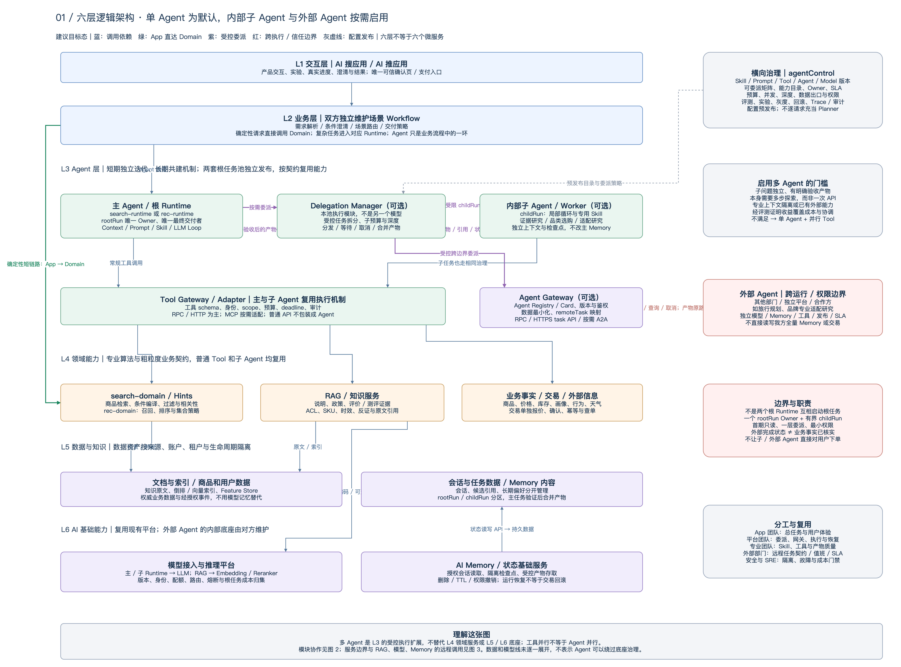
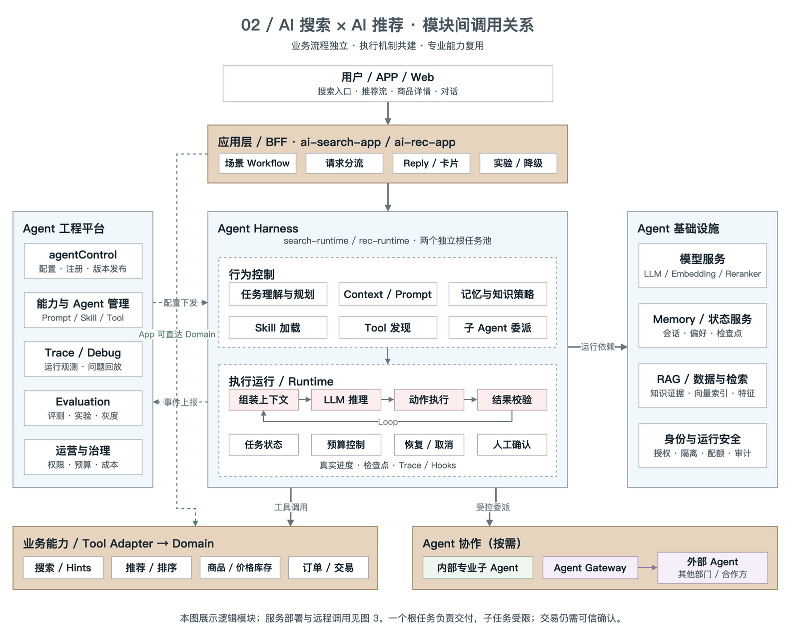
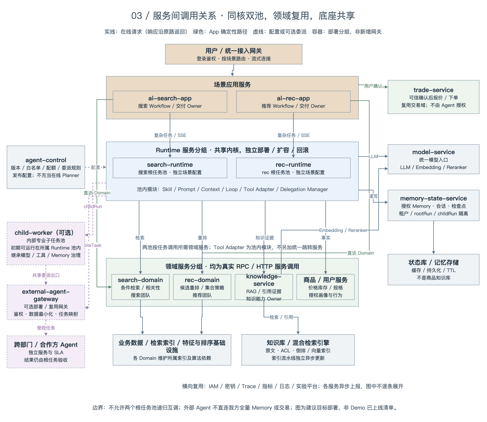

# AI搜索×AI推荐统一Agent架构｜六层分工、模块协作与服务调用

> 2026-10-08 修订。本篇为独立新稿，不覆盖原方案。全文仅保留三张图：六层架构图、模块间调用关系图、服务间调用关系图；每张图后说明职责及 AI 搜索、AI 推荐团队的协作方式。第五部分保留原有四个业务场景，并按本版架构更新。
>
> 本文描述面向 C 端购物 Agent 的建议目标架构，不代表当前 Demo 已实现所有服务、持久记忆、多 Agent 或交易能力。服务名称为逻辑部署建议，团队 Owner 为建议分工，需由双方与平台团队评审确认。

## 一、总体方案与三图阅读方式

**一句话结论：搜索与推荐分别对自己的用户场景负责，共建 Agent 执行机制，复用搜索、推荐、商品与知识能力；模型、Memory 和治理能力通过统一底座提供。**

| 视图 | 主要回答什么 | 不应如何理解 |
| --- | --- | --- |
| 图 1：六层架构 | 能力分在哪一层，各层对什么负责？ | 六层不等于六个服务，也不是每次请求必须逐层经过 |
| 图 2：模块间调用 | App、Runtime、Skill、Tool、RAG、Memory、LLM 等如何配合？ | 逻辑模块不一定独立部署；图中“运行依赖”不是一个统一代理服务 |
| 图 3：服务间调用 | 谁远程调用谁，哪些服务独立扩容、发布、值班？ | 分组容器不是新增服务，不因架构完整而把每个模块拆成微服务 |

**全篇统一约束：**确定性请求由 App 直接调用 Domain；需要澄清、检索、比较和多步决策时进入所属 Runtime。一个任务只有一个根任务 Owner 和一个最终交付者。搜索与推荐的根任务池不互相递归启动请求；跨团队优先复用 Domain，只有独立多步任务才委派子 Agent。价格、库存与交易状态以业务服务为准，知识结论需要证据，用户权限不能由模型生成。

## 二、六层架构：保留分层，明确能力归属

### 2.1 各层分工

| 层 / 横向能力 | 主要职责和交付 | 明确边界 |
| --- | --- | --- |
| L1 交互层 | 搜索入口、推荐流、对话、澄清、真实进度、商品卡片、可信交易确认 | 不把草稿或模型生成的价格当成事实；不负责 Agent 循环 |
| L2 业务层 | 双方分别维护场景 Workflow、请求分流、实验、交付及降级策略 | 决定是否启用 Agent；排序刷新、条件筛选等可以直达 Domain |
| L3 Agent 层 | 主 Runtime 负责上下文、Skill、Prompt、LLM 循环、Tool 执行、状态与预算；按需加入子任务委派 | 负责任务执行，不重新实现搜索和推荐算法；子任务不能越过根任务权限 |
| L4 领域能力层 | search-domain 提供检索与相关性；rec-domain 提供个性化排序；RAG 提供知识证据；业务域提供商品、用户、外部信息与交易事实 | 各自提供粗粒度、可版本化的业务契约；RAG 不代替实时价格库存 |
| L5 数据与知识层 | 商品索引、用户特征、知识原文、倒排与向量索引、会话与任务数据 | 是数据资产及存储，不是一个万能数据库；按租户、用户、来源和生命周期隔离 |
| L6 AI 基础能力层 | 模型接入与推理、Embedding、Reranker、Memory / 状态服务 | 模型服务管访问、版本、配额和推理；Memory 服务管授权存取，不决定业务推荐策略 |
| 横向 agentControl 与工程平台 | 能力注册、Skill / Prompt / Tool / Agent 版本、权限策略、评测、实验、灰度、回滚及观测 | 事前发布配置与运行策略，不在每一步在线调用中充当 Planner |

图中的内部子 Agent 属于 L3 扩展，外部 Agent 是跨运行或信任边界的协作方，二者都不替代 Domain。L4 的 RAG 是面向业务的证据能力；图 2 将其与数据检索并列在基础设施侧，是为简化依赖展示，并不把它改成与模型服务相同的职责层。Memory 服务在 L6，Memory 内容与状态存储在 L5，两者不是重复建设。

### 2.2 AI 搜索和 AI 推荐团队如何协作

| 责任范围 | AI 搜索团队 | AI 推荐团队 | 共建 / 支撑团队 |
| --- | --- | --- | --- |
| 用户场景与交付 | 搜索 App、搜索 Workflow、搜索实验及根任务质量 | 推荐 App、推荐 Workflow、推荐实验及根任务质量 | 产品、前端和体验团队共同定义交互及反馈口径 |
| 场景智能 | 搜索 Skill / Prompt、查询理解、检索澄清和相关性策略 | 推荐 Skill / Prompt、偏好理解、候选取舍和推荐解释 | 共建 Runtime 内核与标准扩展点，场景策略分别发布 |
| 领域能力 | search-domain、候选集质量；建议牵头知识检索与 RAG 服务 | rec-domain、用户收益、多样性和集合策略；提供推荐特征需求 | 商品 / 用户域提供事实；知识内容 Owner 对资料准确性与时效负责 |
| 公共底座 | 提交搜索场景需求，参与契约和回归评审 | 提交推荐场景需求，参与契约和回归评审 | 平台维护模型、Memory、agentControl；SRE / 安全提供可靠性和权限保障 |

协作方式不是“搜索做 Agent、推荐只提供 API”，也不是双方各造一套知识库和模型网关。**场景 Owner 对端到端体验负责，能力 Owner 对接口、数据质量与 SLA 负责，平台 Owner 对底座可靠性负责。**跨团队需求优先变成可复用契约，再由各自场景组装，不共享对方的线上配置写权限。

## 三、模块间调用关系：保留简版图，解释真实执行

### 3.1 各模块分工

| 模块 | 输入与职责 | 产物 / 约束 |
| --- | --- | --- |
| App / 业务 Workflow | 接收可信身份、用户意图、会话和实验信息；选择直达 Domain 或 Agent 路径 | 负责根任务归属、结果呈现及业务降级 |
| Skill 加载与行为策略 | 加载指定版本的任务说明、执行规则、允许工具、输出要求和停止条件 | Skill 是任务能力配置，不是另一个模型或必需独立服务；加载不等于执行成功 |
| Context / Prompt | 组合系统规则、用户目标、授权 Memory、Skill、工具 schema、已返回事实和证据 | Prompt 是给 LLM 的输入；外部内容只作为数据，不能覆盖系统权限 |
| Runtime / Loop | 发起推理、接收工具意图、执行动作、回填结果、校验回复、检查预算和停止条件 | 循环状态由程序维护；一次 LLM 响应不等于整个任务完成 |
| LLM / 模型服务 | LLM 负责理解、规划、生成 tool call 和基于证据的表达；模型服务负责路由、鉴权、推理、限流和版本 | LLM 不直接访问数据库，不自行完成 RPC，不授予交易权限 |
| Tool 发现与 Adapter | 暴露白名单 schema；校验参数、身份和 scope；真实调用 Domain / RAG / 业务服务 | 返回结构化结果、失败码和耗时；Tool 是调用接口，不等于 Agent |
| RAG / 知识检索 | 按问题、SKU、用户可见范围和时效检索原文；可选重排与反证检索 | 输出 EvidenceBundle、引用和缺失项；不直接代替商品排序 |
| Memory / 状态 | 提供当前会话、候选引用、授权偏好、任务检查点和受控产物 | 会话状态与长期偏好分离；不是给所有 Agent 开放全量历史 |
| Delegation Manager / 子 Agent | 仅对有独立目标和验收标准的多步子问题，创建受限 childRun，等待、取消和合并结果 | 子任务有独立上下文与预算；最终交付和 Memory 合并由根任务验收 |
| Agent Gateway / 外部 Agent | 发现已审核外部能力，执行身份映射、最小数据传递、远程任务映射 | 跨边界返回产物，不开放主任务 Memory / 交易；外部成功状态仍需校验 |
| agentControl / Evaluation / Trace | 发布版本、能力目录、工具权限和模型策略；记录运行事件，进行评测与发布审核 | 在线 Runtime 消费已发布配置，不能等每轮推理都请求控制台批准 |
| Reply / 结果校验 | 验证候选合法性、关键事实、证据引用和输出安全，产生卡片与流式解释 | 真实开始 / 完成 / 失败事件用于进度展示；不展示模型内部思维链 |

### 3.2 五类主调用关系

1. **确定性短链路：**App 按已知条件调用 search-domain 或 rec-domain，并组装业务事实后返回。需要组合搜推时由 Workflow 编排，不必绕过一轮 LLM。
2. **单 Agent 主链路：**App 选择所属 Runtime；Runtime 加载 Skill、读取 Memory、组装 Prompt，经模型服务调用 LLM；执行其合法 tool call，将结果回填同一任务，直到可交付、需澄清或触发停止条件。
3. **商品比较链路：**Runtime 的知识 Tool 调用 RAG；RAG 使用 Embedding 与检索引擎，必要时调用 Reranker；将带型号、来源和时效的证据交回 Runtime。LLM 基于证据解释差异，而非自己编造测评。
4. **受控多 Agent 链路：**主任务通过 Delegation Manager 委派内部 childRun，或经 Agent Gateway 创建 remoteTask；父任务验收产物并继续主循环。可并行执行几个普通 Tool 时，不为此单独创建几个 Agent。
5. **发布与反馈链路：**agentControl 在运行前下发版本；运行中的真实事件进入观测平台；授权行为及结果进入评测。经过审核和灰度后再发布新配置，不允许模型自行修改线上 Skill。

### 3.3 双团队按“产物契约”合作

| 契约 | 谁提供、谁消费 | 双方共同约定 |
| --- | --- | --- |
| TaskSpec / Constraints | 场景 App 与 Runtime 产生，所有能力服务消费 | 品类、预算、用途、硬约束、偏好及条件版本；显式新条件优先于旧会话 |
| CandidateSet | search-domain 提供，Runtime / rec-domain 消费 | candidateSetId、SKU 集合、约束摘要、检索版本、有效期、原排序 |
| RankedSet | rec-domain 提供，Runtime / App 消费 | 输入候选集合标识、排序版本、可解释特征；重排模式不得引入集合外 SKU |
| EntitySnapshot | 商品 / 用户域提供，双方消费 | 权威来源、查询时间、价格适用条件、库存与授权范围；不是模型补齐的字段 |
| EvidenceBundle | RAG 提供，双方 Runtime 消费 | 文档 ID、SKU / 型号、引用位置、发布时间 / 有效期、冲突与缺失；检索分数不当成真值概率 |
| TaskArtifact | 内部子 Agent / 外部 Agent 提供，根任务消费 | rootRunId、parentRunId、目标、证据、结果状态、成本、版本与可验收结果 |
| Reply / Feedback | 场景团队输出及归集 | 商品卡、理由、引用、真实进度、拒绝 / 更换理由；曝光点击口径一致 |

搜索入口可以复用推荐排序，推荐入口可以复用搜索与 RAG，**不用先调用对方的根 Runtime**。推荐需要补充候选时，应提出明确补召回请求，由主任务重新获得并校验 CandidateSet，而不是在重排接口里悄悄换商品。若确有独立的“品类适配研究”任务，由能力团队提供注册的子 Agent 契约，仍由原场景任务负责交付。

多 Agent 建议只在子问题可独立验收、确需多步探索、专业上下文隔离或复用独立外部能力时启用；以质量、延迟和成本对照验证收益。首期采用单层、只读、有限并发，限制总 token、工具次数、委派深度与 deadline。共享根任务成本；失败允许部分交付或退回单 Agent，不允许两池递归“互相求助”。

## 四、服务间调用关系：区分部署单元与进程内模块

### 4.1 服务职责、部署边界与 Owner

图 3 的两个 Runtime 是同一执行内核的两个部署池，场景 Skill / Prompt / Tool 权限独立发布。图内 Runtime 和领域服务的大框仅用于分组，不是远程网关。图 1 的六层属于逻辑分工，不限制图 3 的网络调用方向。

| 服务 / 部署单元 | 服务职责 | 建议 Owner 与实施边界 |
| --- | --- | --- |
| 接入网关 / BFF | 鉴权、路由、限流和流式连接转发 | 接入平台；复用既有能力，不另造用户认证 |
| ai-search-app | 搜索 Workflow、实验、根任务发起、卡片交付和直达 Domain | AI 搜索团队；独立发布 |
| ai-rec-app | 推荐 Workflow、实验、根任务发起、卡片交付和直达 Domain | AI 推荐团队；独立发布 |
| search-runtime / rec-runtime | 托管 Agent Loop、进程内 Skill / Prompt / Tool Adapter / Delegation Manager | 各场景团队维护运行池，公共内核共同维护；池间版本可灰度但契约兼容 |
| search-domain | 条件编译、检索、过滤、相关性及候选产物 | AI 搜索团队；维护自己的索引和检索依赖 |
| rec-domain | 推荐候选策略、指定候选重排、特征与集合优化 | AI 推荐团队；维护特征与专用排序依赖 |
| knowledge-service / RAG | 统一知识检索、ACL / SKU / 时效过滤、引用与 EvidenceBundle | 建议搜索 / 知识平台牵头；推荐共定比较维度，内容团队负责资料质量 |
| 商品 / 用户 / 交易服务 | 商品事实、实时价格库存、授权画像与行为；独立交易域负责报价与幂等交易 | 复用现有业务域；图中是服务集合，落地需映射实际服务目录 |
| model-service | LLM、Embedding、知识 Reranker 的模型访问与配额、版本、熔断 | 模型平台；统一入口不要求所有推理跑在同一进程或同一模型上 |
| memory-state-service | 授权记忆读取、会话状态、隔离检查点、TTL 和删除 | AI / 数据平台；初期可以复用现有会话服务并扩展契约 |
| agent-control | 版本与策略管理、评测发布、工具与 Agent 能力注册 | Agent 平台与双团队共管；业务配置按 Owner 隔离 |
| child-worker（可选） | 承载独立上下文的专业子任务执行 | 能力团队负责子任务质量；初期同池运行，需资源隔离或独立 SLA 时再拆池 |
| external-agent-gateway（可选） | 外部任务协议适配、身份和数据出口治理、取消与超时映射 | 平台 / 安全与能力团队；优先复用已有网关 |
| 外部 Agent | 提供经审核、具有独立发布与 SLA 的跨部门 / 合作方能力 | 对方团队维护；我方根任务 Owner 对验收和用户交付负责 |
| 存储与横向基础设施 | 知识索引、状态库、特征存储、IAM、密钥、监控、日志与实验 | 对应平台及 SRE；按职责复用，不全部归并为 Memory |

**RAG 的服务化建议：**本目标架构由搜索和推荐共同消费知识，建议使用独立 knowledge-service，以统一权限、知识更新、引用和容量管理。Demo 或小规模单应用可以保留进程内实现，通过相同契约演进，没必要先拆全部微服务。开发用本地内存向量库不承担多副本生产一致性；生产主索引应有持久化、备份、版本与更新流程。实例本地缓存可以存在，但不是唯一真源。建索引由异步流水线负责，在线 Tool 查询已发布索引，不要求用户每次先点击“构建索引”。

### 4.2 服务调用约束与图中省略的公共依赖

| 调用方 | 被调方 | 协作约束与失败处理 |
| --- | --- | --- |
| App | 本场景 Runtime；search-domain / rec-domain；可信交易域 | 每个 rootRun 唯一归属；确定性直达不绕 Runtime；交易必须有可信确认和幂等令牌 |
| 任一根 Runtime | search-domain、rec-domain、RAG、商品 / 用户域 | 通过进程内 Adapter 执行 RPC / HTTP；校验身份、schema、scope 和结果，不共享服务数据库 |
| 根 Runtime / 内部 Worker | model-service、memory-state-service、允许的 Tool 服务 | Worker 沿用相同治理但 scope 更窄；检查点按 childRun 隔离；图中省略 Worker 的重复底座连线 |
| RAG 在线查询 | 模型服务的 Embedding / 可选 Reranker；知识检索引擎 | 过滤 ACL / SKU / 时效，返回引用；重排失败可退回原检索结果，证据缺失则明确弃权 |
| RAG 索引流水线（异步） | 原文库、Embedding、倒排 / 向量索引 | 增量更新、删除同步、模型和索引版本对齐；发布可回滚，不在每个选购请求里重建 |
| search-domain / rec-domain | 所属索引、特征及专用排序设施，必要的业务事实服务 | 专业模型由领域契约管理；知识 Reranker 与商品排序不能混成一个分数 |
| Memory 服务 | 会话 / 状态 / 记忆存储 | 当前条件可更新；长期偏好按来源、授权和时效存取；会话持久化不等于任意步骤可恢复 |
| 根 Runtime / 允许的子任务 | Agent Gateway → 外部 Agent | 传最小化任务数据与 deadline；支持 taskId、取消及结果验收；外部不直接读主 Memory |
| agent-control | 配置分发 / 运行池本地快照 | 任务固定能力版本；控制面故障可使用有效已发布快照，不逐步阻塞推理；紧急撤权走可强制执行的安全策略 |
| 所有在线服务 | Trace / 指标 / 审计 / 实验平台 | 公共异步依赖在图中不逐条画线；日志脱敏，保留归因所需的任务和版本标识 |

请求至少传播 requestId、traceId、rootRunId、sessionId、租户与可信用户身份、deadline、实验及能力版本；委派额外传播 parentRunId、childRunId / remoteTaskId、子预算、允许工具和产物 schema。身份令牌由可信服务签发，不能从 LLM 参数中接受 userId 覆盖。长任务用任务句柄配合 SSE 事件交付；断线重连依赖事件序号与检查点能力，不能无条件重放写操作。

降级由场景 Owner 预定义：推荐超时保留合格搜索排序；知识不足不输出无依据的优劣；模型不可用可回到确定性商品卡；价格核验失败不能承诺报价；外部 Agent 超时取消或丢弃迟到产物。预算和并发额度按根任务归集，避免并行子任务放大成本。交易只读查询可作为受限 Tool，写操作仍走独立交易状态机与确认，不因图 2 有“订单 / 交易”模块就自动获得下单权限。

### 4.3 双团队从开发到运维如何合作

| 阶段 | AI 搜索团队 | AI 推荐团队 | 平台 / QA / SRE / 安全及共同产物 |
| --- | --- | --- | --- |
| 场景立项 | 明确检索、条件及相关性目标 | 明确人群、偏好和选择收益目标 | 指定一个场景 Owner；共同确定成功、弃权、时延和成本口径 |
| 契约设计 | 定义 CandidateSet 与知识证据接口 | 定义 RankedSet 与所需可信特征 | 共同评审 schema、版本、ACL、超时、配额、错误码与兼容规则 |
| 开发联调 | 搜索 Skill / Workflow / Domain / RAG 适配 | 推荐 Skill / Workflow / Domain / 用户策略 | Runtime / 模型 / Memory SDK 共建；使用同一套契约测试与端到端测试集 |
| 质量评测 | 相关性、硬约束满足、证据覆盖与时效 | 排序收益、多样性、偏好一致性与解释可用性 | QA 负责回归 / 故障注入；安全验证越权、数据外发和提示注入；共同评估任务完成率 |
| 发布上线 | 搜索应用、配置、运行池和领域服务分别灰度 | 推荐应用、配置、运行池和领域服务分别灰度 | agentControl 固定版本组合；先验契约兼容，再验证共同场景；允许按能力独立回滚 |
| 运行值班 | 值守搜索场景与检索 / 知识质量故障 | 值守推荐场景与排序 / 偏好质量故障 | SRE 值守容量、延迟、错误率及依赖；模型 / Memory 平台各有服务 Owner；入口团队牵头事件处置 |
| 反馈迭代 | 处理无结果、检索偏差、知识缺口 | 处理不喜欢、重复推荐、收益不明确 | 数据与运营维护授权反馈和知识修订；评测通过才发新版，不直接在线自改策略 |

**运维责任不因“共建”而模糊：**每个服务必须登记一名负责团队 Owner、值班入口、接口版本、SLO、容量与回滚方案。SLO 数值通过双方目标和压测确定，不在架构图中虚构承诺。搜索入口出问题由搜索团队先牵头，推荐入口由推荐团队先牵头，通过 Trace 分别交由检索、推荐、知识、模型或 Memory Owner 修复。平台负责底座可用性，业务团队仍负责结果质量。

## 五、具体用户场景与完整案例

本部分保留原四个场景，统一改用前三图中的模块与服务名称。以下是业务设计示例，不表示已经上线；不另附第四张业务流程图，改用步骤与职责表说明完整执行。

### 场景一：搜索商品，同时获得个性化推荐

**用户：“推荐 6000 元以内，适合经常出差的笔记本。”**

| 服务 / 模块 | 完成的工作 |
| --- | --- |
| ai-search-app | 确定实验和可信身份，启动 search-runtime 根任务，由搜索场景负责最终交付 |
| search-runtime / Skill / Memory | 读取本轮约束和授权偏好，经模型服务解析预算、便携、续航及用途；必要时澄清 |
| search-domain | 返回满足预算、品类等硬条件的 CandidateSet |
| 商品服务与 RAG | 校验规格、价格、库存，获取对应型号的重量、续航口径及限制证据；不同测试条件不直接混比 |
| rec-domain | 在指定候选中按出差用途和可信特征重排，输出 RankedSet，不加入集合外商品 |
| search-runtime / LLM / Reply | 依据事实与证据解释取舍，校验候选、关键事实与引用 |
| ai-search-app | 展示商品卡与流式解释；来自事件的真实进度同步呈现 |

**团队协作：**搜索团队负责场景和候选质量，推荐团队负责指定集合的个性化排序，RAG Owner 负责证据。推荐超时保留搜索原排序；解释生成失败仍可返回核验过的商品卡，不再启动 rec-runtime 根任务。

### 场景二：推荐过程中追问商品差异

**用户：“这几款冲锋衣，哪款更适合下雨时徒步？”**

| 服务 / 模块 | 完成的工作 |
| --- | --- |
| ai-rec-app | 将追问、会话标识和当前商品卡引用传给 rec-runtime |
| Memory / Context | 读取 candidateSetId，明确“这几款”的 SKU；引用缺失或过期时澄清，不任意猜测 |
| rec-runtime / 比较 Skill | 判断为已有候选比较，确定防水、透湿、重量、适用场景等比较维度 |
| 商品服务 / knowledge-service | 获取规格与同型号说明、使用限制、测试条件和可引用资料；不是把所有知识查询都交给 search-domain |
| search-domain（按需） | 只有当前候选不满足条件、需找替代品时才补充候选 |
| LLM / Reply | 基于证据对齐属性，指出资料缺失；不把“防泼水”夸大为“完全防水” |
| ai-rec-app | 展示对比卡、适用条件及引用；若需新排序，再显式调用 rec-domain |

**团队协作：**推荐团队负责追问体验，搜索 / 知识团队提供标准 EvidenceBundle。复用 RAG 服务而非复制一套知识问答系统；不为一次说明书检索创建子 Agent。没有足够证据时说明限制或请求补充，不伪造比较结论。

### 场景三：用户修改条件，继续推荐

**第一轮：“推荐 500 元以内的双肩包。”第二轮：“更轻一点，不要黑色，预算可以到 800 元。”**

| 服务 / 模块 | 完成的工作 |
| --- | --- |
| 所属 App | 保留会话标识，把第二轮消息交给同一场景 Runtime 池 |
| Runtime / Memory / 意图模块 | 基于旧条件生成新版本 TaskSpec：预算改为 800，排除黑色，增加轻量偏好；不同时沿用旧预算 |
| search-domain | 重新按新硬约束检索，返回新 CandidateSet，而非直接重排旧列表 |
| rec-domain | 在合格集合中提高轻量偏好的权重；不把“轻”伪造成未经核验的重量数值 |
| 商品 / RAG / Reply | 校验商品与规格，必要时补充背负和使用说明证据，解释为何新结果满足变化 |
| memory-state-service | 保存新条件、候选引用与拒绝项；本轮选择不自动成为永久用户偏好 |

**团队协作：**搜索维护约束语义和候选有效性，推荐维护偏好重排，双方通过条件版本与集合标识避免用错旧结果。若有并行子任务，旧条件对应的迟到产物不得合并到新一轮。会话持久化后可以由池内其他实例接手，但只有设计了检查点的步骤才可恢复；跨搜索、推荐场景交接仍需明确授权。

### 场景四：完整案例——用户寻找高性价比商品

#### 5.4.1 将“性价比高”变成可执行目标

用户最初只说“帮我找一个性价比高的商品”，Agent 不能直接猜品类，也不能把销量最高、价格最低或推广收益最高等同于最适合。应先确认品类、预算和用途；已有明确输入不重复询问，历史 Memory 不能代替必要确认。

经澄清，本例目标为：**500 元以内的无线耳机，主要用于地铁通勤，重视降噪和佩戴舒适，使用安卓手机，不为用不到的功能多花钱。**

“高性价比”先要求满足预算、品类、兼容性和可售性，再比较降噪、佩戴、续航、售后等实际收益及到手价、附加成本和功能限制。结论限定在本次候选、渠道和查询时间，不承诺全网最低价或绝对最优。没有可比测评时，不把“支持主动降噪”直接等同于“地铁降噪最好”；舒适度有个体差异，必须说明证据范围。

#### 5.4.2 一次请求如何运行：对应三图的执行步骤

本例从推荐入口开始，由 ai-rec-app / rec-runtime 拥有根任务；从搜索入口开始时则换为搜索侧拥有根任务，其他能力复用方式不变。

| 步骤 | 实际执行与模块协作 | 可核验的产物 / 边界 |
| --- | --- | --- |
| 0. 上线前准备 | agentControl 发布选购 Skill、Prompt 模板、Tool 白名单、模型路由、预算和评测版本；RAG 流水线发布知识索引 | 固定配置及索引版本；这一步不由每次用户请求临时重做 |
| 1. 接入与分流 | ai-rec-app 校验身份，建立 requestId / rootRunId，判断需要多步比较，进入 rec-runtime | 唯一根任务 Owner；普通列表刷新仍走 App → Domain |
| 2. 读取上下文 | Runtime 经 Memory 服务读当前会话及授权偏好，用新输入形成 TaskSpec；缺品类或预算则先澄清 | 分清显式条件、历史偏好、推测信息；不能悄悄放宽预算 |
| 3. 加载能力与推理 | 加载选购 Skill，将规则、目标、允许 Tool schema 与上下文组成 Prompt，经 model-service 请求 LLM | LLM 提议下一步或 tool call；Skill 约束执行，不把固定文案当真实推理 |
| 4. 检索与事实核验 | Runtime 校验 tool call，Adapter 真正调用 search-domain 和商品服务；独立只读请求可并行 | CandidateSet 与 EntitySnapshot；工具实际失败必须返回失败事件 |
| 5. 获取知识与排序 | 调用 RAG 获取同型号降噪、续航、佩戴与安卓限制证据；调用 rec-domain 对合格候选重排 | EvidenceBundle 与 RankedSet；可信结构化特征用于排序，主观资料保留在解释中 |
| 6. 回填和有界补查 | Runtime 按 toolCallId 回填结果，再次调用 LLM；若安卓功能条件不清，可在预算内补查 | 同一任务可重复推理和 Tool 调用；超预算、无证据或无进展则停止 / 澄清 |
| 7. 校验比较结论 | LLM 根据证据比较收益与成本；Runtime 验证 SKU、硬条件、引用型号、时效及关键事实 | 不能把引用存在当成语义已被证明；冲突资料应缩小结论，有界修正失败则降级 |
| 8. 流式交付 | App 展示真实进度、卡片和解释；普通文本经增量安全处理流式输出，关键事实和推荐结论按相应粒度校验后释放 | 卡片由权威商品字段填充；价格变化致超预算时重新筛选或明确告知，不直接透传草稿 |
| 9. 会话与反馈 | Memory 保存本轮目标、候选引用、排除项和状态；授权反馈进入评测，由人和发布策略审核下一版 | 不自动把一次任务偏好永久化；点击不等于完成购买，不允许模型自行上线新策略 |

步骤 4—6 可以按数据依赖重复，不是把一次请求硬编码成固定十次模型调用。RAG 在需要证据时由 Skill 所允许的知识 Tool 真正调用；不需要证据的操作也不必为“使用了 RAG”而额外检索。

#### 5.4.3 Tool、RAG、Memory 和模型如何分工

| 本例工具 / 能力 | 被调用服务 | 返回什么，不能代替什么 |
| --- | --- | --- |
| searchProducts | search-domain | 预算与品类等约束下的候选；不能代替最新报价 |
| getProductFacts | 商品 / 价格库存服务 | 规格、可售性、到手价适用条件、查询时间；不能用模型补齐未知字段 |
| retrieveKnowledge | knowledge-service / RAG | 型号匹配、带引用的资料与冲突 / 缺失说明；不能直接声称测评效果 |
| recommendProducts | rec-domain | 在指定候选中的排序与理由特征；不自行扩充集合或套用另一种分数 |
| Memory 读写 | memory-state-service | 授权偏好、当前条件、候选引用、检查点；不是用户与商品事实的唯一来源 |
| LLM 推理 | model-service 的 LLM 路由 | 意图理解、下一步 tool call、带证据解释；不亲自执行 Tool |

RAG 内部按查询调用 Embedding，对知识库进行带 ACL、SKU 和时效过滤的检索，必要时调用知识 Reranker，最后返回 EvidenceBundle。项目中的 bge-m3 向量化能力属于这条知识检索路径，不是最终回答用的 LLM。知识 Reranker 的分数与推荐排序分数没有可直接相加的统一含义。

Runtime 依据工具开始、完成、失败及校验事件，向用户呈现“已确认预算与用途”“已检索候选，正在核对价格”“已获取商品说明，正在比较差异”。没有实际完成的步骤不能显示为已完成；这些是执行状态，不是向用户暴露模型思维链。

#### 5.4.4 什么时候启用子 Agent 或外部 Agent

对三款耳机查询参数和资料，通常单 Agent 配合并行 Tool 足够。只有“多品牌安卓兼容性研究”“不同佩戴方式的专业证据核对”等子问题各自需要多步探索，且有清晰输出和验收标准时，才创建内部 childRun；确需独立跨部门能力且具备授权时，再经 Agent Gateway 调外部 Agent。

根任务发送子目标、候选引用、可见证据范围、deadline、预算和允许工具；子任务不能擅自增加最终商品、修改长期 Memory 或执行交易。父任务按条件版本验收子产物，合并证据而非不加验证地拼接答案。某个研究超时，只保留已核实结论或回到单 Agent，不让用户等待无限协商。

**团队协作：**推荐团队拥有本例根任务、排序策略与用户交付；搜索团队提供候选检索和知识证据；专业能力团队对可选子任务负责；平台保障模型、Memory 和委派治理。多 Agent 不改变责任归属，也不意味着搜索和推荐各输出一份互相矛盾的最终答案。

#### 5.4.5 最终用户看到什么

下表中的 A / B / C 是结果结构示例，不是实际商品或报价；真实展示必须来自工具结果和证据。

| 候选角色 | 给用户解释的取舍 | 所需依据 |
| --- | --- | --- |
| A：更省钱且满足主要需求 | 为什么少花钱也够通勤用，牺牲了什么？ | 当前到手价、必要功能、同型号说明与限制 |
| B：加价后收益更明确 | 多花的钱换来了哪些这个用户确实在意的收益？ | 可比参数或可靠测评；无证据不声称效果提升 |
| C：不优先推荐或证据不足 | 是兼容性、预算、冗余功能问题，还是缺少资料？ | 具体约束冲突或缺失项；不编造负面评价 |

结果提供“查看差异”“换一批”“更看重舒适”“查看依据”等后续入口。用户点击购买后，App 再进入交易域的报价、可信确认、幂等执行与支付流程；选购 Skill、内部子 Agent 和外部 Agent 均不拥有替用户确认购买或支付的权限。

#### 5.4.6 验收与回归

联合验收至少覆盖硬约束满足、价格卡片一致性、证据与型号匹配、无证据时弃权、偏好和多轮条件一致性、越权与数据泄漏、工具失败与预算降级、首个有效结果时延、总成本，以及用户是否理解推荐取舍。子 Agent 额外检查预算归集、取消、迟到结果和条件版本冲突。不能只凭回答流畅或点击率证明“找到了高性价比商品”。

**完整协作总结：agentControl 事前发布能力；App 选择业务路径；Runtime 加载 Skill、读取 Memory、组装 Prompt；模型服务承载 LLM 推理；Tool 真实访问搜索、推荐、商品与 RAG；必要时受控委派子任务；根任务校验并流式交付；授权状态和反馈支持下一轮与下一版本。**
