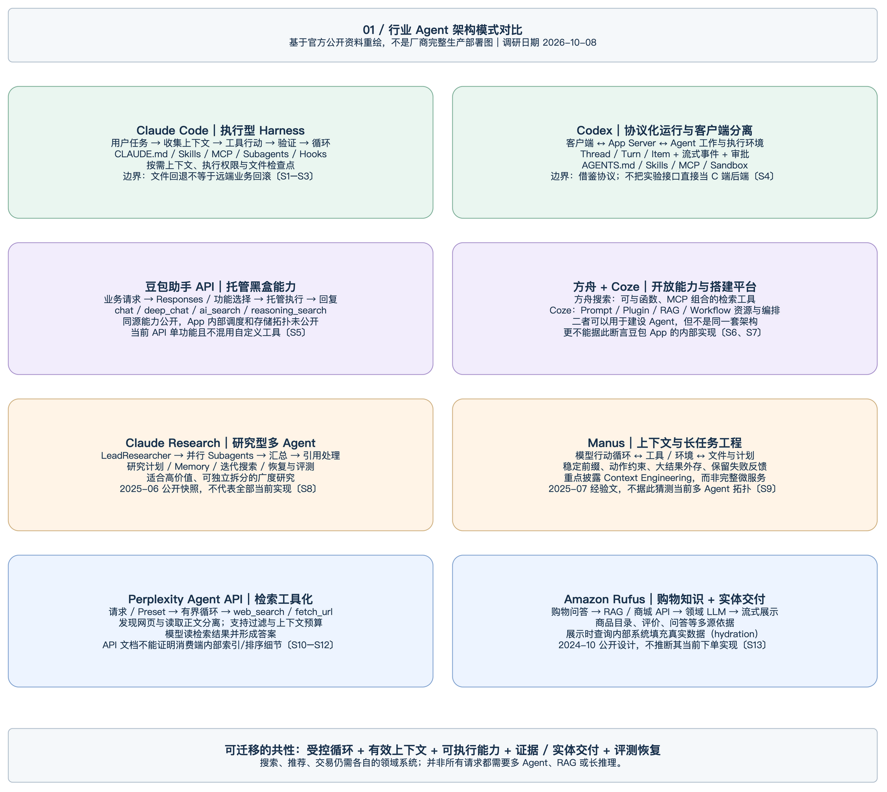
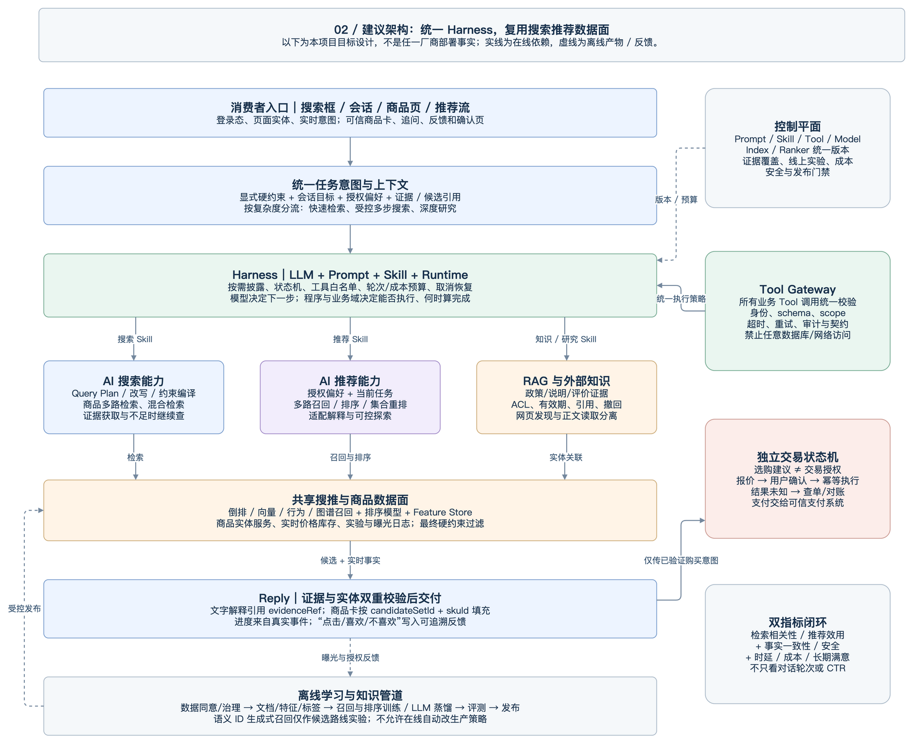
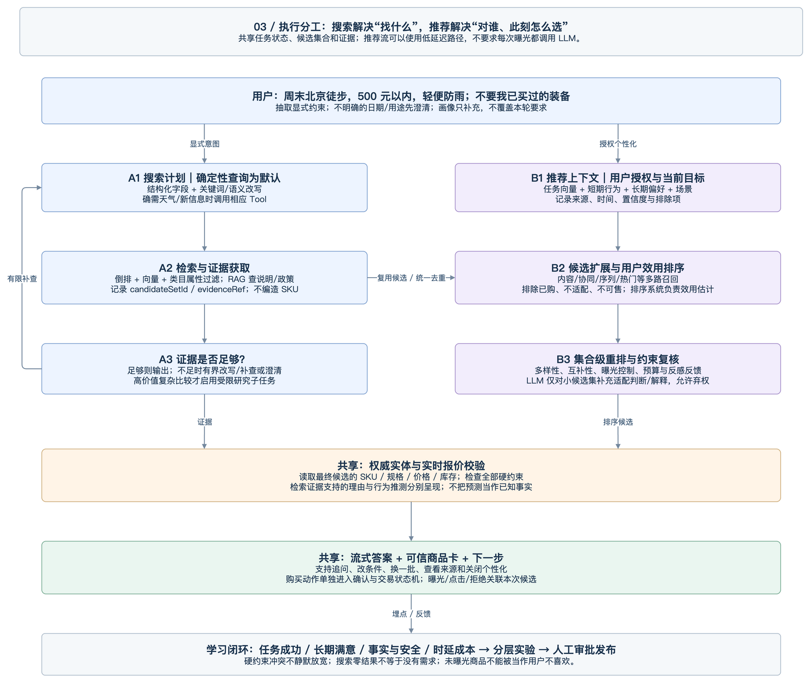

# 主流 Agent 架构调研与 AI 搜索、AI 推荐落地方案

JoySpace 在线文档：[查看架构调研](https://joyspace.jd.com/pages/McF1qwG4B966NeZ0l8Vm)。在线版本包含三张可编辑的原生 Draw.io 图表。

> 调研日期：2026-10-08｜版本：v1.0｜定位：基于官方公开资料的架构调研与本项目建议方案。  
> 重点对象：Claude Code、Codex、豆包助手/火山方舟、Coze、Claude Research、Manus、Perplexity、Amazon Rufus。正文的〔S编号〕对应文末可点击来源；“建议”不代表厂商已实现或本项目已上线。

## 1. 执行摘要：应该学什么，不应该照搬什么

**建议采用“统一 Harness 控制面 + 共享搜索推荐数据面 + 独立交易状态机”的组合架构。**

- 从 **Claude Code / Codex** 学习受控执行循环、按需上下文、能力发现、审批和真实过程事件，不把 Shell 权限模型直接迁移成购物授权。〔S1–S4〕
- 从 **豆包助手与方舟** 学习“轻量交互、联网搜索、深度研究分层”以及“托管能力与可组合工具的不同接入边界”。豆包助手 API 与方舟搜索工具的限制不同，不能当成同一种产品。〔S5、S6〕
- 从 **Claude Research / Manus** 学习复杂任务的有界探索、证据汇聚、计划与上下文管理；不能因为任务名叫 Agent 就默认开启多 Agent 或几十轮搜索。〔S8、S9〕
- 从 **Perplexity** 学习把发现网页、读取正文、检索约束和执行预算明确分开，避免把搜索摘要直接等同于完整证据。〔S10–S12〕
- 从 **Amazon Rufus** 学习商品目录、评价、问答、业务 API 与流式实体展示的结合。对本项目，Rufus 是比通用编码 Agent 更直接的购物体验参考。〔S13〕
- **AI 搜索**负责把用户问题编译为检索计划，找到有证据的商品和答案；**AI 推荐**负责在当前任务与授权偏好下选择和组织候选。二者共享商品、特征、召回、排序与反馈，不应各建一套重复事实库。
- **LLM 不等于全量搜索引擎，也不等于推荐排序引擎。**初期让它承担理解、澄清、计划、小候选集判断与解释；大规模检索、效用估计、硬约束和交易由专门服务承担。生成式召回可作为后续实验路线，但不是让聊天模型随意生成 SKU。

一句话目标：**用户可以用对话表达需求，系统仍然用可靠的数据系统找商品、用受控策略做推荐、用权威业务系统处理购买。**

## 2. 调研方法、证据等级与边界

### 2.1 本次实际获取了什么

本次阅读了厂商工程文章、官方产品/API 文档、Codex 官方手册、Coze 开源 README 的固定提交，以及生成式召回论文；同时结合内部《Shopping Agent Harness 架构设计》和当前项目已有文档。没有购买厂商服务、调用其付费推理 API，也没有对竞品做统一流量压测。因此，本文是**架构与接口边界调研**，不是效果排行榜或产品性能实测。

| 标记 | 含义 | 使用规则 |
| --- | --- | --- |
| F：公开事实 | 官方工程文、手册/API 文档或可核查源码说明直接支持 | 写明出处与时间范围，不外推为完整私有架构 |
| I：架构归纳 | 根据多个已披露能力抽象出的结构 | 明确是本文归纳，不画成厂商提供的部署图 |
| P：本项目建议 | 面向京东购物场景的设计和演进决策 | 需要领域团队评审、接口确认与实验验证 |
| U：未披露/未核实 | 本次资料不能确定 | 不填造内部服务名、模型路由、参数、QPS 或 SLA |

**时间边界**：Claude Research 工程文章发表于 2025-06-13；Manus 文章为 2025-07-18；Rufus 工程文章为 2024-10-04，均按其公开快照解读，不声称是 2026 年完整内部实现。动态文档按 2026-10-08 读取结果；豆包助手页标注更新于 2026-10-02，方舟联网搜索页标注更新于 2026-09-13。〔S5、S6、S8、S9、S13〕

### 2.2 特别避免的四种误判

1. **产品 ≠ 模型 ≠ 开放平台 ≠ 开源框架**：豆包 App、豆包模型、豆包助手 API、火山方舟与 Coze 不能互相替代为证据。
2. **可用 API ≠ 内部实现公开**：API 支持多轮搜索，不证明内部一定使用某个 Planner、多 Agent 框架或向量数据库。
3. **能力相似 ≠ 协议兼容**：支持 Function Calling 不代表支持某厂商托管搜索参数、事件格式或所有工具混用方式。
4. **厂商报告提升 ≠ 本项目可兑现收益**：本稿不把厂商内部评测增益、历史 Token 倍数或宣传指标转化成本项目 SLA。

## 3. 行业架构画像

图 1 是基于下列来源的架构模式归纳，不是厂商原始网络拓扑；豆包 App 的未公开部分保持黑盒，不用 Coze 图替代。

### 3.1 Claude Code：模型外面的 Harness 才是可执行产品

**F｜已披露**：官方将运行过程描述为收集上下文、采取行动、验证结果的循环；模型负责判断，工具负责行动，外围 Harness 管理模型可见上下文与工具。Skills 按需加载，Subagents 使用独立上下文，MCP 提供外部能力。Hooks 可在调用前后等生命周期触发；检查点用于文件变更，远端数据库/API 操作不能靠文件回退撤销。〔S1–S3〕

**I｜架构归纳**：`任务 → Context/Skill → 模型决策 → 权限/Hook → Tool → 观察结果 → 验证/继续`。它不是仅向模型发送一个“请完成任务”的 Prompt。

**P｜对购物系统的价值**：保留 Skill 的渐进披露；把商品查询、报价、库存核实、推荐解释做成工具；进度由真实 Tool 事件驱动。将“验证文件与测试”替换为“验证候选、证据与业务状态”。

**U｜不能外推**：官方文档没有给出 C 端电商订单账本、价格锁定或用户画像的生产设计。也不能把本地执行许可当作消费者已授权支付。

### 3.2 Codex：任务协议、客户端与运行环境解耦

**F｜已披露**：官方手册描述 App Server 向富客户端提供会话历史、审批和流式 Agent 事件；核心对象包括 Thread、Turn、Item。项目指导、Skills、MCP、Subagents 等是不同扩展面，沙箱控制可执行边界，审批策略控制何时需要授权。手册对相关 App Server/WebSocket 接口保留实验性与生产使用限制提示。〔S4〕

**I｜架构归纳**：`客户端 ↔ 会话/轮次/事件协议 ↔ Agent Runtime ↔ 受限执行环境`。用户可见的任务状态，不应只存在于一段自然语言中。

**P｜对购物系统的价值**：建立 `conversationId/runId/stepId/eventId`，把业务卡片、进度、确认请求和最终结果作为结构化事件；断线重连可以恢复，而不是重复执行写操作。借鉴协议理念，不直接将实验性开发工具服务暴露给消费者。

**U｜不能外推**：Codex 的本地/云环境与企业策略不能作为本项目已有隔离能力的证明；开源组件可检查，也不代表整个托管产品的内部部署全部公开。

### 3.3 豆包：托管助手能力与可组合搜索必须分开看

**F｜豆包助手 API**：方舟官方文档明确将它描述为与豆包同源的企业 API，并列出 `chat`、`deep_chat`、`ai_search`、`reasoning_search` 四种功能。读取时文档仍标注 beta 申请；单次只能启用一种功能，不能与自定义函数、其他内置工具或 MCP 在同次请求中混用。内部信源、搜索轮次等也不是调用方任意可控参数。〔S5〕

**F｜方舟联网搜索工具**：另一份文档介绍豆包搜索 Custom 版与联网内容插件。Custom 版支持与函数调用、MCP 等组合，并可通过所列协议接入。这个能力不等同于前述“豆包助手 API”的整套托管功能。〔S6〕

| 对象 | 可以确认 | 不能由此确认 | 购物接入建议 |
| --- | --- | --- | --- |
| 豆包 App | 面向个人的助手产品；助手 API 文档说明 API 与 App 的关系 | App 内部调度器、记忆系统、搜索排序、所有服务拓扑 | 作为交互体验参考，不猜测实现 |
| 豆包助手 API | 托管的沟通/搜索功能、同源描述与公开限制 | 内部 Skill 结构、子 Agent 数量、私有工具协议 | 可作为外部研究/回答能力，外层仍由自身 Harness 控制 |
| 方舟搜索工具 | 模型工具化搜索、所列混用能力和协议 | 自动兼容当前 Spring AI 模型网关的全部参数 | 经适配和契约测试接入为检索能力 |
| Coze | 开发平台及可查看的开源实现 | 豆包 App 就是用 Coze 搭建 | 用于研究编排、资源管理和发布方法 |

**P｜关键设计决策**：若把豆包助手作为外部工具，调用结果只能作为带来源与时间的外部材料，不能将其推荐商品、价格或交易状态直接当成京东权威事实；工具返回给外层 Harness 后，由我们自己的商品/交易服务核验。不能设计一个单次请求同时挂载它与京东下单函数，却忽略文档中的互斥限制。

**U｜明确未知**：本次没有获得豆包 App 的完整官方后端架构图。不能断言其采用特定多 Agent 拓扑、内部 Memory 数据库、搜索索引或某套私有 Prompt。

### 3.4 Coze：可审计的编排与能力资产管理参考

**F｜已披露**：Coze Studio 官方开源项目列出 Prompt、RAG、Plugin、Workflow 等能力，支持智能体/应用/工作流创建发布以及知识库、数据库、提示词资源。README 说明后端 Go、前端 React/TypeScript，并按领域组织系统。此次将 README 固定到提交 `fefb05ff27be1da939612fbf9faf5db62583b8ae` 核验。〔S7〕

**I｜架构归纳**：`开发/资源管理面 → 编排/发布 → 会话执行 → 模型与插件/知识资源`。这里可借鉴的是资产生命周期，不只是拖拽画布。

**P｜对本项目的价值**：Skill、Prompt、Tool schema、知识索引、输出卡片应统一登记 Owner、版本、依赖与发布记录。自由推理适合澄清和找证据，确定性 Workflow 适合确认与交易。

**边界**：本次检查的是官方 README 与固定版本公开材料，不宣称完成了所有源码路径审计，也不把开源版部署方式等同于扣子云服务或豆包 App 的生产实现。

### 3.5 Claude Research：多 Agent 适合可并行的研究，不是所有请求

**F｜已披露**：2025 年工程文描述 LeadResearcher 制定策略，分配并行研究子任务，汇总后决定是否继续，并做专门引用处理；计划/Memory、错误恢复与评测也是设计的一部分。文中同时说明多 Agent 的成本、协调和共享上下文问题。〔S8〕

**I｜架构归纳**：`主研究者 → 多方向搜索/筛选 → 证据汇总 → 缺口再查 → 引用化报告`。

**P｜适合购物的场景**：高客单价跨品类方案、复杂产品比较、长周期选型。对“给我看 300 元以内的背包”这类需求，优先单次结构化检索与排序，而不是为每个品牌启动一个 Agent。独立 API 并发查询也不等于多 Agent。

**边界**：保留文章的历史时间范围；不宣称当前系统仍使用文章中的模型组合、同步调度方式或相同评测数据。

### 3.6 Manus：上下文是工程资源，不是无限聊天记录

**F｜已披露**：2025 年官方工程文强调稳定 Prompt 前缀、考虑 KV cache、通过动作约束控制工具选择、把大结果外存、反复保持任务目标，以及保留失败观察帮助纠错。该文章讨论的是上下文与执行经验，不是完整服务部署拓扑。〔S9〕

**I｜架构归纳**：`模型决策 ↔ 工具观察`外围增加计划、受控动作空间和可回读的外部材料。

**P｜对购物系统的价值**：将商品候选详情、长评价和网页原文存为受权限控制的对象，只向模型提供摘要和引用；保留预算/尺码/排除项等结构化任务状态；错误回填精简原因，避免模型反复调用失败工具。

**不能照抄**：本项目无需把所有材料写到用户文件系统；可使用对象存储/数据库。同样，外部模型 API 不一定支持文章中的底层动作约束方式，必须用服务端白名单兜底；禁止把凭证或完整敏感堆栈放进上下文。

### 3.7 Perplexity：发现、读取、生成和预算各有接口

**F｜已披露**：Agent API 文档将 run 配置、模型/预设、Prompt、工具和循环预算分开；`web_search` 用于发现相关网页，`fetch_url` 用于读取已知 URL。搜索文档还提供过滤与检索上下文预算控制。〔S10–S12〕

**I｜架构归纳**：`问题 → 有界搜索决策 → 搜索结果 → 必要时读全文 → 证据化回答`。搜索结果摘要与页面正文是不同层级的证据。

**P｜对购物系统的价值**：知识搜索返回可引用片段与来源；商品搜索返回候选 SKU 与匹配理由；需要核实参数时读权威商品详情，不能只复述站外摘要。把查询数、工具耗时和上下文 Token 同时纳入预算。

**U｜不能外推**：公开 API 不能证明 Perplexity 消费端的完整爬虫、索引、排序、反作弊与对话路由架构，也不能直接推出其线上成本或准确率。

### 3.8 Amazon Rufus：与购物 Agent 最直接相关的案例

**F｜已披露**：2024 年 Amazon Science 工程文介绍购物领域模型、来自商品目录/评价/问答等来源的 RAG、商城 API 调用、基于反馈的改进及流式展示。回复可以包含不同类型的展示元素，并在输出过程中查询内部系统填充数据，文中称为 hydration。〔S13〕

**I｜架构归纳**：`购物问题 → 多源商品/知识/业务事实 → 领域生成 → 结构化展示指令 → 实体数据填充`。它不只是一个能联网的通用聊天框。

**P｜对本项目的价值**：模型可提出“比较这几个候选”的展示意图，但商品图、价格、库存和购买入口由 Reply 根据实体引用获取；解释用知识证据，卡片用业务事实，两者关联但不混同。

**边界**：文章没有公开本项目所需的全部推荐打分器、用户确认、支付和幂等实现；本文不以这篇 2024 年文章推断 Rufus 当前的完整购买能力。基于用户反馈改进也不等于每次点击都会立刻更新生产模型。

## 4. 横向对比：按架构能力，而不是产品名排名

下表是基于第 3 节证据的 I 级归纳；“未披露”不是“该产品没有”。

| 维度 | Claude Code / Codex | 豆包助手 API / 方舟 / Coze | Claude Research / Manus | Perplexity | Rufus |
| --- | --- | --- | --- | --- | --- |
| 主要交付 | 可验证的执行结果、代码/工件 | 助手结果；开放工具；可配置应用 | 多步研究/复杂任务成果 | 有检索支持的答案 | 购物回答与业务展示 |
| 控制核心 | 工具执行循环、权限、事件协议 | 托管能力与自建编排应分开 | 研究编排或上下文工程 | 有界模型/检索循环 | 多源检索、生成与展示整合 |
| 上下文重点 | 仓库、任务、技能、执行观察 | 功能/资源配置；App 内部细节未知 | 计划、证据、大结果与任务连续性 | 问题、检索结果与读取材料 | 商品与购物相关证据 |
| Skill/SOP | 明确支持技能等扩展面 | Coze 资源编排不等同 App 内部 Skill | 未据资料统一断言同一种 Skill 格式 | 预设与指令不是 SKILL.md 的同义词 | 文章未披露同类 Skill 注册结构 |
| 确定性治理 | Sandbox、权限/审批、Hook 等 | 接口/平台能力边界；具体以产品文档为准 | 执行约束、恢复、任务预算 | 工具参数与循环预算 | 业务系统与展示填充；完整治理未披露 |
| 多 Agent | 可委派，但非每任务必需 | 不从 App 能力推断内部多 Agent | Research 明确披露；Manus 此文不能证明全拓扑 | 不由 Agent API 名称推断消费端多 Agent | 文章未明确相关拓扑 |
| 最值得复用 | Runtime、能力边界、事件模型 | 托管/自建选择、资产发布 | 长任务证据与上下文控制 | 检索分层和预算 | 商品知识 + 权威实体卡片 |
| 最易误用 | 把执行许可当支付授权 | 把 Coze/模型/API 视为豆包同一层 | 所有查询默认深度研究 | 把网络摘要当实时库存 | 把历史工程文当完整现状 |

**综合结论**：可迁移的是架构原则和契约，不是某个产品名字。C 端购物中，任务理解与执行可借鉴编码 Agent，复杂选型可借鉴研究 Agent，商品与交付必须依赖电商领域架构。

## 5. 与内部 Shopping Agent Harness 文档如何对齐

主要内部参考：〔S15〕《Shopping Agent Harness 架构设计》。该文把 Context、Skill/Tool/SubAgent、Runtime、Reply 与 Hooks 分工讲清楚；以下为在此基础上的增量设计，不重复另造一个中心编排器。

| 内部参考的设计 | 行业证据的对应点 | 本项目增量建议 |
| --- | --- | --- |
| Base / Business / Volatile + Messages | Claude Code 的上下文管理、Manus 的稳定上下文 | 稳定规则前缀与动态数据分区；保留来源、权限、时效与结构化约束 |
| Skill 提供 SOP，Tool 执行业务 | Claude Code / Codex 的技能与工具边界 | 搜索/推荐作为领域能力注册；交易状态机不交给 SOP 文本独自控制 |
| 常用能力直接给，长尾渐进发现 | Claude Code 按需 Skill；方舟可组合工具 | 按入口/任务/授权选能力，在一次 run 内减少无意义 schema 变化 |
| Runtime 调用后回填 Messages | 主流工具循环与研究型恢复 | 工具结果包括候选/证据引用与新鲜度，失败也结构化回填 |
| Reply 按实体引用生成卡片 | Rufus 的展示数据填充 | candidateSetId、skuId、evidenceRef 分离；关键事实先校验再发卡片 |
| 多来源知识、Memory | Research / Manus 的计划和证据管理 | 偏好信号、当前约束、知识、实时事实不能混在一个无来源摘要中 |
| 自动归因与高效推理 | 研究评测、Rufus 反馈改进 | 增加搜推指标、消融实验、成本与安全门禁，而非自动改 Prompt 上线 |

### 5.1 一个值得显式解决的冲突：渐进披露与缓存稳定性

Claude Code 文档强调按需加载技能/工具；Manus 文章提醒频繁改动工具定义会影响前缀缓存。这不是非此即彼：前者解决无用上下文，后者解决重复计算成本。〔S1、S9〕

**P｜建议做法**：能力目录与描述保持稳定；入口先选择一个小而充分的候选工具包；正文/SOP 与大资料按需读取；避免每一轮随机换一组 schema。记录缓存命中、Token、工具选择正确率和延迟，通过实验决定披露粒度。权限撤销必须立即生效，不允许为缓存稳定而继续保留危险能力。

### 5.2 另一个冲突：灵活规划与业务确定性

搜索策略可由模型自适应，用户身份、预算上限、可售资格、报价确认和交易执行不能随模型临时发挥。**让模型决定“还需要查什么”，让代码决定“是否有权做、事实是否有效、操作是否成功”。**

## 6. 建议目标架构：统一控制面，保留强数据面

图 2 为 P 级方案，未把行业产品的私有实现当作事实。与现有 Demo 的关系见第 11 节。

### 6.1 统一什么

- **任务意图**：query、目标、硬约束、软偏好、地区/时间、已排除候选、缺失信息与来源。
- **上下文和状态**：当前会话、候选集、证据包、已核实商品事实、未完成操作；实时输入优先于旧画像。
- **执行治理**：Skill/Tool 发现、授权、预算、持久运行状态、取消恢复、Trace、发布版本与成本。
- **交付协议**：答案片段、候选卡片、引用、澄清、真实进度与确认请求。
- **搜推基础设施**：商品实体、类目/属性、索引、Embedding、Feature Store、行为数据、实验分流和反馈 ID。

### 6.2 保留哪些专业系统

| 系统 | 负责什么 | LLM 的边界 |
| --- | --- | --- |
| 搜索 | Query 编译后的多路召回、过滤、相关性排序 | 不凭空创造索引命中或 SKU |
| 推荐 | 用户/场景特征、候选召回、效用估计、集合策略 | 不以一段生成文案代替真实召回/排序模型 |
| 知识检索 | 文档、说明、评价/问答证据；ACL 和有效期 | 不把“引用存在”当成“结论必真” |
| 商品/价格/库存 | 权威实体、实时报价、库存与可售条件 | 不以模型记忆或站外页面取代 |
| 交易 | 风控、报价、确认、幂等、订单、查单与补偿 | 模型只能产生意图，不能自己证明用户已授权 |
| 数据与实验平台 | 授权事件、特征/索引更新、实验归因、模型与策略发布 | 模型建议不是未经审核的线上配置变更 |

推荐首页的高 QPS 路径和深度选购的长任务路径可以共享状态契约，但不应共享同一个“每次都多轮 LLM”的执行模板。

## 7. AI 搜索应该如何做

### 7.1 分清三种搜索对象

| 类型 | 主要返回 | 正确性要求 |
| --- | --- | --- |
| 商品搜索 | SKU/商品候选、属性、匹配依据、过滤信息 | 候选确实存在，结构化约束可验证 |
| 知识/问答搜索 | 商品说明、政策、评价、问答片段与引用 | 有来源、有适用范围、有时效与访问权限 |
| 外部研究搜索 | 网页发现、正文证据、公开信息比较 | 追溯源站、时间、正文依据；不能直接授权交易 |

“RAG”主要解决知识证据供给；它不是全部商品搜索，也不能替代排序与实时业务查询。参考 Perplexity 的发现/读取分工与 Rufus 的多源购物证据，但采用自己的权威商品边界。〔S11–S13；本节其余为 P〕

### 7.2 三条执行路径，而不是全部深度搜索

| 路径 | 触发方式 | 建议执行 | 典型例子 |
| --- | --- | --- | --- |
| Fast Path | 意图明确、结构化约束足够、风险低 | 轻量解析 → 搜索/排序 → 实体卡；可不调用大模型 | “某品牌 20L 背包，500 元以下” |
| Agentic Search | 多条件、存在信息缺口、需知识解释 | 有界计划 → 检索/读详情 → 补查或澄清 → 答案卡片 | “通勤又适合周末徒步、防雨且轻的背包” |
| Deep Research | 高价值复杂比较、用户允许等待 | 研究计划 → 独立子任务 → 证据汇聚/去重 → 报告 | “全家露营装备，比较三套预算方案” |

由复杂度、信息缺口、业务风险和延迟预算路由，而不是见到长句就一律深度思考。只读独立查询可以并行；涉及条件依赖的步骤保持顺序。

### 7.3 在线流程

1. **理解与约束提取**：输出结构化 ShoppingIntent。预算、尺寸、地域、禁忌等显式要求成为硬约束；品牌倾向等可协商偏好分开。价格单位、出行日期和“不要”的范围含糊时澄清。
2. **Query Plan 编译**：自然语言生成候选查询，但执行前通过 schema、字段白名单与约束编译器；禁止让模型直写任意 SQL/DSL 访问全库。一次改写不能偷偷删掉预算或禁忌。
3. **多路检索**：商品倒排保证精确品牌/型号/规格，语义召回补充场景表达，类目属性约束收敛候选；知识采用合适的关键词/向量组合。分数来源不同，不能未经校准直接相加。
4. **去重与重排**：SPU/SKU 的聚合粒度明确；相关性重排与可售过滤分别记录原因；必要时精读商品详情/证据，不把短摘要当完整说明。
5. **检查证据缺口**：预算、关键规格、适用场景与用户问题是否都有依据？缺口小则补查，约束互斥则追问；超过 deadline/轮次则解释不足，不能无限“再搜一次”。
6. **权威回源与交付**：最终候选回源核价库存，知识理由关联 evidenceRef，返回答案、候选、可调整条件与来源；商品价格变化后更新卡片而不是沿用旧文案。

### 7.4 查询改写与证据治理的关键规则

- 改写可新增同义词和场景词，但硬约束保存在独立字段，不能只寄希望于 Prompt 记住。
- 用户问“第二款”，使用本次会话的 candidateSetId 和展示序号映射，不重新猜品牌。
- 站外评测、商家宣称、用户评价和官方规格标注来源类别；出现冲突时按事实类型查权威源，并说明仍不确定的部分。
- 证据不足时，优先给可售候选与待核实点，或明确无法支持结论；无命中不等于用户没有需求。
- 搜索结果和网页正文可携带恶意指令。其内容只作为数据，不能修改系统权限、要求传出画像或调用下单接口。

## 8. AI 推荐应该如何做

### 8.1 从“猜你想买什么”升级为“当前任务下的个性化决策”

以下是 P 级设计。将推荐任务表达为：`当前目标 + 显式约束 + 授权偏好 + 场景 + 候选可用性 → 一组可解释、可调整的候选`。

| 信号 | 用途 | 边界 |
| --- | --- | --- |
| 当前用户输入 | 最强任务意图：预算、用途、排除项 | 优先于历史画像 |
| 会话行为 | 比较过、点开、否定、改条件 | 仅解释当前上下文，避免越界推断 |
| 长期授权特征 | 品牌、尺码、价带、常用品类 | 可关闭、纠正、删除；有时效和来源 |
| 场景信息 | 时间、地区、天气、库存、配送 | 按需获取且告知必要范围；关键事实需回源 |
| 商品特征 | 规格、内容、价格、质量、服务 | 由商品/搜推系统加工，不由 LLM 臆造 |

行为预测应呈现为不确定的偏好信号，而非“系统知道你下一次必买什么”。未经校准的模型分数不展示成“购买概率 87%”；用户的购买结果还受曝光、价格、库存和运营影响。

### 8.2 推荐链路的分层改造

1. **用户/任务表示**：以授权画像、近期行为和本轮任务构建特征。LLM 可离线提炼商品场景标签，在线抽取任务约束；敏感属性不靠自由推断补全。
2. **候选召回**：复用内容、协同、序列、热门/新颖性等通道；对话候选和搜索候选共享 ID，记录每个通道贡献，避免另建一套“聊天推荐商品库”。
3. **专业排序**：根据任务相关性、用户效用、可售性与服务质量估计排序；先校准信号再多目标权衡。不要把不同模型的未经校准分数随意加权。
4. **集合级重排**：控制重复、品牌/价格带多样性、组合互补、曝光疲劳和反感反馈。用户要一套装备时，总预算与单品预算分别建约束。
5. **LLM 小集合判断与解释**：仅在需要时对有限候选进行适配对比，引用真实规格与证据；允许说明“不足以判断”。解释不能在排序后编造不存在的推荐理由。
6. **权威校验与可控反馈**：核价库存后展示；提供“太贵/不适合/已买过/不要该品牌”等明确反馈，更新任务约束或经授权的偏好，不把所有点击都当成喜欢。

LLM 参与排序的程度应通过实验选择，不绝对排除大模型排序；但冷启动阶段不能未经成本、稳定性和偏差评估，就替换全量在线排序系统。

### 8.3 四个适合优先做的推荐场景

| 场景 | Agent 增量 | 验收重点 |
| --- | --- | --- |
| 对话选购 | 澄清需求、识别约束、解释取舍 | 约束满足、推荐接受度、减少无效追问 |
| 候选比较 | 从用户关心维度比较同类候选 | 事实准确、差异明确、证据可追溯 |
| 组合/搭配 | 按场景生成互补候选集合 | 总预算、兼容性、重复购买控制 |
| 行为偏好辅助 | 从授权行为提出可验证偏好假设 | 可纠正、不冒充确定预测、用户可关闭 |

首页推荐流可使用离线增强特征、预计算解释和小模型实时适配；用户主动展开“为什么适合我/换一种需求”后再进入交互式 Agent。不能要求每个曝光都等完整大模型多轮执行。

### 8.4 生成式推荐与 Agent 推荐不是一回事

**F｜研究路线**：《Recommender Systems with Generative Retrieval》提出以语义编码表示物品，并训练模型根据用户交互序列生成下一物品标识。这是经过训练、可评测的生成式召回机制，不是让通用聊天模型自由生成商品名。〔S14〕

**P｜建议路线**：将其作为后续召回通道候选，与双塔/序列/内容召回进行离线与线上比较。必须解决语义 ID 版本、到有效 SKU 的映射、新品/下架同步、受约束解码与库存过滤。上线后仍需要排序、权限、商品事实和交易服务。

三者应分开立项：**LLM 辅助传统推荐**（理解/标签/解释）；**Agentic Recommendation**（主动澄清与工具协作）；**生成式召回/排序模型**（学习产生候选或序列）。不能用其中一个 Demo 的效果代表另外两个已完成。

## 9. 搜索与推荐的共同执行契约

### 9.1 建议共享的数据对象

| 对象 | 关键字段 | 主要 Owner |
| --- | --- | --- |
| ShoppingIntent | query、goal、hardConstraints、softPreferences、missingSlots、contextRefs、version | Agent + 产品/搜推 |
| QueryPlan | queries、filters、sources、readBudget、deadline、reasonCode | 搜索 + Agent |
| CandidateSet | id、skuIds、retrievalReasons、rankVersion、intentVersion、expiresAt | 搜推 |
| EvidenceBundle | evidenceId、source、docVersion、skuId、textRef、validity、acl、sourceType | 知识/数据 |
| RecommendationSlate | candidateSetId、orderedSkuIds、reasonRefs、constraintChecks、policyVersion | 推荐 |
| EntitySnapshot | skuId、specVersion、price、stockStatus、fetchedAt、validUntil | 商品/价格库存 |
| FeedbackEvent | requestId、runId、slateId、exposureId、position、action、consentScope、timestamp | 客户端 + 数据 |

身份与 scopes 从服务端注入，不作为模型可随意改写的字段。上下文、候选集、引用、缓存均按账户/权限/区域隔离。

### 9.2 建议的粗粒度 Tools

| Tool | 输入与结果概要 | 边界 |
| --- | --- | --- |
| `searchProducts` | 结构化 QueryPlan → CandidateSet | 接口内完成检索基础流程，不暴露任意查询执行 |
| `retrieveKnowledge` | 问题/商品/范围 → EvidenceBundle | ACL、时效、撤回检查，不返回无权限片段 |
| `getProductFacts` | SKU 列表/字段 → EntitySnapshot | 批量权威查询；价格库存标记时效 |
| `recommendProducts` | intentRef/profileRef/candidates → Slate | 内部承载召回/排序/重排，不由 LLM 模拟排序结果 |
| `compareProducts` | 候选和维度 → 事实对比与缺失项 | 返回可验证事实，解释由模型或模板组织 |
| `fetchExternalEvidence` | 允许的来源/问题 → 引用证据 | 网络出口受控，不泄露用户画像与密钥 |
| `preparePurchase` | 已验证候选和数量 → 报价/确认意图 | 不代表下单；确认与执行由独立交易流程完成 |

粒度原则：模型决定业务步骤，而不是每次调用都直接操纵倒排索引、特征读取和排序引擎。把稳定的领域流程封在粗粒度 Tool 内可以降低轮次、失败面与模型耦合。

### 9.3 模型、工具、检索各自是什么事实源

- 模型文本是候选结论，不能充当工具执行记录。
- Tool 返回业务数据，但仍需区分可信业务域与不可信外部内容。
- RAG 片段有引用，不代表适用于所有地区、型号和日期。
- 推荐理由必须能回溯到当前约束、授权偏好或商品证据；“大家都在买”需要相应统计支持。
- 搜索/推荐结果不携带交易授权；必须重新报价、明确确认、幂等执行，未知状态先查单。

### 9.4 流式展示

建议事件包括任务接受、步骤开始/完成/失败、正文分片、候选更新、引用、需要澄清、需要确认及最终结果。使用 sequence/eventId 去重，断流不会创建新业务动作。

普通文字经增量安全处理后尽快输出；商品卡片与关键价格/库存要先验证。进度提示展示“已核实哪些信息、还在查什么”，不公开内部思维链，不将计时动画伪装成真实完成事件。

## 10. 如何证明方案有效：评测、实验与成本

以下均为 P 级验收设计；本次没有线上实验结果。

### 10.1 分层指标

| 层级 | 建议指标 | 避免误区 |
| --- | --- | --- |
| 意图/约束 | 关键槽位准确率、硬约束保持率、有效澄清率 | 对话更长不等于理解更好 |
| 搜索 | Recall@K、nDCG/MRR、零结果率、关键证据覆盖 | 只看答案流畅度，忽略漏掉候选 |
| RAG | 相关性、引用正确与忠实度、过期/越权片段率 | 引用 ID 能解析不等于结论成立 |
| 推荐 | 候选覆盖、多样性、任务完成、接受/拒绝、长期满意 | 只看 CTR/GMV，忽略退货、疲劳与投诉 |
| Agent | 工具选择正确、冗余调用、预算超限、恢复成功 | 把唯一固定轨迹当作所有任务唯一正确解 |
| 交易/安全 | 未授权操作、跨用户泄漏、重复执行、未知状态处置 | 用“模型说成功”当业务成功 |
| 体验/成本 | 首有效内容、完成时延、每任务/有效决策成本 | 用廉价进度事件优化首字指标掩盖等待 |

### 10.2 建议消融实验

采用分层、增量实验，而不是拿“传统搜索”和“所有新能力一起上”的大包方案比较。

1. **B0**：现有搜索/推荐基线。
2. **B1**：仅增加意图与约束抽取，检索/排序保持不变，检验自然语言理解增量。
3. **B2**：增加知识证据和可信解释，检验事实与决策帮助。
4. **B3**：允许有界多步检索与澄清，检验额外轮次是否值得。
5. **B4**：对复杂选型启用小候选 LLM 判断或受限研究任务，单独测时延与成本。
6. **独立推荐实验**：画像信号、召回通道、重排/多样性、生成式召回分别开关，避免混淆收益归因。

数据按用户或合适实验单元稳定分桶，避免同一会话策略串扰；按照有无曝光、位置、是否查询过等条件解释行为，未曝光候选不能当负反馈。离线反事实评估只在有必要日志与统计假设成立时使用，不凭日志相关性声称因果提升。

### 10.3 必须覆盖的困难样例

- 多轮预算改变、先喜欢后排除、指代“第二款”、已购排除、总预算与单品预算混淆。
- 同名不同型号、规格缺失、知识与商详冲突、价格变化、区域无货、配送不能满足出行时间。
- 新用户冷启动、关闭个性化、删除记忆、跨账号复用 chatId、恶意网页要求导出画像。
- 搜索零结果、工具超时、流式分片未闭合、断线重连、取消执行、报价确认过期与未知订单结果。

### 10.4 成本与时延设计

按路径分别记录模型轮次、输入/输出 Token、检索/重排调用数、依赖尾延迟和缓存命中。单任务总成本计算所有模型轮次的重复上下文，不能只计算最后一条答案。

优先减少不必要探索，再优化摘要、批量查询、工具粒度和独立查询并发。缓存要区分公共知识、会话材料和私有画像；缓存命中不构成继续使用过期报价的理由。具体 p95、QPS、轮次和价格目标由业务/模型配额压测确定，本稿不给未经测量的承诺。

## 11. 基于当前 Spring AI 项目的落地路线

现有项目已经有真实模型循环、Skill 按需加载、Tool 回调、流式进度与独立 RAG Demo；画像/商品等仍是演示数据，RAG 尚未成为 Skill 的统一检索 Tool。不能把这些示例等同完整的 C 端搜推系统。〔S16〕

| 阶段 | 交付 | 不做什么 | 验收门禁 |
| --- | --- | --- | --- |
| P0 契约对齐 | ShoppingIntent、CandidateSet、EvidenceBundle、Slate、版本与事件协议 | 不替换现有搜推系统 | Agent/搜推/商品/安全联合评审 |
| P1 真实只读搜索 | 把搜索、商品事实、知识检索注册为粗粒度 Tool；登录态和 ACL | 不先接下单，不无限改写 | 约束、引用、时效、隔离、失败降级 |
| P2 任务型推荐 | 授权画像和当前目标结合；真实召回排序；候选比较与反馈 | 不让 LLM 编造购买概率 | 推荐接受度、硬约束、多样性、拒绝反馈 |
| P3 受控探索 | 快/慢路径分流；复杂选型才使用有界研究；离线标签/蒸馏实验 | 不全站每次曝光调用大模型 | 相对基线的质量/成本/时延收益 |
| P4 交易及规模治理 | 沿已有生产方案补齐确认/幂等/查单、灰度、值班与应急 | 不把模型建议当交易成功 | 交易域会签、故障演练、审计与客服就绪 |
| P5 生成式召回研究 | 语义 ID 及生成召回与现有通道对照 | 不把论文结果直接当线上承诺 | 数据/映射/可售性与线上增益验证 |

### 11.1 Spring AI 层面的具体接法

- 沿用现有 `ChatModel.stream()` 和显式工具循环；把 Runtime 的权限、状态和预算校验置于每次执行前。避免内部自动 Tool 执行与外部循环同时启用造成重复调用。
- `SkillCatalog` / `SKILL.md` 定义任务步骤与完成条件；`ToolRegistry` 注册 Java 适配器，调用现有领域 API。不要把复杂召回与排序实现塞入 Prompt。
- 将 `RagKnowledgeBase` 的检索能力封装为带 ACL、时效、引用的知识接口，接入 `retrieveKnowledge`；生产换持久索引和增量管道，不靠进程内索引唯一保存知识。
- 模型供应商继续使用当前已配置底座即可开展第一阶段；若引入豆包/Perplexity 等托管能力，用独立外部适配器和契约测试，不假设当前模型网关支持其私有工具类型。
- 前端从“展示回答字符串”升级为“正文 + 证据 + CandidateSet 卡片 + 真实事件”，身份不能继续由演示用户下拉框承担。

### 11.2 团队责任与协作接口

| 团队 | 应拥有的能力 | 与 Agent 团队的交付契约 |
| --- | --- | --- |
| Agent 平台 | Context/Skill/Runtime/Reply、运行状态、Tool Gateway | 不自行实现所有领域事实，负责统一执行与安全接入 |
| AI 搜索 | 查询理解/编译、多路检索、证据选择、相关性 | QueryPlan、CandidateSet、检索诊断与检索预算 |
| AI 推荐 | 特征、召回、排序、集合策略、个性化开关 | RecommendationSlate、理由依据、模型版本与反馈解释 |
| 商品/交易 | 实体、价格库存、可售规则、确认、幂等与订单 | EntitySnapshot、报价/执行/查单契约 |
| 数据/知识 | 授权行为、知识审核、索引/特征更新、数据删除 | 来源/时效/ACL、血缘与变更事件 |
| 算法/评测 | Prompt 与模型策略、评测集、消融与质量归因 | 质量/成本对照、发布门禁，不用单一模型自评 |
| 产品/客户端/运营 | 意图入口、澄清、可信卡、反馈、人工接管 | 场景验收、曝光定义、用户控制与投诉处理 |
| SRE/安全 | 权限边界、审计、容量、告警、依赖隔离 | 按路径 SLO、开关、Runbook 与域负责人值班 |

每个新场景以一张场景卡贯通：目标/风险 → Skill/Tool/数据契约 → 用例与指标 → 灰度 → 值班与回滚。搜索、推荐和 Agent 共同评审意图与候选协议，避免三方各自改写用户约束。

## 12. 建议形成的架构决策记录

| 决策 | 建议 | 拒绝的替代做法 | 需要补充验证 |
| --- | --- | --- | --- |
| 控制核心 | 自有 Harness + 领域 Tool | 将购物全权委托给一个不可控外部助手 | 模型网关协议、恢复与鉴权能力 |
| 搜索改造 | 自然语言计划 + 强检索数据面 | 全目录塞进 Prompt 或只用向量替代所有精确检索 | 召回覆盖、属性过滤、证据质量 |
| 推荐改造 | 任务/偏好融合 + 专业排序 + 可验证解释 | 用生成理由伪装已经做过个性化排序 | 离线/在线增益与偏差 |
| 多 Agent | 限于高价值可独立研究任务 | 每轮搜索/每个商品都启子 Agent | 信息增益与成本上限 |
| 外部搜索能力 | 当作可替换且受限的证据供应商 | 把站外内容、托管答案当权威价格/库存 | 来源覆盖、使用约定、时效与失败处理 |
| 工具/上下文 | 稳定能力包 + 按需材料 + 强制授权 | 为缓存绕过权限、或每轮重建全部 schema | Token/缓存与工具选择效果 |
| 展示 | 正文证据与商品实体分别校验后整合 | 模型自己生成完整购买卡字段 | 引用忠实、实时校价、卡片一致性 |
| 交易 | 显式确认 + 确定性状态机 | 用户一句模糊赞同就执行购买 | 意图绑定、幂等、查单与人工流程 |

### 12.1 下一次评审应回答的五个问题

1. 搜索、推荐现有服务能提供哪些粗粒度能力、证据字段、召回诊断和版本信息？
2. 哪些场景真的需要 Agent 多步探索，哪些应保持快速检索/推荐流？
3. 用户画像的授权、留存、纠正和删除由哪个团队负责，当前任务如何覆盖旧偏好？
4. 外部搜索采用自有抓取/供应商工具/托管助手中的哪一层，数据边界、预算和退出方案是什么？
5. 以哪些基线、消融和安全门禁证明新增 LLM/Agent 成本值得，而不是只增加对话包装？

## 13. 可核查来源清单

所有来源于 2026-10-08 获取/核查。链接指向原始官方资料或原始论文；无独立发布日期的动态文档不杜撰日期。S1–S14 是外部资料，S15–S17 是本项目内部参照。

| 编号 | 来源与链接 | 时间/版本 | 本文使用范围 |
| --- | --- | --- | --- |
| S1 | [Anthropic：How Claude Code works](https://code.claude.com/docs/en/how-claude-code-works) | 动态官方文档，读取日为准 | 执行循环、上下文、Subagent、权限与文件检查点边界 |
| S2 | [Anthropic：Skills](https://code.claude.com/docs/en/skills) | 动态官方文档 | 技能与按需上下文扩展 |
| S3 | [Anthropic：Hooks reference](https://code.claude.com/docs/en/hooks) | 动态官方文档 | 生命周期、工具调用前后检查 |
| S4 | [OpenAI：Codex 官方手册](https://developers.openai.com/codex/codex-manual.md) | 官方 helper 在读取日刷新 | Customization、Agent approvals & security、Codex App Server 三节；包括实验接口限制 |
| S5 | [火山方舟：豆包助手](https://www.volcengine.com/docs/82379/1978533) | 页面更新 2026-10-02 | 同源 API、四功能、beta、单功能及工具混用限制；不采信页面示例回答为独立产品事实 |
| S6 | [火山方舟：联网搜索工具](https://www.volcengine.com/docs/ark/web-search?lang=zh) | 页面更新 2026-09-13 | 搜索 Custom 版/联网内容插件、所列工具混用能力与接口边界 |
| S7 | [Coze Studio 官方 README 固定版本](https://github.com/coze-dev/coze-studio/blob/fefb05ff27be1da939612fbf9faf5db62583b8ae/README.zh_CN.md) | 提交日期 2026-07-29 | Prompt/RAG/Plugin/Workflow 资源及技术栈；未声称全源码审计 |
| S8 | [Anthropic：How we built our multi-agent research system](https://www.anthropic.com/engineering/multi-agent-research-system) | 2025-06-13 工程文章 | 主研究者/子任务、引用、恢复、评测及适用边界 |
| S9 | [Manus：Context Engineering for AI Agents](https://manus.im/blog/Context-Engineering-for-AI-Agents-Lessons-from-Building-Manus) | 2025-07-18 工程文章 | 缓存、工具动作约束、外部上下文、计划与错误反馈 |
| S10 | [Perplexity：Define the run](https://docs.perplexity.ai/docs/agent-api/building-agents/define-the-run) | 动态官方文档 | Run、Preset、指令与有界循环；不外推消费端内部实现 |
| S11 | [Perplexity：Web Search](https://docs.perplexity.ai/docs/agent-api/tools/web-search) | 动态官方文档 | 搜索工具、过滤、上下文预算 |
| S12 | [Perplexity：Fetch URL Content](https://docs.perplexity.ai/docs/agent-api/tools/fetch-url-content) | 动态官方文档 | 已知 URL 的正文读取，与发现网页区分 |
| S13 | [Amazon Science：The technology behind Amazon’s GenAI-powered shopping assistant, Rufus](https://www.amazon.science/blog/the-technology-behind-amazons-genai-powered-shopping-assistant-rufus) | 2024-10-04 工程文章 | 购物领域模型、RAG、商城 API、反馈与流式 hydration |
| S14 | [Recommender Systems with Generative Retrieval](https://arxiv.org/abs/2305.05065v3) | NeurIPS 2023；v3 为 2023-11-03 | 语义 ID 与生成式召回研究，不是线上收益承诺 |
| S15 | [Shopping Agent Harness 架构设计](https://joyspace.jd.com/pages/OC2gjXst9eBuAEYtAFBG?topic=ppRn3z) | 本次会话已导出核查 | Context、Skills/Tools/SubAgents、Runtime/Reply/Hooks |
| S16 | 本仓库 `docs/skills.md`、`docs/rag.md` 与相关代码 | 当前工作区 | Demo 已实现能力与未整合部分 |
| S17 | [面向 C 端的购物 Agent：生产架构、执行流程与团队协作方案](https://joyspace.jd.com/pages/ulhdbldMzKEPudM4keKo) | 2026-10-08 评审稿 | 交易、组织、运维与生产演进，属于前次建议方案 |

**证据缺口**：仍未获得豆包 App、Perplexity 消费端、Manus 当前版本及 Rufus 当前完整后端部署/排序/记忆拓扑；也未完成不同商业产品的同条件效果和成本实测。本文用可验证的官方能力边界做对比，没有用推测补齐这些空白。

## 14. 图源与评审输出

- 行业架构模式图：`docs/diagrams/agent-industry-landscape.drawio`。
- AI 搜索/推荐目标架构图：`docs/diagrams/agent-search-recommendation-architecture.drawio`。
- 搜索/推荐执行流程图：`docs/diagrams/agent-search-recommendation-flow.drawio`。
- 重建脚本：`scripts/build-agent-research-diagrams.mjs`，通过 `node scripts/build-agent-research-diagrams.mjs | apply_patch` 更新图源。
- 原有 Demo 图与生产架构文档保持不变。本稿重点补充行业证据、架构取舍和搜索推荐增量设计。

**建议评审结论**：先统一意图/候选/证据契约，复用现有搜索推荐能力接入受控 Harness；先做只读导购与可验证推荐，再扩展深度研究和交易；是否引入托管助手或生成式召回，分别通过接口边界与效果成本实验决策。
