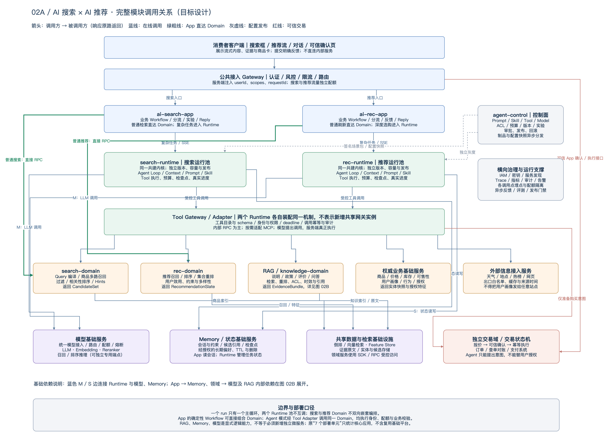
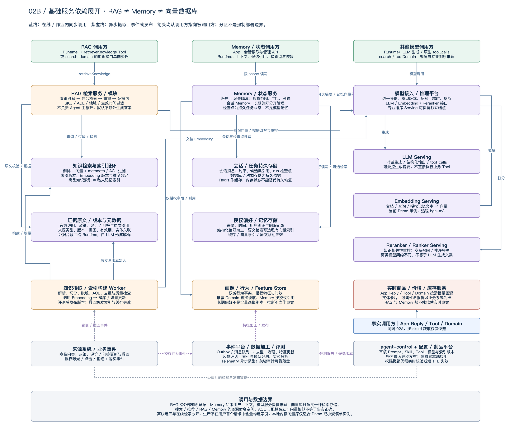

### 2. 调用关系（2026-10-08 修订）

本节替换原简化调用图，结合《主流 Agent 架构调研与 AI 搜索、AI 推荐落地方案》的统一 Harness、强领域能力、证据与实体分离原则，补齐 App 直达 Domain、RAG、模型、Memory、数据与治理的调用关系。以下为建议目标设计，不代表当前 Demo 已部署这些服务。

**核心结论：App 负责业务 Workflow，Runtime 只是其中可选的 Agent 执行环节。确定性请求可以由 App 直接调用 Domain；需要模型动态选择步骤时，才进入 Runtime。两条链路复用相同的领域能力、身份校验与业务契约。**

#### 2.1 完整模块调用图

图例：箭头从调用方指向被调用方，响应沿原调用返回；蓝实线表示在线调用，绿粗线表示绕过 Runtime 的 App → Domain 短链路，灰虚线表示配置发布，红线表示交易相关调用。图中同名模块与图 02B 是同一逻辑能力，不是重复部署。横向治理作用于所有服务，避免为每条埋点和鉴权连接再画一条线。

**部署口径：**前文“6 个逻辑服务、7 个部署单元”仅统计两套 App、共建 Runtime 的两个池、两个 Domain 和 agent-control，不是全系统只有 7 个服务。模型、Memory、RAG、商品、用户、检索、交易等基础能力必须显式纳入调用和容量设计，但优先复用已有平台。RAG、Memory、Tool Adapter 可先作为模块或 SDK 实现，需要共享治理、独立扩容或独立发布时再服务化；不能把图上的每个框机械地拆成微服务。本次不重新决定 Runtime 实现语言。

#### 2.2 RAG、Memory、模型与数据依赖

**四类能力不能混为一个“向量服务”：**

| 能力 | 输入与输出 | 必须守住的边界 |
| --- | --- | --- |
| RAG / knowledge-domain | 问题、SKU、知识范围 → 带来源、版本和有效期的 EvidenceBundle | 提供外部知识证据；默认不再调用一个聊天 Agent；不以旧知识代替实时报价 |
| Memory / 状态服务 | userId、sceneId、sessionId、runId、授权范围 → 会话、约束、引用、检查点或偏好 | 会话 Memory、长期偏好、持久任务状态分别管理；跨场景共享需授权 |
| 模型基础服务 | Prompt / 文本 / 候选特征 → 生成内容、向量或评分 | LLM、Embedding、知识 Reranker 与商品 Ranker 是不同接口；模型不能自己执行交易 |
| 数据与检索基础设施 | 带租户、ACL 和版本的读写请求 → 索引命中、原文或特征 | 向量库只是检索组件；知识索引和私人 Memory 索引隔离；数据以所属业务域为准 |

Memory 的“会话状态”和 Runtime 的“检查点”可以复用持久存储基础设施，但数据模型、写入权限和生命周期不同。Memory 不是把全部用户画像再复制一份；当前用户输入优先于历史推断，长期偏好必须可纠正、可删除。模型生成的摘要和推测不能升级为权威行为事实。

#### 2.3 调用矩阵：谁可以调用谁

以下是允许的调用关系，不意味着每个请求都调用全部服务。“直接”表示绕过 Agent 主循环，不表示绕过网关、鉴权、业务校验或配额。

| 调用方 | 被调用方 | 目的与关键契约 |
| --- | --- | --- |
| 客户端 | 公共网关 → ai-search-app / ai-rec-app | 登录态、交互、分流、流式事件；客户端不能直接访问内部 Domain 或模型凭证 |
| ai-search-app | search-domain | 普通搜索、筛选、分页、Hints，直接返回候选，不必经过 Runtime / LLM |
| ai-rec-app | rec-domain | 推荐刷新、换一批、固定策略重排，保留高 QPS 短链路 |
| 任一 App 的确定性 Workflow | search-domain / rec-domain | 固定搜推融合可直接依次组合两个领域接口；不得另藏一个无治理 Agent Loop |
| ai-search-app / ai-rec-app | 对应的 Runtime 池 | 创建 / 继续 / 取消 run，读取真实执行事件；返回 SSE / 结构化结果 |
| Runtime | 模型基础服务 → LLM | 装配 Prompt 与工具 schema，接收正文或 tool_calls；调用次数和预算由 Runtime 控制 |
| Runtime | 本池 Tool Gateway / Adapter | 执行 schema、scope、deadline、依赖及安全校验；不是所有调用都必须经过一个共享网关进程 |
| Tool Adapter | search-domain / rec-domain | 返回 CandidateSet / RecommendationSlate；两个池均可按授权使用两类能力 |
| Tool Adapter | RAG / knowledge-domain | retrieveKnowledge → EvidenceBundle；检索结果回填同一个 Runtime 主循环 |
| search-domain 的知识接口（可选） | RAG 模块 / 服务 | 单向委托知识检索；可与前一入口复用同一实现，不重复建库、不嵌套启动 Agent |
| Tool Adapter / App Reply / Domain | 商品、价格、库存、可售性基础服务 | 批量回源得到 EntitySnapshot；商品卡按 skuId 填充，不能相信模型生成的价格 |
| rec-domain / 授权 Tool | 用户画像、行为、Feature Store | 获取授权事实和特征；当前意图与历史偏好分开记录 |
| Tool Adapter | 天气、景点、热榜、外部网页接入服务 | 按需获取场景和外部证据；限制出口、数据字段、来源与缓存有效期 |
| App / Runtime | Memory / 状态基础服务 | App 使用会话管理 API；Runtime 持久化与恢复 run；检查点不能由客户端任意覆盖 |
| Memory 服务 | 持久状态库 / 偏好库 / 可选私有向量索引 | 按账户、场景、授权和 TTL 存取；删除联动缓存、向量与原文 |
| Memory 服务（按需） | 模型基础服务 / 授权画像接口 | 有界摘要、语义编码或授权特征引用；简单结构化状态读写不需要调用 LLM |
| RAG 服务 | 模型基础服务 + 知识索引 + 证据原文 | 查询向量化、混合检索、按需重排、权限与时效过滤，返回可验证证据 |
| search-domain / rec-domain | 搜推索引、Feature Store、专用模型 Serving | 复用商品召回和排序系统；专用低延迟排序端点不强制绕行 LLM 网关 |
| 知识摄取 Worker | 内容源、Embedding、索引与原文存储 | 离线构建 / 增量更新 / 撤回；通过评测后发布可用知识版本 |
| Tool Adapter | 交易域的准备接口 | 只创建购买意图、获取报价；不凭模型输出直接确认支付或下单 |
| 可信 App 确认接口 | 独立交易域 / 交易状态机 | 校验用户确认、报价快照、风控与幂等；未知结果查单对账，支付交给可信支付系统 |
| 各服务 / App | 事件、观测与审计平台 | 真实进度、Trace、指标、授权反馈；普通埋点异步，关键审计必须可靠落盘 |
| agent-control | 配置 / 制品平台 → 各消费模块 | 发布版本化 Prompt、Skill、Tool、模型路由、预算和索引策略；不逐请求查询控制面 |

#### 2.4 五条典型路径

**A. 普通搜索 / 推荐：**客户端 → 公共网关 → App → 对应 Domain → 既有索引 / 排序 / 业务事实 → App Reply → 客户端。没有自然语言推理需求就不进入 Runtime；AI 能力不可用时也能保留基础结果。

**B. 固定搜推融合：**App Workflow → search-domain 获取候选 → rec-domain 按用户和场景重排 → 商品事实服务核验 → Reply。固定业务步骤可由 App 编排，不要求为了“跨 Domain”而强行启动 Agent。

**C. 深度选购与优劣比较：**App → 对应 Runtime → Memory 取本轮约束与授权偏好 → 模型选择工具 → Tool Adapter 调用搜索 / 推荐 → RAG 取商品证据 → 将证据回填 LLM → 校验解释和引用 → Reply 回源填充商品卡。模型可以在预算内补查；RAG 不再另起主循环。各次调用可根据依赖并行或跳过，不是固定每轮全部执行。

**D. 多轮追问与恢复：**App → Runtime → Memory 读取会话、candidateSetId 与持久检查点 → 用户新条件覆盖旧条件 → 按需重新查询 Domain / RAG → 更新版本与交付结果。跨池交接只传经授权的意图和引用，不由两个 Runtime 递归调用彼此。

**E. 用户发起购买：**可信 App → 交易域报价 → 用户确认 → 校验确认凭证及最新业务条件 → 幂等执行 → 权威订单状态 → App 展示。若价格、库存或关键条件变化，必须重新报价确认。Agent 的 run 状态不能代替订单状态。

#### 2.5 工程约束与降级

- **执行边界：**每个 run 一个主循环；App 是业务流程拥有者，Runtime 是可选执行组件；Domain 不通过互相启动 Agent 实现能力融合。
- **知识与事实：**RAG 支持解释和比较，商品 / 价格 / 库存系统负责实时事实，Memory 保存本用户上下文；不能相互替代。
- **索引生命周期：**生产由后台 Worker 构建与发布索引，在线只读已就绪版本。模型与索引版本兼容后再切换；知识撤回和权限撤销触发失效，不能为“固定快照”继续返回已撤回数据。
- **服务化边界：**MVP 可以是同进程模块 + 现有平台，生产是否独立部署取决于共享范围、SLA、容量、权限和发布边界，不以框图数量决定。
- **配置与运行：**场景包预发布，任务记录所用版本；运行时鉴权、熔断、配额仍在线执行。权限撤销必须及时生效，不为减少控制面调用而缓存永久授权。
- **故障隔离：**推荐异常可回退搜索原排序；RAG 不可用则只给已核验事实与资料不足提示；Memory 不可用可降级为当前输入，但不能伪称恢复成功；模型不可用回到确定性短链路。
- **可靠性：**两个 Runtime 池独立限流，共享基础服务按调用方配额隔离。共享协议携带 requestId、runId、身份范围、deadline、版本和 trace；写操作另带可信确认及业务幂等键。
- **数据闭环：**授权事件进入数据平台，形成特征、知识、评测与实验报告，经审核再发布；不允许模型根据一次反馈自行修改生产 Prompt 或策略。

设计依据：原《AI搜索×AI推荐统一Agent架构结论》的六层分工，以及《主流 Agent 架构调研与 AI 搜索、AI 推荐落地方案》第 6、7、8、9 节。本节明确展开原文已提到但未画出的能力，不将参考资料中的厂商内部实现当作本项目部署事实。
