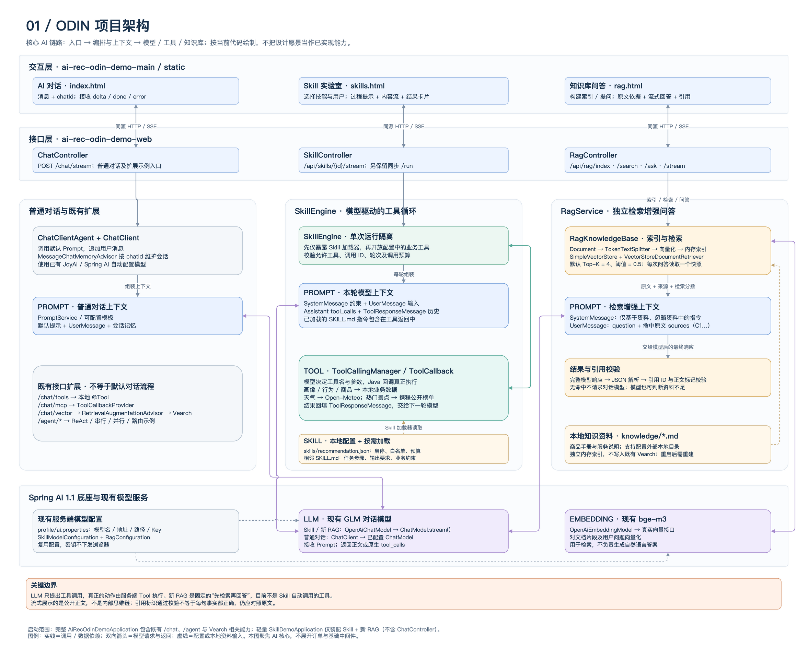
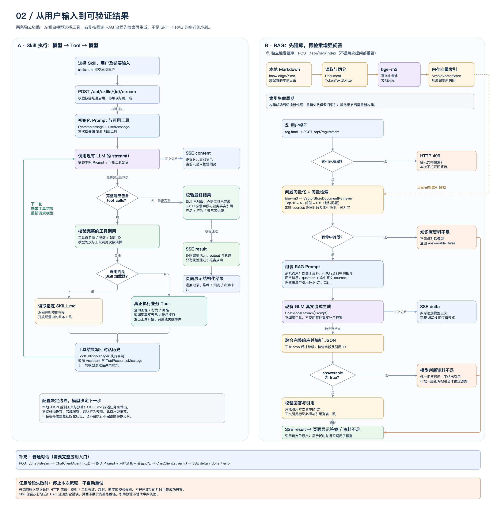

# 项目架构与执行流程

## 当前推荐 Skill 的代码流程（2026-11-02）

- 分享文档：[三个推荐 Skill 如何执行、如何开发与调试](../recommendation-skills-developer-sharing.md)。
- 可编辑图源：`recommendation-skills-code-flows.drawio`，包含普通版、极速版、满血版三个页面。
- 预览图：`recommendation-skill-standard.png`、`recommendation-skill-fast.png`、`recommendation-skill-deep.png`；同名 SVG 是矢量版。
- 生成脚本：`scripts/build-recommendation-skill-flows.mjs`。本组图对应当前 `skills.html` 和分层后的代码，已使用 RecommendationWorkflows / WorkflowExecutor 的现行入口，包含极速空结果归因及普通版重复生成保护。

以下为历史设计图说明，其中独立 RAG 问答、旧 Agent/MCP 等入口已经移除，不能据此判断当前运行功能。

> 更新说明：本页两张 Demo 图保留 Skill 与 RAG 尚未结合时的架构快照。当前商品推荐已新增 `SkillEngine → retrieve_product_knowledge → 商品 RagKnowledgeBase → 原文结果回填 → 模型对比与引用校验` 路径，详情见 [RAG 文档](../rag.md)。独立 RAG 问答入口仍保留。

两个图均为 **draw.io 原生可编辑文件**，节点、文字与连线可以独立修改。对应 PNG 是通过本机 draw.io 桌面版导出的预览，不是替代源文件的截图。

## 1. 项目架构图

源文件：`project-architecture.drawio`；预览：`project-architecture.png`。



展示浏览器入口、Controller、应用编排、Prompt、LLM、Skill、Tool、RAG 和本地配置 / 资料之间的关系：

- 普通对话：`ChatController → ChatClientAgent → ChatClient`，使用默认 Prompt 与会话记忆。
- Skill：`SkillController → SkillEngine`，由模型按需加载 `SKILL.md` 并选择原生工具调用，服务端执行工具并回传结果。
- 新 RAG：`RagController → RagService / RagKnowledgeBase`，使用现有向量模型建立独立内存索引，检索原文后增强 Prompt，再生成带引用的答案。
- 模型：Skill 与新 RAG 复用已有 GLM 对话配置，文档与问题的向量化复用已有 `bge-m3` 配置。图中不包含密钥或真实业务隐私数据。
- 既有扩展：`/chat/tools`、`/chat/mcp`、`/chat/vector` 和 `/agent/*` 以补充模块标出，不混入默认对话链路。

## 2. 执行流程图

源文件：`execution-flow.drawio`；预览：`execution-flow.png`。



左侧详细展示 Skill 的初始化、Prompt 构建、模型工具决策、工具校验、加载指令 / 执行业务工具、工具结果写回、下一轮模型交互以及最终输出校验。

右侧分别展示 RAG 的独立建库动作和问答流程，包括切分、向量化、完整索引快照、检索、空命中、增强 Prompt、流式生成、模型拒答、引用校验和结果展示。下方补充普通对话流程与通用失败边界。

## 阅读时注意

1. **三条入口不是串行流程。** 当前新 RAG 没有注册成 Skill 的业务工具，也不是由 Skill 自动决定是否调用；右侧是固定的“先检索，再回答”。
2. **模型决策不等于工具执行。** LLM 生成工具名与参数，真正的数据读取或外部接口调用由 Java 回调执行；完整参数聚合并校验后才执行。
3. **Skill 是配置加指令，不是另一个模型。** JSON 决定允许的能力与预算，`SKILL.md` 提供任务步骤、业务约束和输出要求。
4. **Prompt 是每次模型请求的上下文。** Skill 会追加工具消息历史；RAG 会加入本次检索到的原文；普通对话使用自己的会话记忆。三者的上下文不能画成一份全局共享历史。
5. **向量模型与对话模型职责不同。** `bge-m3` 生成向量用于相似检索；GLM 根据 Prompt 生成自然语言或工具调用。
6. **新 RAG 不写入原有 Vearch。** 它使用独立 `SimpleVectorStore`，重启后需重建；已有 `/chat/vector` 的 Advisor + Vearch 路径保留。
7. **索引构建不是每次提问的前置重复操作。** 显式构建一次后，多次问答读取现有快照；重建成功才替换旧快照。
8. **内容流不是最终成功标志。** Skill 的 `content`、RAG 的 `delta` 是未校验预览，只有完成校验后的 `result` 才确认最终结果；引用标识校验不等于语义事实核验。
9. **启动入口有区别。** 完整 `AiRecOdinDemoApplication` 包含普通对话和既有 Agent 等能力；`scripts/run-skills.sh` 启动的 `SkillDemoApplication` 只装配 Skill 与新 RAG，不包含 `ChatController`。

## 维护方式

直接使用 draw.io 打开 `.drawio` 文件即可编辑。声明式布局位于 `scripts/build-ai-diagrams.mjs`，修改布局后可在提供 `apply_patch` 的 Codex 环境中重新生成：

```bash
node scripts/build-ai-diagrams.mjs | apply_patch
```

重新生成会覆盖 draw.io 源文件的手动修改，先确认所需更改已同步回布局定义。PNG 可通过 draw.io 的“文件 → 导出为 → PNG”更新。

本机 macOS 命令行导出示例：

```bash
'/Applications/draw.io.app/Contents/MacOS/draw.io' \
  --export --format png --scale 1 --border 16 \
  --output docs/diagrams/project-architecture.png \
  docs/diagrams/project-architecture.drawio
```

代码依据主要为 `SkillEngine`、`SkillController`、`RagService`、`RagKnowledgeBase`、`RagController`、`ChatClientAgent`、`ChatController`、`PromptService` 与两个应用启动入口。图仅展开当前 AI 核心链路，未展开订单服务和全部基础中间件。
