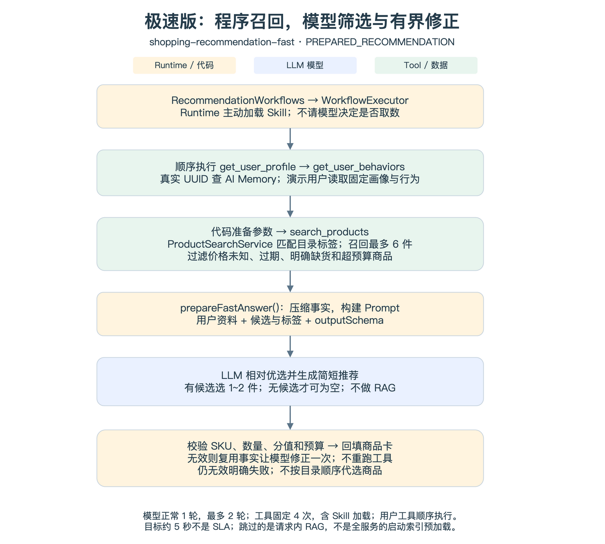
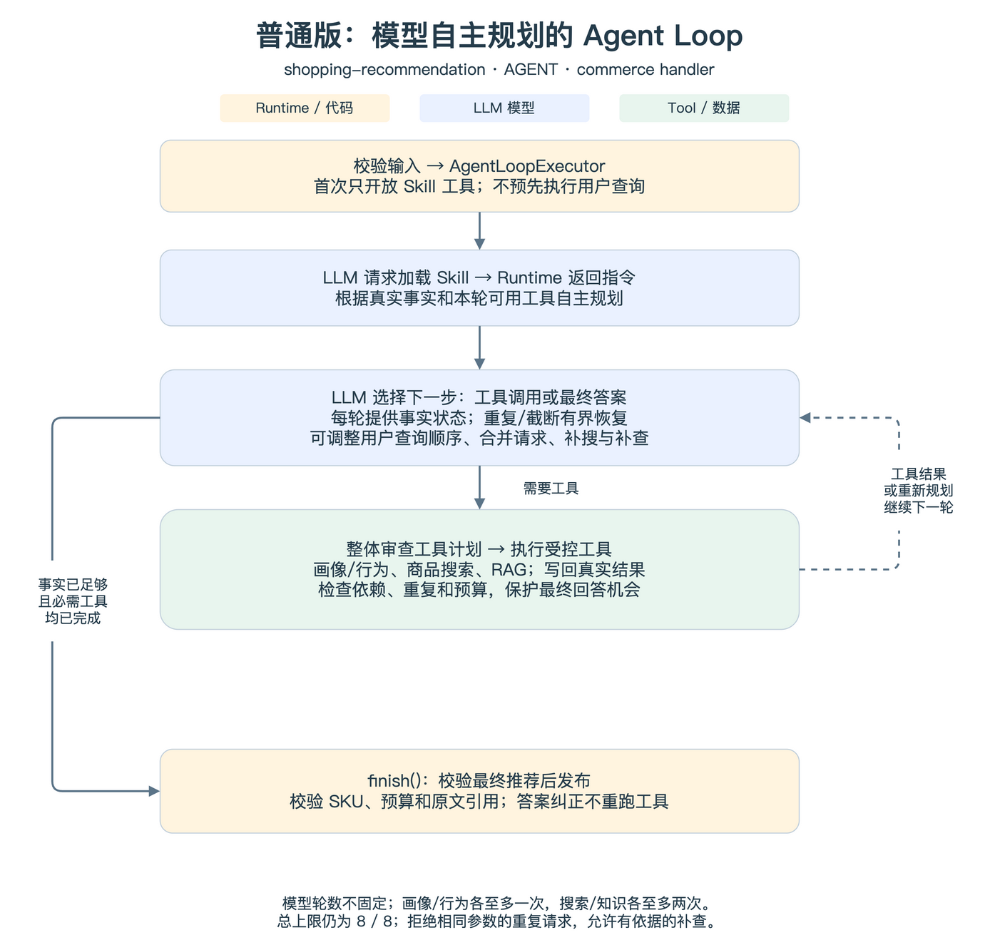
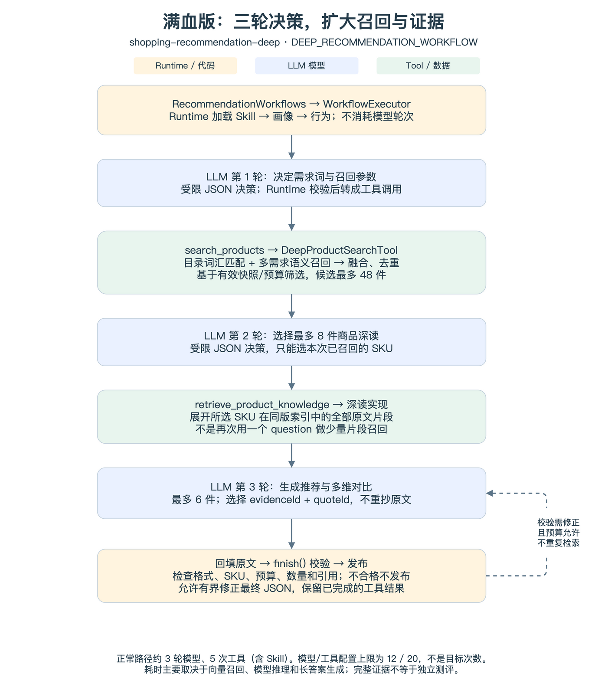

# 三种个性化商品推荐 Skill：流程、效果与开发定位

> 版本：2026-11-02。按最新代码重写，适合团队分享和新人入门。
> 配套开发步骤见 `docs/development.md`。图源：`docs/diagrams/recommendation-skills-code-flows.drawio`，包含三页可编辑流程图；同目录保留 SVG 和 PNG。

配套 Joyspace：[Odin Agent 开发指南：分层、扩展与调试](https://joyspace.jd.com/pages/yPOTkgX9wDbVXPmBK2jE)。

**一句话区别：极速版先由代码找商品，再让模型筛选；普通版让模型自主理解需求、调用工具；满血版固定关键阶段，让模型做更广的选择和更丰富的证据对比。**

“满血”表示召回和证据范围更大，不表示一定更准，也不表示模型轮次必须更多。

## 1. 三者共享什么

- 同一套本地 Skill 清单、SKILL.md 和当前模型配置，不是三套独立模型服务。
- 同一个 SkillEngine，业务差异在 commerce handler；并非 Engine 为每个 Skill 单独写一条执行主循环。
- 同一份已采集京东商品目录，当前 1000 个 SKU；不是全站实时搜索或实时报价。
- 真实用户通过 AI Memory 获取画像和行为；`username` 传 UUID，不是 PIN。演示模式仅替换用户资料，仍真实调用模型、商品工具和适用的 RAG。
- 同一套工具受控执行、预算、取消、SSE、结果校验和 Web 实验室。
- 服务启动统一预加载商品 RAG；极速请求不使用 RAG，不代表能绕过服务启动门禁。

### 核心概念

| 概念 | 在本项目中的作用 |
| --- | --- |
| Skill | 配置能力目标、指令、工具白名单、必需输出与预算 |
| Agent Loop | 模型根据事实反复选择下一步工具或最终回答 |
| Workflow | 代码固定阶段，可混合 Tool、Local、Decision、Answer 节点 |
| Runtime | 管理一次执行的上下文、轮次、预算、模型/工具请求、事件和终止 |
| Memory | 提供用户画像与行为事实，不负责商品知识 |
| RAG | 找到或展开商品原文，为特点、限制和对比提供依据 |
| LLM | 理解需求、选择候选、判断取舍、生成解释；不能伪造工具结果 |

## 2. 配置与效果对照

| 项目 | 极速版（极简版） | 普通版 | 满血版 |
| --- | --- | --- | --- |
| Skill ID | shopping-recommendation-fast | shopping-recommendation | shopping-recommendation-deep |
| executionMode | PREPARED_RECOMMENDATION | AGENT | DEEP_RECOMMENDATION_WORKFLOW |
| 执行方式 | 固定 Workflow | Agent Loop | 固定阶段 + 模型决策 |
| 取用户信息 | Runtime 直接执行 | 模型请求后执行 | Runtime 直接执行 |
| 谁决定检索条件 | 代码匹配用户资料中的目录标签 | 模型理解需求后决定 | 第 1 轮模型决定 |
| 商品召回 | 目录标签匹配，一次最多 6 件 | 同一目录工具，指令建议每次 6 件，最多补搜一次 | 目录词汇 + 逐兴趣向量召回，最多 48 件 |
| 商品知识 | 不查询 | 按 SKU + 问题召回有限片段；单次最多 4 件 | 第 2 轮选最多 8 件，展开同版索引的全部片段 |
| 最终推荐 | 最多 2 件、简短理由 | 最多 4 件、需求分析与引用对比 | 最多 6 件、更丰富的需求与多维对比 |
| 引用生成 | 不生成对比引用 | evidenceId + 原样 quote | evidenceId + quoteId，服务端回填 quote |
| 常规模型轮次 | 1 | 不固定 | 正常路径约 3 |
| 模型 / 工具上限 | 2 / 4（正常一轮，最多修正一次） | 8 / 8 | 12 / 20 |
| 正常工具数量 | 4，含 Skill 加载 | 随模型规划变化 | 5，含 Skill 加载 |
| 推理配置 | reasoningEffort=low | 沿用模型默认 | reasoningEffort=high |

上限不是目标次数，也不代表底层 HTTP 一定只有相同次数：传输重试与逻辑模型轮次是不同口径。极速版有候选但模型未选择时，请模型修正一次，仍失败则不发布推荐，绝不由程序代选；普通/满血版仍允许有依据的空推荐。均不编造 SKU。

## 3. 极速版：程序召回，模型筛选与有界修正



### 3.1 实际执行步骤

1. RecommendationWorkflows 返回 WorkflowExecutor，Runtime 先执行 Skill 加载，不消耗模型轮次。
2. 顺序执行 get_user_profile、get_user_behaviors，数据来源由本次请求固定。
3. FastRecommendationContext 压缩资料。存在原始 memories 时，每个工具最多保留 6 条、每条最多 400 字，并标记节选；不再传递重复展开的兴趣/行为字段。
4. ProductSearchService 从这些资料中匹配目录标签，使用画像预算或 null，检索最多 6 件有效候选。
5. prepareFastAnswer 将 Skill 指令、画像/行为、searchArguments、candidateCount、candidates.products 和动态 outputSchema 交给模型；候选保留名称、品类、检索标签、价格、库存状态和已选规格。
6. 模型在候选内相对优选 1~2 件并给出简短理由，只有候选为零时才可为空。needs 固定为空仅表示不展示需求分析，不代表用户没有需求。
7. 后端使用同一契约校验 SKU 枚举、数量、整数分值等，继续校验重复 SKU、价格/预算；通过后补齐商品详情，规范总结与状态，不替模型构造推荐条目。
8. 若空选择或格式/业务校验失败，CommerceSkillBehavior.repairFastAnswer 复用已准备事实，加上错误路径及最多 8000 字符的无效草稿，由模型修正一次。Runtime 沿用通用修正循环，不执行任何新工具；再次失败则明确终止。

### 3.2 为什么快，代价是什么

省掉了“模型决定取数 → 模型决定检索 → 模型决定查知识”的往返，也不读取 RAG。模型不只是复述，它仍负责候选筛选与理由，但**不能主动补搜或扩大事实范围**。

如果用户描述没有命中目录标签，程序可能漏召回；记忆压缩也可能损失细节。有候选时极速版要求返回 SKU，但这不保证适配：必要条件无法确认时应明确作为待确认的备选。

当前提示词明确：匹配一项有效需求即可考虑推荐；无 RAG、预算未知或 availability=UNKNOWN，不能单独作为排除理由。标签只解释召回关联，不能拿来编造性能、测评或“性价比最优”。

### 3.3 有 SKU 却显示“暂无匹配”的处理

此前候选上下文缺少检索标签，模型也可能把缺少细节理解为“不应推荐”，而页面把空数组统一解释为目录无匹配。现在保留实际召回依据，统一相对优选任务，并校验模型确实完成选择：

| selectionStatus | 含义 |
| --- | --- |
| RECOMMENDED | 校验通过且已选出商品 |
| INSUFFICIENT_USER_INFORMATION | 画像和行为资料均为空，不能生成个性化结论 |
| NO_CANDIDATES | 本次目录检索确实没有候选 |

候选数和最终状态由后端计算；SKU、分数与理由必须来自模型，selectionSource=MODEL。空数组会记录 FAST_SELECTION_INVALID（/products、MIN_ITEMS_NOT_MET），随后 FAST_SELECTION_RETRY；修正成功记录 FAST_RECOMMENDATION_SELECTION。不会自动取前两件充当模型结果。零候选、工具失败、模型协议错误、取消以及修正预算耗尽均不能伪装成成功。

outputSchema 在此是提示词契约和服务端校验，并非已启用网关强制解码。正常路径仍只有一次模型调用，最坏增加一次模型修正；两次都无效时明确失败，这是不伪造模型选择的边界。

### 3.4 适合什么场景

快速“猜你喜欢”、轻量兴趣匹配、先给少量商品。需要精确解释参数差异、条件限制和引用依据时，应进入普通或满血版。

## 4. 普通版：有约束的 Agent Loop



### 4.1 实际执行步骤

1. RecommendationWorkflows 返回 AgentLoopExecutor。首次只开放 Skill 工具，由模型请求加载指令；不提前查询用户。
2. 模型决定画像和行为的查询顺序，也可以同轮提出两个请求。模型同轮请求不等于后端必然并行执行。
3. 两个用户工具完成后，模型理解需求，生成搜索标签和条件。
4. Runtime 执行目录检索并返回候选。模型可继续初选，也可基于新事实换条件补搜。
5. 模型为选定 SKU 调用 retrieve_product_knowledge，按问题在对应商品文档中召回有限原文。
6. 模型基于事实生成需求判断、推荐理由、优点/限制、适用性和对比总结。
7. 后端校验商品来源、预算、引用归属及连续原文；通过后发布，否则按剩余预算修正最终输出或失败。

这是常见路径，不是固定五轮或固定 Workflow。已经取得充分依据时应收敛，不用把 8 轮跑完。

### 4.2 服务端如何约束循环

- RecommendationLoopPolicy 控制工具依赖、剩余预算和重复请求；画像/行为各最多 1 次，搜索/知识各最多 2 次。
- 不重复相同参数。允许有依据地补搜或补查，不为扩大范围添加无关兴趣。
- 工具批次在执行前整体审查，被拒绝的批次不表示其中某个工具已执行。
- 每轮为模型提供已完成工具、缺失工具、可用工具和预算状态；这不是向用户展示逐步思考过程。
- ModelOutputGuard 识别重复正文/推理增量和不完整生成，结合有界恢复处理；截断的工具批次不执行。
- 最终答案修正复用工具事实，不因一次 JSON 或引用问题重跑整个取数链路。

这些是 Runtime/业务策略对 Agent 的约束，不是把模型的下一步写死。普通版仍由模型决定合法范围内的行动。

### 4.3 推荐效果与边界

相较极速版，普通版有机会把隐含需求转换成更合适的检索标签，再利用商品知识解释取舍。所有最终推荐商品必须已经查询知识。

不过普通版的 search_products 仍是本地目录标签检索，**不是向量商品召回**；向量检索发生在后续商品知识阶段。目录里没有的商品不会因为模型更聪明就自动出现。

证据不足使用 PARTIAL_EVIDENCE 或 INSUFFICIENT_EVIDENCE，未知参数不是商品缺点。页面宣传也不是独立测评。引用严格校验提升可追溯性，但不能保证推断和商业判断绝对正确。

### 4.4 适合什么场景

用户需求比较含蓄，或者会问“为什么适合我”“这些商品怎么选”。代价是多轮模型请求、知识检索及更复杂的校验，耗时与失败概率更受模型表现影响。

## 5. 满血版：固定三阶段，扩大召回与证据



### 5.1 实际执行步骤

1. Runtime 先加载 Skill 并查询画像、行为，不让模型花轮次决定是否执行这些必需步骤。
2. **模型第 1 轮**：分析用户信息，决定 interests、budget、limit；Decision 节点只允许指定的商品检索决策。
3. search_products 经 commerce 的 resolveTool 映射到 DeepProductSearchTool：在有效、已索引商品内结合标题/品类/标签词汇匹配与逐兴趣向量召回，融合去重并覆盖不同需求，最多返回 48 件候选。
4. **模型第 2 轮**：从已有候选中选择最多 8 件值得深读的商品，不能自造 SKU。
5. retrieve_product_knowledge 映射到深读实现，展开这些 SKU 在同一索引版本下的全部原文片段，附带 evidenceId 和可选 quoteChoices。
6. **模型第 3 轮**：综合用户信息和知识，优选最多 6 件，生成需求、理由、优点、限制、对比维度与不确定性。
7. 模型选择 evidenceId + quoteId，服务端回填原文，再执行结构、数量、预算、商品归属和引用校验。不通过时仅在剩余预算内修正最终答案。

正常路径为 3 次模型、5 次工具（含 Skill），不是默认要跑 10～12 轮。若轮数明显增多，应查看协议、结构或引用修正事件，不把上限当作正常耗时目标。

### 5.2 为什么与普通版不同

- **搜索范围更广**：普通版把模型生成的标签交给目录检索；满血版还引入逐兴趣语义召回和多路融合。
- **证据范围更大**：普通版按问题取有限片段；满血版展开所选商品的全部索引片段。这仍是已采集资料，不是商详和外网信息的无限全量。
- **对比结构更丰富**：满血版增加 dimensions，能表达更多有来源的对比维度；不要求凑满优点和限制数量。
- **引用生成更稳**：用 quoteId 选择已提供的原文，减少模型逐字抄写出错，但仍可能选错证据或给出不受支持的结论，校验不能省略。
- **轮次更可控**：通过 Workflow 固定关键阶段，模型专注三个决策；它不是多个 Agent 协作。

### 5.3 适合什么场景

用户有多项兴趣，希望尽可能从当前索引挑选合适商品，或需要更丰富的同类对比和购买条件说明。代价是更多检索、更大上下文和更长答案，即使只有三轮也可能比普通版更慢。

## 6. 用同一个用户理解效果差异

假设用户资料：经常地铁通勤，希望减少听音乐时的噪声，也关注办公用品。以下用于解释机制，不是保证某次执行必定返回的 SKU。

| 阶段 | 极速版 | 普通版 | 满血版 |
| --- | --- | --- | --- |
| 需求理解 | 程序先匹配目录标签，模型后筛选；未命中标签可能漏召回 | 模型有机会推断通勤降噪、办公等需求，再设计检索条件 | 模型先规划多项需求，随后做多兴趣融合检索 |
| 候选选择 | 只能从本次最多 6 件中挑选 | 候选不合适时可有界补搜 | 更大候选集合中先选最多 8 件深读 |
| 推荐说明 | 说明名称/规格与兴趣的简单适配 | 引用商品片段解释特点、限制和用途取舍 | 利用更多原文按多个维度比较，并说明未知条件 |
| 信息不全 | 有候选则返回待确认备选，不保证个性化适配 | 允许部分证据，不为补齐优缺点编造 | 更多原文也可能没有所需参数，同样必须承认未知 |

没有对同一批用户做离线评测或线上 AB，不能宣称“满血准确率一定高于普通，普通一定高于极速”。更多候选和证据扩大了判断空间，也可能带来噪声、成本和校验失败。

建议评估：候选覆盖、明确需求匹配、引用有效率、空结果率、成功率、端到端 P50/P95、token 成本；若上线，还需在合规前提下评估点击、转化和负反馈。不能用模型自报 score 代替效果指标。

## 7. 从代码定位到开发修改

Java 类主要位于 app 模块，资源位于 main 模块。

| 想调整什么 | 首先看哪里 |
| --- | --- |
| 三版工具白名单、轮次和执行模式 | `skills/recommendation.json` |
| 模型的筛选原则、事实边界和输出格式 | 各自 `skills/<id>/SKILL.md` |
| 三版执行器选择、极速/满血节点 | `application/commerce/RecommendationWorkflows.java` |
| 普通版补搜次数、依赖和重复控制 | `application/commerce/RecommendationLoopPolicy.java` |
| 工具映射、上下文、业务校验接入 | `application/commerce/CommerceSkillBehavior.java` |
| 极速版资料压缩与检索参数 | `domain/recommendation/FastRecommendationContext.java`、`domain/product/ProductSearchService.java` |
| 极速版候选投影与空结果归因 | `application/commerce/RecommendationModelContext.java`、`FastRecommendationResult.java` |
| 满血商品召回 | `tools/product/DeepProductSearchTool.java` |
| 普通/满血商品证据读取 | `tools/product/ProductKnowledgeTool.java` |
| 多维输出契约、引用与数量校验 | `domain/recommendation/RecommendationOutputContract.java`、`ProductComparisonValidator.java` |
| 新增独立业务 | `application/<业务>` 的 SkillExtension / SkillBehavior，加 Tool 和本地配置 |

不要通过修改通用 SkillEngine 来实现某个推荐策略。现有 PREPARED_RECOMMENDATION 和 DEEP_RECOMMENDATION_WORKFLOW 是 commerce 支持的模式；新业务的固定流程通常使用自己的 handler + WORKFLOW，不必复制这些业务模式名。

## 8. 调试时按这条顺序看

```text
用户来源和输入
  → 实际加载的 Skill 与模型
  → 用户工具事实
  → 商品检索参数与候选数量
  → 知识证据（极速版跳过）
  → 模型选择/对比
  → 校验与最终输出
  → SSE 是否完整送达网页
```

1. IDEA Run/Debug Console 搜索 agent_diag，再按同一个 runId 串起事件；SSE 重连另看 sessionId。
2. 模型慢：比较 MODEL_REQUEST、MODEL_FIRST_CHUNK、MODEL_WAITING，区分等待首包、生成长答案与重试。
3. 工具慢：看工具执行开始/完成、耗时和结果体积；满血版重点看融合召回及全片段展开后的上下文长度。
4. 推荐空：极速版看 FAST_RECOMMENDATION_SELECTION 的 candidateCount、selectedCount、selectionStatus；不要先扩充商品库再猜原因。
5. 普通版循环：看剩余预算、可用工具与被拒绝的重复批次，保留 Agent Loop 的自主规划，不用无限次数掩盖问题。
6. 满血版轮数升高：定位格式/引用修正；候选 48、深读 8、推荐 6 是三个不同阶段，不能混用数量上限。
7. 引用失败：先检查 SKU 和 evidenceId，再看 quote 或 quoteId；不得把其他商品证据拿来凑数，也不能关闭校验强行发布。
8. 流式内容只代表模型正在生成。ModelTurn 当前不是完整回复归档；最终商品卡以校验通过的 result 为准。

本地联调接口、配置、Tool/Skill 示例与完整检查清单见开发指南。页面主要调用 `POST /api/skills/{skillId}/session-stream`；`/run` 是非流式联调入口。

## 9. 已验证什么，没有验证什么

2026-11-02 本次修正回归为 321 项 Java、133 项前端测试通过。极速版使用当前配置模型与实际商品目录：演示用户小雨、小明分别约 6.1 秒、4.6 秒，均 1 轮模型、4 次工具、6 件候选、2 件推荐。另人为注入首轮空数组，再让真实模型修正，两名用户均选出 2 件，工具总数仍为 4，证明修正没有重跑工具；这不是自然失败率统计。

这些样本只证明该链路在测试条件下完成，不代表真实 UUID 查询也有相同时延，更不是三版同条件效果对照实验。本次文档重写不把历史普通/满血耗时混成新的性能对比，也不宣称已完成浏览器视觉验收。

选型建议：快速展示用极速版；需要解释和取舍用普通版；需要更广覆盖和丰富证据用满血版。“先极速出结果，用户再点深入对比”是可选产品演进方案，当前页面没有自动串接这两个 Skill。
