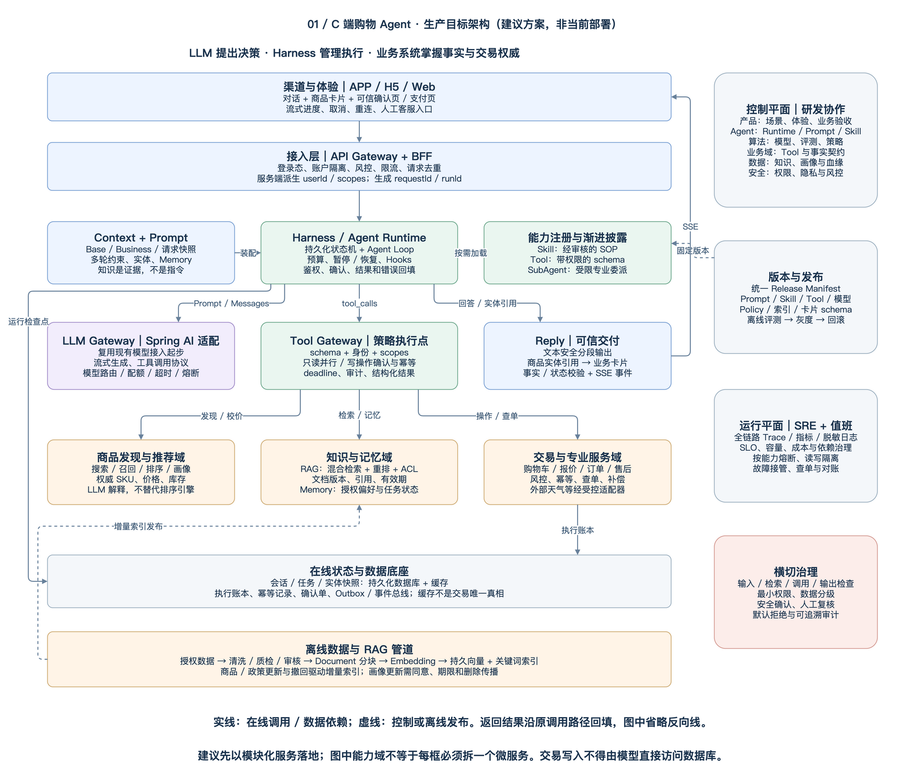
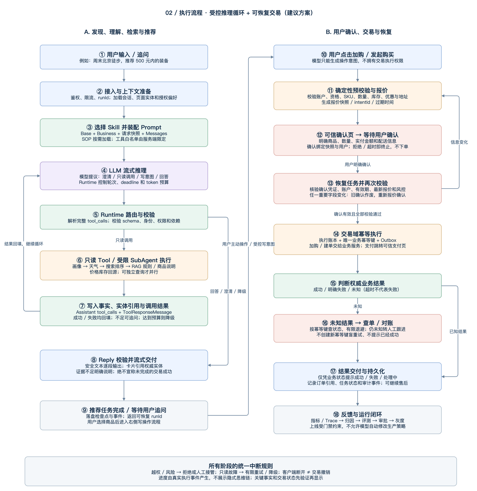

# 面向 C 端的购物 Agent：生产架构、执行流程与团队协作方案

JoySpace 在线文档：[查看架构方案](https://joyspace.jd.com/pages/ulhdbldMzKEPudM4keKo)。在线版本包含两张可编辑的原生 Draw.io 图表。

> 版本：v1.0｜日期：2026-10-08｜状态：架构评审稿，非已上线系统说明。  
> 基于 ai-rec-odin-demo 的现有能力，面向完整购物旅程提出目标架构。本文中的容量、SLO、人员配置和阶段周期均为规划建议，须经业务评审、依赖确认与压测后承诺。

## 1. 结论与设计边界

一个能面向 C 端的购物 Agent，不是“LLM + 几个工具”，而是**以购物体验为入口、以 Harness 为执行中枢、以业务系统为事实和交易权威、以评测和运维为生产保障**的完整产品系统。

- **LLM 负责理解、澄清、规划和解释；不负责身份认证、交易授权或业务事实的最终判定。**
- **Prompt 定义模型行为边界，Skill 定义任务 SOP，Tool 查询事实或执行业务，RAG 提供可追溯知识，Runtime 负责真正执行与恢复。**
- 搜索推荐系统负责大规模召回与排序；商品、价格、库存、订单等业务域仍掌握权威数据和事务。
- 从只读导购逐步开放加购、确认下单和售后，不能把 Demo 的工具调用直接暴露为消费者交易入口。
- 先采用“主 Agent + 确定性业务流程 + 受限领域委派”，不以引入多 Agent 或拆分大量微服务作为目标。

**覆盖范围**：发现需求 → 澄清预算与约束 → 搜索推荐 → 比较解释 → 实时校价 → 用户确认 → 加购/下单 → 支付跳转 → 订单与售后服务。  
**不覆盖**：无用户授权的自动采购；让模型接触支付密码/验证码；重建完整电商交易系统；将健康、金融等高风险建议作为普通商品导购直接上线。

## 2. 参考依据与当前项目差距

### 2.1 对参考文档的继承与扩展

主要参考：[Shopping Agent Harness 架构设计](https://joyspace.jd.com/pages/OC2gjXst9eBuAEYtAFBG?topic=ppRn3z)，2026-10-08 阅读。

| 参考文档的核心思路 | 本方案采纳的设计 | 为 C 端生产补充的内容 |
| --- | --- | --- |
| Harness 统一上下文、能力和交付 | Context → Agent Loop → Runtime → Reply | 接入鉴权、持久任务、恢复、交易安全状态机 |
| Base / Business / Volatile 与 Messages 分层 | 固定规则、场景规则、请求快照、轮次反馈分别组织 | 信任边界、权限过滤、时效、Token 预算和数据删除 |
| Skill / Tool / SubAgent 分工与渐进披露 | SOP 按需加载，Tool schema 按入口和授权开放 | 注册审批、版本锁定、能力撤销、跨域契约 |
| Runtime 执行反馈、实体保存、Hooks 和 Reply 校验 | 真实结果回填，卡片通过实体引用生成 | 幂等、报价确认、未知状态查单、审计与故障接管 |
| 自动归因和自进化、高效推理 | 评测驱动改进、按任务路由模型 | 人工审批、灰度门禁、错误预算、成本与回滚 |

本文不把参考文档中的能力数量、线上通过率、流量占比和耗时指标当成本项目的实测数据。参考文档描述其自身系统，本文描述本 Demo 的演进目标。

### 2.2 已有能力与目标能力

| 能力 | 当前 Demo | 生产目标与差距 |
| --- | --- | --- |
| 模型接入 | Spring AI 底座，真实流式模型调用 | 保留适配，增加模型网关、容量配额、兼容性验证与故障切换 |
| Skill | 本地配置、SKILL.md、按需加载、允许工具及调用预算 | 受控注册中心、审核、版本发布、按入口和用户授权披露 |
| Tool | 回调真实执行；画像/商品等使用演示业务数据，天气/景点调用外部接口 | 接入受授权的画像、搜推、商品、交易接口；供应商 SLA 与数据使用约定 |
| RAG | 独立 Demo：本地文档、真实向量化、内存索引、引用和流式回答 | 持久检索服务、ACL、混合检索、增量更新、撤回、知识运营 |
| Skill 与 RAG | 当前是独立入口，尚未把 RAG 作为 Skill 的检索 Tool | 将知识检索注册为受控 Tool；按任务调用而非每轮强制检索 |
| Web | 选择演示用户、真实进度与流式结果 | C 端登录态、账户隔离、业务卡片、确认页、断流恢复与无障碍体验 |
| 交易 | 没有生产交易写入闭环 | 报价、确认、风控、幂等执行、查单和售后接管 |
| 运行保障 | 工具与输出校验、局部测试 | 多实例持久状态、SLO、限流熔断、全链路审计、值班与应急 |

现有 `/chat/*`、`/agent/*`、`/api/skills/*` 和 `/api/rag/*` 不是一条统一的生产购物链路；轻量 Skill Demo 启动入口也不装配所有示例 Controller。迁移应建立新的统一运行入口，而非假定示例路由已经整合。

## 3. 目标系统架构图

图中的框代表能力边界，不要求各自部署为独立微服务。建议首先部署接入/Agent 运行服务、知识服务和异步任务 Worker，复用现有商品、搜推、画像、交易和平台基础设施；再按隔离性、流量与组织责任拆分。

### 3.1 分层责任

| 层级 | 核心组件 | 明确不承担的职责 |
| --- | --- | --- |
| 交互层 | APP/H5/Web、SSE、商品卡片、确认页、支付页、客服入口 | 不持有模型密钥，不以模型文本判断订单成功 |
| 接入层 | API Gateway、BFF、登录态、风控、配额、请求去重 | 不相信客户端传入的 userId/scopes，不由 Prompt 实现权限 |
| Harness | 意图路由、Context Builder、Skill Loader、Agent Loop、状态机、Hooks、Reply | 不替代交易域事务，不绕过业务规则 |
| 模型层 | Spring AI 适配、LLM Gateway、限额、路由、流式协议 | 模型不直接访问数据库或任意网络 |
| 能力层 | Skill Registry、Tool Gateway、受限 SubAgent | Tool 返回内容不是更高优先级指令；SubAgent 无权限升级 |
| 业务与知识层 | 搜推、画像、商品、价格、库存、订单、售后、RAG、Memory | 知识库不提供实时价格/库存/订单真相 |
| 数据与平台层 | 持久数据库、缓存、对象存储、向量/关键词索引、事件总线、审计、密钥管理 | 缓存不作为确认单、幂等账本的唯一存储 |
| 控制平面 | Prompt/Skill/模型/索引发布、评测、实验、运营审核、监控与应急 | 自动归因不能绕过审批直接修改生产策略 |

### 3.2 建议部署和隔离

- BFF 与运行实例无本地会话依赖；任务检查点落盘，Worker 可在租约到期后接管。用任务版本号/租约围栏防止两个 Worker 同时推进同一写任务。
- 只读查询与交易写入隔离线程池、队列、配额和熔断开关。模型拥塞不能拖垮订单服务，外部天气故障不能耗尽主购物链路资源。
- 状态数据库、执行账本和消息设施采用团队现有高可用方案；备份恢复和跨可用区切换需要演练。交易账本不允许静默丢失已确认执行记录。
- 模型、向量模型和外部数据出口经统一网关管理；凭证存于密钥管理系统，按服务身份访问，禁止把现有开发配置和密钥复制进文档或客户端。

## 4. 核心概念如何协作

### 4.1 Prompt 与 Context

建议保持参考文档的逻辑分层，但**逻辑分层不代表把所有材料都升级为 System 指令**。

| 内容层 | 内容 | 管理方式 |
| --- | --- | --- |
| Base | 身份、真实性、隐私、拒绝越权、交易边界 | 平台维护，安全联合评审，版本固定 |
| Business | 导购策略、澄清原则、卡片 schema、允许能力 | 业务产品与 Agent/算法共同维护 |
| Volatile / 请求快照 | 时间、入口、地区、已授权偏好等本次上下文 | Runtime 从可信来源装配，注明来源/时间，区分数据与规则 |
| Messages | 当前用户输入、必要历史、工具调用与结果 | 随轮次增长，保留完整调用配对与关键事实引用 |
| Evidence | RAG 片段、评论、外部网页等 | 不可信数据区，保留引用与时效，不能覆盖 Base 或授予能力 |

本轮显式约束优先于旧偏好。例如用户说“这次只买 300 元以内”，不能因为历史购买高端商品而继续推荐更高价产品。行为推断是可解释的偏好信号，不应伪装成用户已明确表达的事实。

System 与已选择配置在一次 run 内固定版本；工具结果通过 Messages 回填。对话压缩先删除可重新查询的旧结果，再做摘要；结构化保留预算、规格、候选 SKU、已排除项、未完成动作及确认状态。金额与交易授权不允许只保留在模型摘要中。

### 4.2 Skill：版本化任务方法

一个生产 Skill 至少包含：`id/version/owner`、适用入口、目标和完成条件、SOP、允许工具及版本、必需证据、澄清条件、风险级别、输出 schema、预算、失败/人工接管策略和评测用例。

例：“户外装备选购”Skill 先澄清出行时间/预算，在授权范围内读取兴趣；需要时查询天气和商品知识；调用搜推获取候选；比较权威规格与实时报价；给出理由与不适用条件。用户要求购买时，只生成交易意图并进入确定性确认流程。

常用能力提供精简描述；长尾 SOP 和 schema 在发现后再加载。注册中心配置、签名/完整性校验、Runtime 白名单和业务域鉴权共同生效。**加载了 Skill 绝不等于获得写权限。**紧急撤销的 Skill/Tool 即使 run 已固定旧版本，也必须在下一调用点被阻断。

### 4.3 Tool、SubAgent 与 Hook

- Tool 是结构化业务接口，返回数据、执行状态、来源与时间。Java `ToolCallback` 可以适配现有业务 API，但工具网关需独立于模型执行参数和权限校验。
- SubAgent 用于边界明确且需要独立推理的专业任务，如售后问题分析；主 Agent 负责最终汇总。委派携带有限上下文、最小权限、截止时间、成本预算和父 runId，不允许无限递归或私自下单。
- Hook 用于预装页面实体、脱敏、审计、指标和运营卡片扩展，由 Runtime 按生命周期触发，不依赖模型主动调用。安全 Hook 失败默认阻断相关动作；非关键埋点失败不阻塞业务。
- 运营卡片必须通过同一商品事实与安全校验，商业推广明确标识，不通过 Hook 隐藏改写用户预算和排序原则。

### 4.4 RAG：知识证据，不是万能数据库

RAG 适用于商品说明、选购指南、服务规则和经审核 FAQ。价格、库存、活动资格、订单与配送进度必须调用权威业务 Tool；知识引用的存在只说明“引用 ID 有效”，不能自动证明回答忠实于原文。

生产摄入链路：资料接入 → 来源/版权/业务归属确认 → 去重与安全检测 → 审核 → 分块与元数据 → Embedding → 向量与关键词索引 → 离线检索评测 → 原子切换有效索引版本。

在线链路：服务端身份与适用范围 → 查询改写 → ACL/商品/地区/有效期过滤 → 混合检索 → 重排 → 上下文预算截取 → 返回证据/引用 → 模型组织答案 → 事实与引用验证。过滤需进入检索过程，避免只在最终输出过滤而让模型先看到无权内容。

每个片段保存 `docId/chunkId/version/source/owner/validFrom/validTo/acl`。知识更新、撤回和删除事件推动索引与缓存失效；即使旧索引尚未重建，在线服务也要用撤回/有效性检查阻止使用失效资料。无可信命中时追问、查业务接口或说明不足，不强制生成答案。

### 4.5 Memory 与用户画像

| 数据 | 生命周期与作用 | 注意事项 |
| --- | --- | --- |
| 会话短期状态 | 当前任务约束、候选集、引用、待确认动作 | 持久化检查点，设会话期限；与订单系统分开 |
| 长期偏好 | 用户授权保存的兴趣、尺码、品牌倾向 | 可查看、纠正、关闭与删除；不强推跨场景推断 |
| 行为特征 | 搜索/浏览/购买特征，由画像/推荐域加工 | 来源、目的、授权、更新时间和置信度明确 |
| 实时事实 | 价格、库存、优惠资格、订单 | 按事实类别设置短时有效性，关键动作前回源 |
| 业务知识 | 商品手册、政策、FAQ | RAG 管理版本、适用范围和引用 |

会话隔离键至少包含服务端账户身份与 conversationId。不能仅凭前端 chatId 查历史。用户删除请求需传播至画像、Memory、索引、缓存及可删除副本；须保留的业务审计按企业批准的留存制度隔离处理，具体期限由隐私与业务负责人确认。

## 5. 端到端执行流程图

### 5.1 只读导购示例

用户：“周末去北京徒步，预算 500 元，帮我选装备。”

1. BFF 校验登录态和额度，绑定账户/会话，生成 runId；返回“已收到需求”。
2. Context Builder 读取当前约束和授权偏好。旅行日期不明确时先澄清，不擅自把“周末”固定成任意日期。
3. Runtime 选择适用 Skill，固定配置版本，提供必要工具。LLM 决定是否还缺信息、是否需要查询天气或商品资料。
4. Runtime 校验完整工具调用后执行：获取天气，调用商品搜推，必要时 RAG 查询适用场景/防水等级说明，回源查询候选商品的价格库存。
5. 工具返回事实、失败原因及 entityRef；结果写入 Messages。LLM 可继续查询或形成答案，但不能把失效工具结果猜成成功。
6. Reply 校验商品引用、价格时间、库存状态和知识依据，逐段输出解释与已校验卡片。无可售商品时说清楚原因，提供放宽筛选条件的选项。
7. 持久化约束与有效候选，用户后续“第二款有没有大一码”时按候选引用继续；重新查询关键事实，不把上轮展示当成当前报价。

### 5.2 写操作与交易状态机

建议将交易子流程建模为：

`PREPARING → AWAITING_CONFIRMATION → CONFIRMED → EXECUTING → SUCCEEDED / FAILED / UNKNOWN`

- 用户拒绝或确认过期：`CANCELLED / EXPIRED`，不能进入执行。
- 报价、SKU、数量、地址等关键条件变化：旧确认失效，回到 `PREPARING`，重新展示并取得确认。
- `UNKNOWN` 通过查单/对账进入确定状态；超过处置时限交人工跟进，仍不得假称失败或成功。

**确认与执行规则：**

1. 模型发起的是“操作意图”。服务端从真实候选与账户中构造 intent，不接受模型自行指定其他用户身份。
2. 报价快照包含 SKU、规格、数量、实付金额、优惠分摊、地址引用/版本、配送选项及有效期。确认页显示用户实际将授权的内容。
3. 确认凭证绑定 userId、intentId、快照摘要、操作类型和有效期，服务端验证防重放；不得以“模型说用户同意了”替代可信交互。
4. 确认后立即回源校验并风控；任何影响授权的重要变化都需重新确认。支付密码、短信验证码等由可信支付系统处理，Agent 不收集。
5. 幂等键由服务端按业务意图生成，并在业务域执行。多次点击、SSE 重连、Worker 接管均复用同一意图的键；新交易意图必须重新确认。
6. 执行账本在调用前记录，结合业务域幂等约束、事务 Outbox 与补偿流程恢复。外部调用与本地落盘之间不存在天然的分布式“恰好一次”，需靠查单和对账消除未知状态。
7. 超时不等于失败。先按幂等键/订单引用查询，不创建新键盲重试；退款/取消等补偿也必须由交易域校验，并遵守独立授权要求。

加购与下单可以采用不同确认强度，但都必须是用户明确发起且可识别的操作。首期建议加购也使用可见确认，不默认后台操作购物车。

## 6. 对外协议与真实流式体验

建议新建版本化运行 API，而不是直接把 Demo API 扩为交易协议：

| 建议接口 | 职责 |
| --- | --- |
| `POST /v1/conversations/{id}/runs` | 绑定账户、提交消息和入口实体，返回 runId 与事件流地址 |
| `GET /v1/runs/{runId}/events` | SSE，支持事件游标重连，服务端再次鉴权 |
| `GET /v1/runs/{runId}` | 查询权威运行状态与可恢复结果 |
| `POST /v1/intents/{intentId}/confirm` | 可信确认动作，不是发送一条“已确认”的聊天文本 |
| `POST /v1/runs/{runId}/cancel` | 请求停止；已提交业务写入是否可撤销由业务域决定 |

建议事件：`run.accepted`、`step.started`、`step.completed`、`step.failed`、`content.delta`、`card.upsert`、`confirmation.required`、`run.completed`、`run.failed`。事件带 `eventId/runId/sequence/stepId/timestamp/status`；客户端按 sequence 去重，结果卡按 entityRef 更新，不能重连后重复呈现加购成功。

进度必须来自真实 Runtime 状态，例如“已获取 12 个候选商品”“正在核对库存”，不能按计时器编造“已完成”。Tool 参数分片尚未完整时不能执行 Tool；不要把内部 Prompt、隐式思维链、敏感入参或原始第三方错误流给用户。

**流式与安全的取舍**：普通文本经增量安全检查后尽快显示；价格、交易状态和业务卡片必须在事实/schema 校验后发送。内部内容可以先缓冲，不能为追求“首字快”把未经验证的“已下单”发出再撤回。SSE 仅是展示通道，关闭页面不自动取消已经发起的订单。

## 7. Tool 契约与错误处理

| 契约项 | 要求 |
| --- | --- |
| 注册信息 | name、version、owner、oncall、description、输入/输出 schema、风险等级 |
| 权限 | service identity、用户 scopes、适用入口、可访问资源范围；由服务端注入 |
| 调用预算 | deadline、最大响应体、并发配额、是否允许重试/并行、是否产生副作用 |
| 结果 | status、data、entityRefs、source、fetchedAt、validUntil、errorCode、retryable |
| 写操作 | intentId、confirmationRef、idempotencyKey、业务状态查询接口和补偿说明 |
| 观测 | requestId、runId、toolCallId、业务关联 ID；日志字段脱敏 |

建议错误分类：`INVALID_ARGUMENT`、`UNAUTHORIZED`、`NOT_FOUND`、`NO_STOCK`、`PRICE_CHANGED`、`RATE_LIMITED`、`UPSTREAM_TIMEOUT`、`UPSTREAM_UNAVAILABLE`、`UNKNOWN_EXECUTION_STATE`。

- 参数错误允许模型在预算内修正；越权不通过换参数继续探测。
- 只读瞬态错误可以有限退避，超出 run deadline 即停止；不在 SDK、网关、业务层重复叠加重试。
- 写接口重试仅限业务域明确支持幂等的情况，且复用原键；未知结果先查状态。
- 回填给模型的是精简、结构化错误，不是含凭证的异常堆栈。对用户给可理解的下一步，对运维保留受控排查链路。

## 8. 安全、隐私与推荐可信度

输入、检索、调用、输出四个边界都要防护。Prompt 约束用于引导模型，不是安全边界；真正的边界是服务端鉴权、工具白名单、业务权限和交易状态机。

| 风险 | 生产控制 |
| --- | --- |
| Prompt 注入与知识污染 | 外部内容视为数据；来源审核、引用隔离、能力白名单；资料不能要求调用管理接口 |
| 越权与跨账户记忆泄漏 | 服务端身份绑定、对象级鉴权、按用户隔离缓存/向量检索、会话拥有者校验 |
| 工具访问任意网络/执行代码 | 出口白名单、URL/重定向校验、禁止任意脚本工具；敏感业务只能走受控 API |
| 虚构商品/优惠/订单成功 | 候选 SKU 和卡片均引用权威实体；价格库存回源；业务状态决定成功 |
| PII 暴露与不必要画像 | 最小化传入模型；地址使用引用或脱敏摘要；留存、删除与访问审计 |
| 过度个性化与商业偏置 | 用户可关闭个性化；展示理由与可调约束；商业推荐标识，多样性和满意度共同考核 |
| 长循环、模型失控、成本攻击 | 每用户/每任务预算、最大轮次、工具调用上限、并发限额和独立熔断 |

上线前由安全、隐私和业务团队确认数据用途、模型服务的数据保留/使用约定、外部供应商准入和需向用户说明的内容。本文不是合规结论，不替代对应专业评审。

## 9. 团队分工与开发/运维角色

以下是**能力域与责任角色**，不是对现有组织或人员的假定。小团队可以兼任，但发布审核、交易权限和故障责任不能消失。

| 团队/能力域 | 开发与产品角色 | 主要交付物 | 运维与持续责任 |
| --- | --- | --- | --- |
| 产品与体验 | 产品负责人、场景 PM、UX/交互设计 | 场景范围、旅程、澄清/确认/失败体验、验收口径 | 业务效果、投诉归因、灰度策略和用户沟通 |
| 客户端与接入 | APP/H5/Web 工程师、BFF 工程师 | 登录态、卡片、流式协议、重连、可信确认页 | 客户端可用性、版本兼容与展示故障 |
| Agent 平台 | 架构师、Java 后端、Runtime 工程师 | Harness、状态机、Context、Skill/Tool 网关、SDK | Agent 主链路 On-call、预算、恢复、配置回滚 |
| LLM 与算法 | 应用算法、Prompt/Skill 工程师、模型服务工程师 | 意图/规划、Prompt、模型策略、结构化输出和评测优化 | 模型质量/时延/成本、版本回归与降级策略 |
| 搜索推荐 | 搜索/推荐算法、服务工程师 | 候选召回、排序、多样性、特征、实验策略 | 搜推时效与 SLA、推荐质量和数据漂移 |
| 商品与交易域 | 商品/价格/库存、订单/支付/履约/售后工程师 | 权威读写 API、确认、幂等、查询、补偿和契约测试 | 业务正确性、重复订单处置、查单与对账 |
| 数据与知识 | 数据工程师、知识工程师、知识运营 | RAG 管道、索引、元数据、画像血缘、知识审核 | 新鲜度、撤回、删除、检索质量与数据告警 |
| 安全风控与隐私 | 安全工程师、风控策略、隐私接口人 | 威胁模型、权限策略、攻击测试与数据准入 | 安全告警、泄漏处置、写能力紧急封禁 |
| QA 与质量评测 | 测试开发、Agent 评测、业务验收人员 | 端到端自动化、攻击/回归集、故障与重连测试 | 发布门禁、线上抽检、重大缺陷复现 |
| SRE 与平台 | SRE、平台/发布工程师、容量成本负责人 | 监控、部署、弹性、备份、灾备、压测、成本看板 | 值班体系、事件指挥、错误预算、演练和恢复 |
| 运营与客服 | 商品运营、知识编辑、客服专家 | 场景素材、规则审核、人工接管 SOP | 客诉、内容纠错、未知交易人工跟进与反馈闭环 |

**角色边界：**

- Prompt/Skill 不是“运营改文案即可上线”：算法/Agent 编写，业务专家验事实，QA 评测，受影响的安全/交易负责人审批，平台发布并可回滚。
- Tool 不是 Agent 团队独自维护所有业务：Agent 团队拥有工具网关与协议；领域团队拥有业务接口、语义、幂等和领域值班。一个 Tool 必须同时登记两侧责任人。
- 知识运营负责内容准确与审核；知识工程负责摄入/索引；不能让向量库负责人默认承担全部政策真实性责任。
- SRE 负责稳定性方法和平台，不替研发承担全部业务故障。提供服务的研发团队必须参与 On-call；交易错误由交易域主责，Agent 团队负责阻断入口与联动。

### 9.1 核心项目组建议

首个只读导购版本可组织约 **8–12 名专职核心成员**：产品 1、体验 0.5–1、客户端/BFF 1–2、Agent 后端 2–3、应用算法 1–2、数据/RAG 1、QA/评测 1–2，按现有平台复用程度调整。这是预算讨论的量级，不是上线最低人数承诺；兼职折算和岗位重叠需另行核算。

搜推、交易、安全、SRE 和客服应有明确借调/接口负责人，不能只在验收前临时咨询。开放交易和 7×24 服务前，需单独配置足够的主备值班梯队；不能依靠一两名核心开发长期覆盖全天候。

## 10. RACI：谁负责、谁批准

A = 最终负责与批准；R = 实际执行；C = 必须咨询/会签；I = 同步知情。每行只有一个 A，涉及安全/交易时，C 中的专业审核是强制发布门禁，不由 A 代替。

| 活动 | A | R | C | I |
| --- | --- | --- | --- | --- |
| 产品范围与业务验收指标 | 产品负责人 | PM、体验、业务运营 | 搜推、交易、安全、QA | 项目组 |
| 端到端架构及能力边界 | Agent 技术负责人 | Agent、BFF、领域架构师 | SRE、安全、数据、算法 | 产品、QA |
| Prompt / Skill 版本发布 | Agent 技术负责人 | 算法/Skill 工程师、平台发布 | 业务专家、QA、安全；涉写则交易域 | 运营、客服 |
| 某业务 Tool 接入与 SLA | 该业务域负责人 | 领域后端、Agent 接入工程师 | 安全、QA、SRE | 产品、算法 |
| 知识真实性与生效/撤回 | 该知识业务 Owner | 知识运营、知识工程 | 业务专家、安全/隐私、QA | Agent、客服 |
| 模型切换与策略灰度 | 算法负责人 | 模型工程、Agent、QA | 产品、SRE、安全 | 运营 |
| 交易确认和幂等方案 | 交易域负责人 | 交易后端、Agent、客户端 | 风控、安全、QA、SRE | 产品、客服 |
| 总体版本 Go / No-Go | 产品发布负责人 | 各研发 Owner、QA、发布工程师 | 安全、交易、SRE 强制会签 | 全部值班与客服 |
| 重大线上事件指挥 | 当班 Incident Commander | Agent/SRE/故障领域 On-call | 安全、交易、产品（按事故类型） | 客服、相关管理者 |
| 根因修复与预防项关闭 | 根因服务负责人 | 根因团队、QA | SRE、受影响业务、安全 | 项目组 |

## 11. 团队如何合作：从需求到值班

### 11.1 一个 Skill 的完整交付链

1. **产品 + 领域专家**提交场景卡：用户目标、允许/禁止动作、正常与失败样例、业务指标和验收标准。
2. **Agent + 算法**设计 Skill、上下文、工具依赖、输出协议和预算，明确哪些状态由确定性代码控制。
3. **领域后端 + Agent**联合冻结 Tool 契约，领域提供测试环境、幂等/超时样例和错误码；客户端冻结卡片及确认协议。
4. **知识团队**提供资料来源、审核记录、有效期和检索验收集；安全完成数据与权限评审。
5. **QA + 业务专家**建立端到端黄金用例及对抗/故障用例，验证工具轨迹、实体事实、权限和最终业务状态，不能只检查答案看起来是否流畅。
6. **研发 + SRE**登记 SLO、指标、Dashboard、告警、On-call、降级开关和 Runbook；未登记 Owner 的 Tool 不上线。
7. **发布负责人**收齐证据与专业会签后灰度；客服先获知能力范围、失败话术与人工接管入口。
8. **运营 + QA + 算法**定期归因失败案例，区分需求理解、检索、排序、知识、工具、模型、展示与交易原因，再交对应 Owner 修复。

### 11.2 协作产物与节奏

| 产物/机制 | 内容 | 建议节奏 |
| --- | --- | --- |
| 场景卡与 ADR | 目标、边界、替代方案、风险、决策 Owner | 新场景/重要变更必须有 |
| Tool 契约与消费者测试 | schema、scope、错误码、SLA、幂等语义、兼容期 | 变更前联评，合并时自动检查 |
| Skill 评测包 | 正常、多轮、拒答、注入、跨账户、故障、交易样例 | 每次发布回归 |
| Release Manifest | runtime、prompt、skill、toolSchema、modelPolicy、safetyPolicy、index、cardSchema 版本 | 每次发布固定与存档 |
| 质量/成本/事故看板 | 满意度、正确率、预算、时延、错误预算、缺陷 Owner | 每周质量会，重大事件即时 |
| 发布和 On-call 交接 | 变更、风险、开关、回滚、已知问题、联系方式 | 每次灰度与值班轮换 |

契约采用向后兼容优先策略；破坏性变更发布新版本并提供迁移期。发布固定 run 的配置快照，避免执行到一半切换 SOP；安全紧急撤销例外，下一敏感动作必须重新校验。

## 12. 测试、评测与发布门禁

| 评测层 | 必测内容 | 判定方式 |
| --- | --- | --- |
| 单元与契约 | schema、权限、错误码、输出映射、引用与超时 | 确定性断言与消费者契约测试 |
| Agent 轨迹 | Skill 选择、必要工具、轮数、澄清、跨轮约束 | 检查允许轨迹/任务结果，不锁死所有可行调用顺序 |
| RAG | Recall@K、证据相关性、引用忠实度、过期/撤回与 ACL | 标注集、引用校验、业务专家复核 |
| 安全与隐私 | 注入、越权、跨账户、PII、恶意工具结果 | 红队样例和属性测试，关键风险阻断发布 |
| 交易 | 重复确认、报价变化、超时未知、接管、查单、补偿 | 业务账本与订单状态核对，不用 LLM 自评代替 |
| 流式与恢复 | 分片工具参数、断流、重放、取消、实例崩溃 | 前后端 E2E、故障注入和事件一致性验证 |
| 性能与成本 | 并发、Token 峰值、工具尾延迟、长对话 | 压测、依赖限额和成本预算验证 |

LLM-as-judge 可辅助筛选，但需与人工标注校准，不能独自批准交易、安全或事实正确性。评测集要分离调优与保留集，防止针对样例过拟合。

建议发布顺序：离线回归 → 影子流量（禁用写副作用、控制隐私与成本）→ 内部用户 → 小流量只读 → 分层灰度 → 扩量。A/B 关注任务完成、满意度和投诉，不能只优化点击/转化。严重越权、未经确认写入和重复下单任一出现，立即停止相关写能力并排查。

代码、Prompt、Skill、模型路由、知识索引均是变更面，需要可追溯版本和回滚预案。回滚配置不能撤销已经产生的订单；发生交易副作用要使用业务处置流程。

## 13. SLO、容量与成本：先给口径，再承诺数值

### 13.1 建议验收起点

以下是用于立项和压测的**候选目标**，不是当前 Demo 或参考系统的实测值。首反馈、有效答案、最终结果必须分开计量。

| SLI | 建议初始目标 | 口径 |
| --- | --- | --- |
| 请求接入可用性 | 月度 99.9% 候选目标 | 合法请求是否成功接受；不等同任务成功率 |
| 首个真实进度事件 | P95 ≤ 1 秒 | 从入口接受请求到客户端收到事件；不伪装成有效答案 |
| 首个有效回答/商品卡片 | 简单只读场景 P95 ≤ 5 秒 | 不计“正在查询”等进度；按场景与依赖分桶 |
| 简单只读任务完成 | P95 ≤ 15 秒候选目标 | 不含用户等待；复杂多工具任务单独设预算 |
| 后端单 run 执行预算 | 初始 30 秒、最多 6 轮模型/10 次 Tool 调用 | 仅初始配置建议，评测后按 Skill 分级；确认等待不占 Worker |
| 交易结果可解释性 | 所有执行必须对应可查业务状态 | 未知单列，不把“模型已回复”算成功 |
| 严重安全/交易违规 | 零容忍发布门禁 | 是风险准则，不宣称统计意义上风险为零 |

只读端到端成功、交易域成功、模型可用和知识新鲜度分别建指标，并按入口/模型/Skill/工具版本拆分。拒绝恶意请求与合法无货应与系统错误区分；未知交易既不算成功也不能从报表中隐藏。

### 13.2 容量估算示例

假设每天 10 万活跃用户、每人 5 次 Agent run，则每日 50 万 run。按一天 86,400 秒计算平均约 5.8 run/s；若峰均比假定为 8，则峰值约 46 run/s。

若每 run 平均调用模型 3 次、读 Tool 4 次，则对应峰值需求量级约 139 次模型调用/s、185 次 Tool 调用/s。若有效 run 平均存活 12 秒，需承载约 552 个活跃 run（46×12），不含长时间等待用户确认的持久任务。

再假定每 run **全部模型调用合计**输入 12,000 tokens、输出 1,500 tokens，则每日约 60 亿输入 tokens、7.5 亿输出 tokens。上下文在多轮重复发送会计入总量；不能把“用户消息 tokens”当成整次任务成本。

这些仅是算例，不是本项目测得的用户量、QPS 或模型配额。压测需要验证峰值 tokens/s、TTFT、并发流连接、连接池、Tool 尾延迟、队列长度及失败重试放大，而不仅看请求数。

日成本 = 输入 tokens×输入单价 + 输出 tokens×输出单价 + Embedding/重排 + 检索与存储 + 业务/外部 API + 基础设施。单价由实际模型与供应商合同补齐；建立每任务、每有效推荐和每成功订单的成本口径。

优化优先级：减少无用轮次 → 精简工具结果/渐进加载 → 并行独立只读查询 → 场景模型路由 → 合理缓存。缓存按用户/权限/地区隔离，实时报价与授权结果不能为降成本而跨用户复用。

## 14. 运维体系与故障处置

### 14.1 必备观测

每次 run 串联 `requestId/runId/conversationId/skillVersion/modelVersion/toolCallId` 与必要业务关联 ID；用户标识脱敏。Trace 覆盖接入、上下文、模型各轮、工具、RAG、确认和 Reply。保留工具结构化状态及版本，不默认保存完整原始 Prompt/个人数据。

看板分为体验、任务质量、依赖、数据新鲜度、交易一致性和成本六组。告警基于 SLO 消耗率与业务风险，而非只看 CPU。敏感日志限制访问并审计，禁止把 API Key 和支付信息写入追踪。

### 14.2 值班与分级

- Agent On-call 接收主链路告警并初步分流；SRE 提供平台恢复与事件指挥支持；Tool Owner 对领域故障负责。
- 重大事故指定唯一 Incident Commander，统一冻结变更、组织排查、记录时间线并同步产品/客服。安全事故立即联动安全负责人。
- 设置只读降级、禁止写入、禁用某 Skill/Tool、停止特定模型和全入口兜底的独立开关；关写不必同时关掉商品浏览。
- 事故后形成根因、影响面、交易/数据对账结果及有 Owner/期限的行动项，并补入回归集。

| 故障 | 自动动作 | 人工主责与恢复条件 |
| --- | --- | --- |
| 模型超时/限流 | 限制排队，熔断，已验证模型回退或普通搜推兜底 | Agent + 模型/SRE；确认质量/配额后恢复，不盲换未验证模型 |
| 商品/价格/库存失败 | 不输出伪造事实；标明暂不可核实，关闭购买动作 | 对应业务域；权威接口恢复并校验卡片 |
| RAG 污染/规则过期 | 撤回来源、失效缓存、暂停相关知识回答 | 知识业务 Owner + 安全；修订、重建与回归通过 |
| 越权/个人信息泄露 | 阻断相关能力、收紧访问、保存受控审计证据 | 安全主导处置；完成影响评估、修复与复核 |
| 下单超时/疑似重复单 | 冻结该意图进一步写入，按键查单与对账 | 交易域主责，Agent 关入口；明确状态后通知用户 |
| SSE 中断/实例退出 | 客户端重连去重，Worker 按检查点和租约接管 | Agent/BFF；不能因重连重复执行写操作 |
| 费用异常/长循环 | 用户与 Skill 配额、预算截断、禁用异常版本 | Agent + 算法 + 成本负责人；确认根因并回放验证 |

灾备 RPO/RTO 必须分会话体验、知识索引和交易账本评审，不能用一个统一数值掩盖差异。恢复后先对账和重建任务租约，再接管未完成写任务；交易状态以订单域为准。

## 15. 从本项目落地的演进路线

下列阶段按依赖排序，不承诺固定日期。每阶段可独立验收，只有前一阶段的安全与运行门禁通过才开放更高风险能力。

| 阶段 | 在现有 Spring AI 项目上的改造 | 上线门禁与结果 |
| --- | --- | --- |
| P0：明确边界与契约 | 梳理路由、保留现有 Demo；定义统一 run、Tool、事件、Skill 配置模型 | 明确业务 Owner、数据来源、权限与风险；不能外放交易 |
| P1：生产只读导购 | 抽取 SkillEngine 的循环/校验；接入登录态与真实画像/搜推/商品服务；状态持久化、网关与观测 | 跨账户隔离、事实准确、故障降级、容量压测通过；限流灰度 |
| P2：知识与多轮完善 | RagKnowledgeBase 抽接口、持久检索服务与增量管道；注册知识 Tool；Memory 和引用卡片整合 | 知识审核、ACL、撤回、检索质量和多轮约束回归通过 |
| P3：受控加购 | 确认意图、可信页面、幂等账本、业务回执、重连恢复 | 重复点击、过期确认、错误账户、崩溃恢复用例全部通过 |
| P4：受控下单与售后 | 报价/风控/确认/订单/支付跳转、查单/对账/补偿、人工接管 | 交易域会签、故障演练、值班与客服就绪；小流量逐步放开 |
| P5：规模化优化 | 场景模型路由、领域 SubAgent、归因平台、精细化实验与成本治理 | 证明质量/收益提升且风险不增加，再扩大场景 |

### 15.1 代码与底座复用建议

- `SkillEngine`：保留真实 `ChatModel.stream()`、显式 tool call 校验和结果回填思路，拆出持久 Runtime、策略执行点及事件接口；不直接叠加全部生产逻辑到单类。
- `SkillCatalog` 与配置：保留开发时本地 SKILL.md 的便捷性；生产使用审核后的版本化制品，服务启动/发布时加载并校验完整性，禁用任意路径读取。
- 现有工具注册与回调：通过 Tool Gateway 适配业务 API；演示数据与真实服务实现使用明确环境隔离，防止误发布。
- `RagKnowledgeBase / RagService`：复用 Document、分块、Embedding 和检索/引用流程，替换内存快照为生产知识服务。项目原有 Vearch 路径与新增 RAG 路径目前独立，选型时明确归一方案，避免无意覆盖 Bean 或双套知识真相。
- `SkillController / RagController` 与静态页面：保留为开发验证入口；C 端采用新 BFF 和版本化协议，管理型“重建索引”接口必须鉴权并与消费者入口隔离。
- 自动 Tool 执行和显式 Runtime 循环只能有一个控制方。保持项目现有显式循环思路，防止 Spring AI 内部自动调用与外层 Runtime 重复执行。

## 16. 首次评审需要拍板的事项

1. **产品范围**：首期入口、用户群、品类、只读/加购/下单边界；是否支持未登录用户及其能力范围。
2. **业务接入**：画像、搜索推荐、商品、价格库存、购物车、订单、支付和售后各自 Owner、接口、SLA、测试环境及准入流程。
3. **数据与隐私**：模型网关的数据边界、用户授权、画像/记忆保留与删除、知识来源和运营审批责任。
4. **交易安全**：确认单字段、有效期、价格变化策略、幂等与查单契约、人工处理未知状态的时限。
5. **容量预算**：DAU、任务频次、峰均比、平均模型轮次、Token、模型配额和成本上限；候选 SLO 是否可达。
6. **生产责任**：唯一产品与技术负责人、领域值班、发布批准链、Incident Commander 机制和客服接管能力。
7. **平台选型**：会话/任务持久层、消息设施、知识索引、监控与发布设施优先复用现有平台；本稿不指定未经验证的内部服务名称。

上述事项未确认前，可推进 P0 与受限内部验证，但不应宣称已具备 C 端交易上线条件。

## 17. 附录：参考与图源

- 主要架构参考：前述《Shopping Agent Harness 架构设计》。本文使用其 Harness、上下文分层、能力渐进披露、Runtime/Reply/Hooks 思路；生产治理与组织分工为本稿建议。
- 本地事实依据：`docs/skills.md`、`docs/rag.md`、`docs/diagrams/README.md`，以及 `SkillEngine`、`RagKnowledgeBase`、`RagService`、对应 Controller 与现有启动入口。对当前能力的说明以仓库实现为准。
- 架构图源：`docs/diagrams/shopping-production-architecture.drawio`。
- 执行图源：`docs/diagrams/shopping-production-execution.drawio`。
- 重建：`node scripts/build-shopping-production-diagrams.mjs | apply_patch`；PNG 可由 draw.io 桌面版导出。
- 两图是本次新建的生产目标图，未覆盖原有 `project-architecture.drawio` 与 `execution-flow.drawio` 的 Demo 现状图。

**评审结论填写区**：产品范围〔待确认〕；架构〔待确认〕；交易/安全〔待确认〕；数据〔待确认〕；SLO/预算〔待确认〕；Owner 与值班〔待确认〕。
