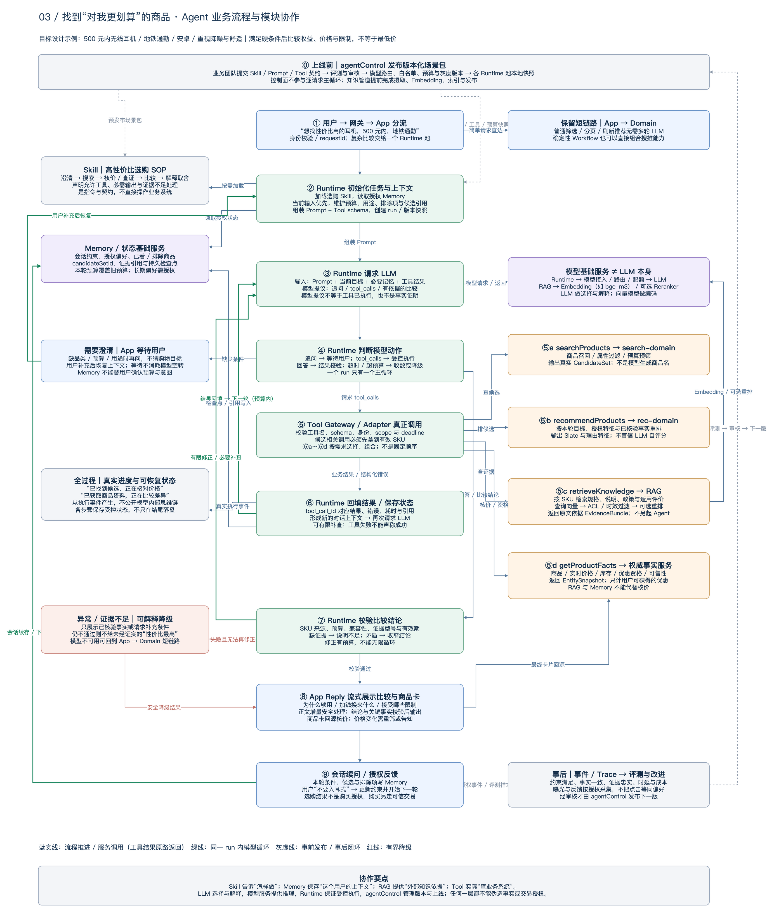

### 场景四（完整案例）：用户寻找高性价比商品，Agent 如何协作

补充日期：2026-10-08。以下是面向生产的业务设计示例，用于解释前述模块如何协作；不表示当前 Demo 已实现全部服务、持久记忆或交易能力。

#### 1. 先把“性价比高”变成可执行的购物目标

用户最初只说：“帮我找一个性价比高的商品。”Agent 不能直接猜用户想买什么，也不能把销量最高、价格最低或推广收益最高当成“最适合”。首先要确认品类、用途和预算；用户已经提供的信息不重复询问，Memory 也不能代替必要的用户确认。

本例经澄清后得到需求：“想买一款 500 元以内的无线耳机，主要在地铁通勤时用，重视降噪和佩戴舒适；用安卓手机，不想为了用不到的功能多花钱。”此时已有明确比较目标，值得进入 Agent 的多步检索和比较流程。若用户只是选择价格筛选或刷新推荐列表，App 仍可直接调用 Domain，不必调用大模型。

**本例中的“高性价比”定义：先满足预算、品类、兼容性和可售性等硬条件，再比较通勤降噪、佩戴、续航与售后等实际收益，以及用户可获得的到手价、使用限制和额外成本。不是只找最便宜，也不是让 LLM 凭感觉生成一个综合分。**

没有可靠测评时，不把“支持主动降噪”直接等同于“地铁降噪效果最好”；佩戴舒适度有个体差异，应说明证据范围与不确定性。比较限定在本次渠道、候选和查询时间内，不承诺“全网最低价”或“绝对最优”。

#### 2. 每个模块扮演什么角色

| 模块 | 在这个案例中做什么 | 不负责什么 |
| --- | --- | --- |
| App / 业务 Workflow | 接收问题、维护可信用户身份、分流、展示追问和商品卡；复杂比较交给对应 Runtime 池 | 不把每次页面刷新都转成多轮 Agent；不把模型生成价格直接展示为事实 |
| agentControl / agent-control | 上线前管理、评测与发布选购 Skill、Prompt、工具白名单、模型路由、预算及灰度版本；线上结果进入反馈评测闭环 | 不逐请求规划，也不在每次 Tool 调用前由管理平台人工审批 |
| Skill | 版本化“高性价比选购 SOP”：澄清 → 找候选 → 查价格和证据 → 比较 → 给出取舍；定义输出和缺证据处理要求 | 不是大模型，也不直接访问商品系统；文本规则不能取代代码权限和交易控制 |
| Runtime / Agent 执行引擎 | 创建 run、读取已发布场景包、装配上下文、调用模型、执行工具、回填结果、限制循环、保存检查点并发送真实进度 | 不把模型提议当作已经执行成功；一次任务不同时由两个 Runtime 控制 |
| Memory / 状态基础服务 | 读取本会话预算、用途、已看商品与排除项；按授权补充旧偏好；保存本轮候选引用、约束与 run 状态 | 不是商品知识库，也不是实时价格源；本次想买耳机不自动写成永久爱好 |
| Prompt / Context | 把系统规则、Skill 指令、本轮需求、必要的 Memory、工具 schema 与已返回事实组织成这一轮模型输入 | 不把知识文档中的指令当成系统命令；不无差别装入用户全部历史 |
| LLM | 识别缺失条件、选择下一步工具、分析候选与证据、提出有依据的比较和自然语言解释 | 不自己连接库存库，不凭空产生有效 SKU、优惠、测评结论或购买授权 |
| 模型基础服务 | 为 Runtime 提供 LLM 推理；为 RAG 提供 Embedding 和按需 Reranker；承担身份、版本、配额、路由与熔断 | 模型接入平台不等于某个 LLM；向量模型不负责生成推荐文案 |
| Tool Gateway / Adapter | 把模型给出的工具名和参数变成经过身份、schema、scope、deadline 校验的真实服务调用 | 不是独立“思考者”；模型不能通过参数伪造 userId 或扩大权限 |
| 搜索 / 推荐 Domain | 搜索符合条件的有效商品；利用授权特征、相关性和集合策略筛选或重排有限候选 | 不能由一段生成文案替代真实召回和排序；不把业务收益当作用户性价比的证明 |
| RAG / 知识服务 | 检索同型号说明书、规格、售后规则、适用测评和评价片段；提供带 SKU、来源、版本与有效期的证据 | 不另开一个 Agent 主循环；不代替实时核价；引用存在不等于结论成立 |
| 商品 / 价格 / 库存服务 | 返回有效 SKU、当前价格、优惠资格、库存、配送与可售条件，用于比较和卡片填充 | 不依赖模型记忆判断价格；不能把未领取、无资格或已过期优惠计入到手价 |

#### 3. 业务流程图：上线前配置、在线执行与反馈闭环

读图方式：中央是一次任务的主流程，左侧是 Skill、Memory、澄清与异常处理，右侧是模型与业务能力。蓝实线表示流程推进或调用，绿线表示工具结果回填后的下一轮模型调用，灰虚线表示事前发布与事后评测。右侧 ⑤a～⑤d 是可选择、可重复的工具，不是固定顺序；无依赖的只读查询可并行，需要候选 SKU 的查询必须等候选就绪。

**图中的两个循环要区分：**在线循环是“LLM 提议 → Runtime 执行 Tool → 结果回填 → LLM 再判断”；离线闭环是“反馈 / Trace → 评测 → 人工审核 → agentControl 发布下一版”。后者不在本次用户请求中临时修改生产策略。

#### 4. 一次请求如何走完

**⓪ 上线前：业务团队发布选购能力。**搜索或推荐团队编写 Skill 和 Prompt，约定允许使用搜索、推荐、商品事实和知识检索工具，以及必需输出和弃权规则。agentControl 将审核通过的场景版本、工具契约、模型路由与预算分发到相应运行池。知识后台提前完成说明书、政策等资料的摄取、切分、Embedding、索引与版本发布；本次用户请求不现场全量建库。Runtime 记录实际使用版本，权限撤销仍须及时生效。

**① App 接入与分流。**网关校验身份，App 判断这是需要澄清和证据对比的购物任务，创建 requestId，并交给搜索池或推荐池中的一个 Runtime。另一个池不会被递归启动。若只是固定筛选，直接走 Domain 短链路。

**② 加载 Skill 与 Memory，形成任务状态。**本例场景路由选择“高性价比选购”Skill；Runtime 按版本加载正文及允许的 Tool schema，读取本会话条件与获授权偏好。若历史记忆中写的是 800 元预算，本次明确的 500 元覆盖旧预算。候选集、排除项、证据引用和步骤状态用结构化字段保存；Prompt 只装入当前必要内容，身份与权限由服务端注入。

**③ Runtime 通过模型服务请求 LLM。**输入包括选购规则、本次目标、已授权上下文、可用工具和先前工具结果。没有品类和预算时，LLM 提议澄清，Runtime 返回追问并进入等待状态；用户补充后恢复上下文，不在空循环中不断请求模型。条件齐全后，LLM 可以返回原生 tool_calls，例如请求搜索耳机候选；这只是“准备调用”的提议。

**④ Runtime 判断下一步并执行业务约束。**模型如果请求 Tool，Runtime 检查白名单、参数、用户权限、剩余时间和调用预算；如果请求回答，则进入结果校验；如果请求澄清，则交给 App 等待用户输入。重试与结束条件由程序统一控制，不能同时交给多个框架各自循环。

**⑤ 真实 Tool 调用业务服务。**以下是本案例的一条示例路径，不是每次都完全相同的固定脚本。

| Tool 示例名（契约示意，不是现有接口承诺） | 谁真正执行 | 结果如何帮助判断性价比 |
| --- | --- | --- |
| searchProducts | search-domain 查询商品索引并做属性与预算预筛 | 得到真实 candidateSetId 和 SKU；索引价格只能预筛，最终仍需核价 |
| getProductFacts | 商品、价格、库存、优惠与资格服务批量查询 | 取得当前可获得的到手价、配置、库存和适用条件，剔除超预算或不可售候选 |
| retrieveKnowledge | RAG 按候选 SKU 和比较维度检索说明、评价及政策 | 得到降噪、连接、续航、保修及限制的 EvidenceBundle；缺失项明确返回 |
| recommendProducts | rec-domain 按本轮目标、授权偏好及已核验特征进行小集合重排 | 在有效候选内比较用户收益、多样性和成本；结果保留理由特征与排序版本 |

RAG 内部是“问题 / SKU → 模型基础服务的 Embedding → 带 ACL、型号与时效过滤的检索 → 可选 Reranker → 证据包”。bge-m3 在本项目中可用于向量化，它不是负责最终回答的 LLM。商品排序模型和知识 Reranker 各有契约，也不能把两种分数直接相加。Domain 排序不直接相信 LLM 提取的未经校验数值；定性资料可留给 LLM 做带引用的解释，可信结构化特征才进入排序约束。

**⑥ 工具结果回填同一个对话。**Runtime 将工具调用与结果对应保存，记录成功、失败和耗时，把 CandidateSet、EntitySnapshot、EvidenceBundle 或其受控引用加入下一轮上下文，再次请求 LLM。工具失败也按结构化事实回填，不能改成“已完成”。如果某款耳机缺少安卓功能限制说明，模型可以在预算内补查；超预算或仍无证据时停止补查，并给出可核实部分或请求澄清。

**⑦ 给出比较，而不是只生成“推荐语”。**证据足够后，LLM 按用户关心的维度组织有限候选的优点、限制和取舍。Runtime 检查 SKU 是否来自候选、是否满足预算和兼容性、证据是否属于当前型号且仍有效、结论能否被引用支持。引用 ID 与原文摘录校验不能完全证明语义忠实；矛盾资料或主观效果不足以核实时，应收窄结论。校验失败时允许有界修正，仍不通过就降级，不展示伪造的精确结论。

**⑧ Reply 校验后流式交付。**向用户呈现“更省钱且够用”“多花的钱能换来什么”“哪些限制需要接受”，而不是一串没有依据的性价比打分。商品卡按 skuId 从权威服务填充最新价格和库存，价格变化导致超预算时重新筛选或告知，不静默放宽条件。普通文本经增量安全处理后流式输出；推荐结论、引用和关键商品事实应经过相应校验再展示，不直接透传未验证的草稿。

**⑨ 保存会话、接收反馈。**Memory 保存此次预算、通勤场景、candidateSetId、已比较与排除的商品及状态；用户明确说“不要入耳式”后，下一轮按新条件重新筛选。长期记忆另遵循同意、来源、时效、纠正与删除机制。授权曝光 / 点击 / 拒绝、Trace 和错误进入评测平台，agentControl 审核后发布下一版 Skill / Prompt / 策略，而不是模型自行改线上配置。

#### 5. 最终用户看到什么

最终答案应类似以下结构；A / B / C 仅为结果结构占位，不是实际商品或本次真实报价。实际展示必须由上述工具结果和证据填充。

| 候选角色 | 应回答的问题 | 需要的依据 |
| --- | --- | --- |
| A：更省钱且满足主要需求 | 为什么便宜一些仍能满足通勤需求？牺牲了什么？ | 当前到手价、必要功能、同型号资料与限制 |
| B：加价后收益更明确 | 比 A 多花的钱换来了哪些本用户确实在意的收益？ | 可比口径的参数或可靠评测；没有证据不声称效果提升 |
| C：不优先推荐或证据不足 | 是超预算、兼容性差、功能用不上，还是资料不足？ | 明确的约束冲突或缺失项；不编造负面评价 |

用户可以看到“已确认预算与用途”“已检索候选，正在核对价格”“已获取商品说明，正在比较差异”等真实过程提示。这些提示由 Runtime 的工具开始、完成和校验事件产生；失败时如实提示，不用动画冒充进展，也不展示模型内部思维链。

推荐卡可以提供“查看差异”“换一批”“更看重舒适”“查看依据”等下一步。用户点击购买时，才进入独立交易域的报价、可信确认、幂等执行和支付流程；选购 Skill 不拥有替用户下单或确认支付的权限。

#### 6. 用一句话串起所有模块

**agentControl 事前发布经过审核的能力；App 选择业务路径；Runtime 加载 Skill、读取 Memory 并组装 Prompt；通过模型服务让 LLM 选择下一步；Tool 真正访问搜推、商品与 RAG；结果回填模型形成有依据的比较；Reply 核验后展示；会话状态与授权反馈支持下一轮和后续版本迭代。**

验收时至少检查：硬约束满足率、实际价格与卡片一致性、证据与型号匹配、越权与数据泄漏、无证据时的弃权、工具失败与预算降级、首个有效结果时延、总成本和用户对取舍的理解程度。不能仅凭“回答流畅”或“用户点击了商品”证明 Agent 找到了高性价比商品。
