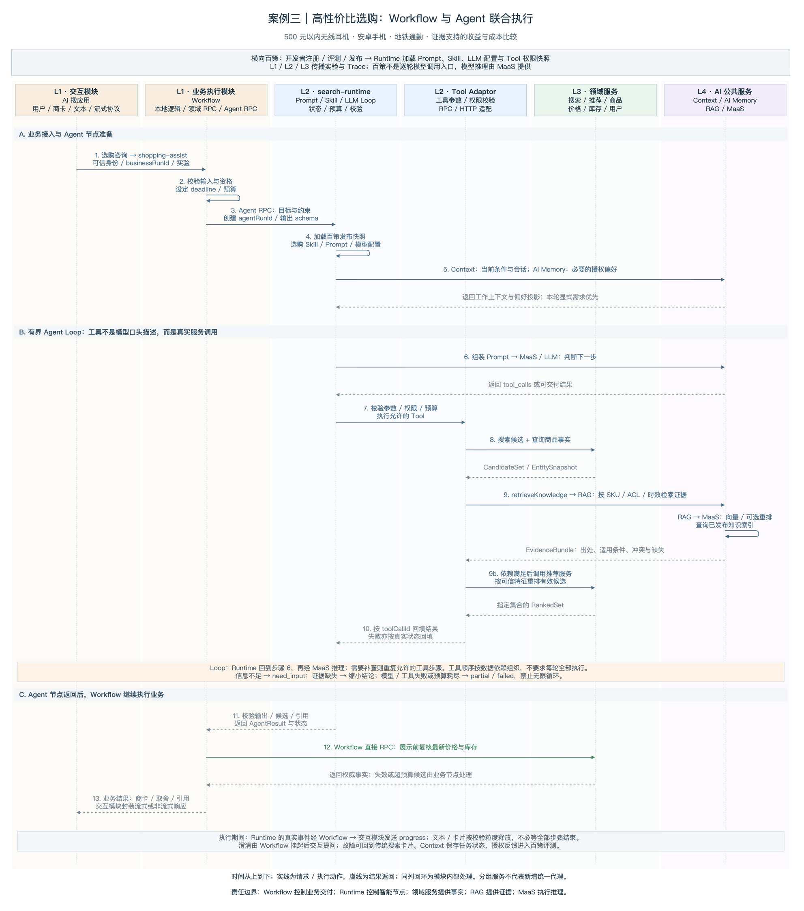
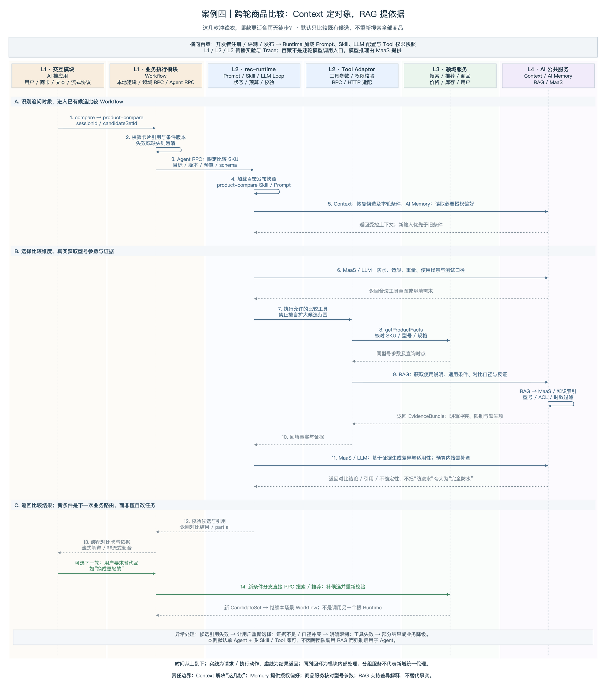
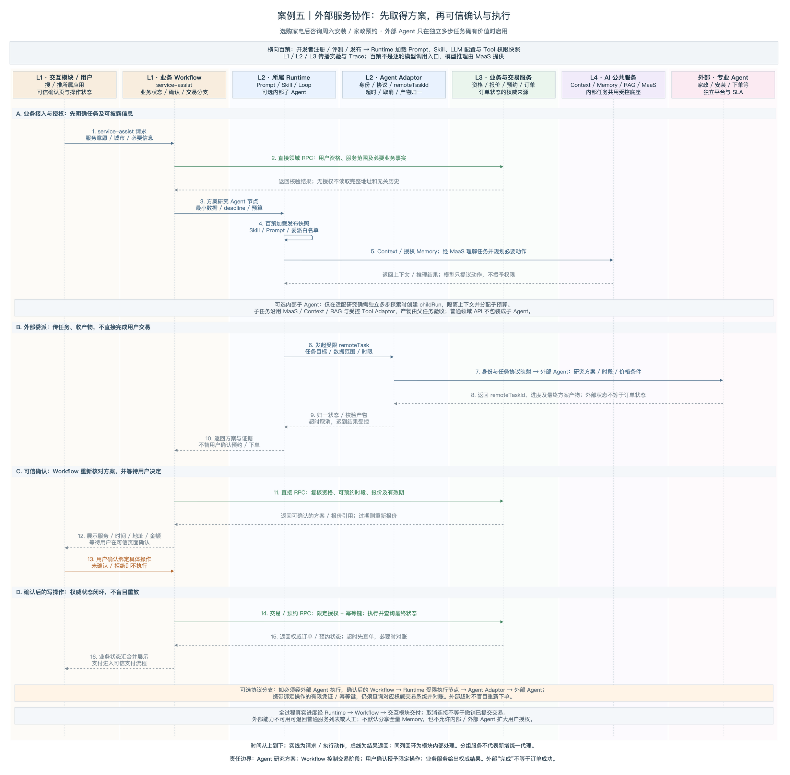

# AI搜索×AI推荐系统架构：案例三、四、五流程图补充

本文仅包含追加到最新线上架构文档对应案例的图与说明，不替换原有架构图、表格及用户修改。图中为目标设计，流程沿时间向下展开；实线为请求或执行，虚线为返回，同列回环为模块内部处理。对应的 `.drawio` 文件支持节点、文字和连线编辑。

## 案例三流程图：高性价比选购

读图说明：L1 搜索交互模块路由到 shopping-assist Workflow；Workflow 以 Agent RPC 调用 search-runtime。Runtime 加载百策发布的 Skill / Prompt / 模型配置，读取 Context 与授权 Memory，经 MaaS 推理，并通过 Tool Adaptor 真实调用搜索、商品、推荐与 RAG。工具结果回填后可以在预算内补查；Agent 返回节点结果后，Workflow 仍直接调用商品服务复核价格库存，再由交互模块交付商卡和解释。图中用服务分组减少重复连线，不要求所有工具一次或每轮全部执行。

异常与交付：缺少条件时 need_input 交回 Workflow 挂起并澄清；知识不足或工具失败时返回部分结果或业务降级。真实进度以及满足校验条件的文本 / 卡片可在运行期间逐步呈现，不等全部步骤完成才输出。

## 案例四流程图：跨轮商品比较

读图说明：L1 推荐交互模块携带 candidateSetId 进入 product-compare Workflow，先确认“这几款”的商品身份与条件版本，再调用 rec-runtime。Context 提供当前候选与会话，AI Memory 仅提供必要授权偏好；Tool Adaptor 获取商品事实及 RAG 引用证据，MaaS 支持比较与有界补查。Runtime 校验后返回 Workflow，交互模块展示对比卡和依据。只有用户提出“换更轻的”等新需求时，才进入下一轮补候选分支，直接调用搜索 / 推荐服务。

异常与交付：卡片引用缺失先澄清；资料不足、型号不符或测试口径冲突不强行给出结论。默认单 Agent 即可，不因复用搜索或 RAG 能力而启动另一个根 Runtime 或子 Agent。

## 案例五流程图：外部服务协作

读图说明：L1 service-assist Workflow 先核验资格和必要授权，再交给所属 Runtime 研究方案；Runtime 经 Agent Adaptor 向外部专业 Agent 委派受限任务，必要时才启用内部子 Agent。外部返回的时段、价格条件和方案只是产物，不是订单成功。Workflow 复核方案并展示可信确认页面；用户确认后，以限定授权和幂等键调用交易 / 预约服务，依据权威状态完成结果交付。

异常与交付：图中实线写操作主路径由 Workflow 直接调用业务域。若对方协议必须经外部 Agent 执行，则确认后通过受限 Runtime 节点与 Agent Adaptor 转发绑定操作的凭证，仍查询权威交易状态并对账。超时先查单而非盲目重试；拒绝或未确认不执行；外部任务结束、流式连接断开均不等于订单成功或交易撤销。
