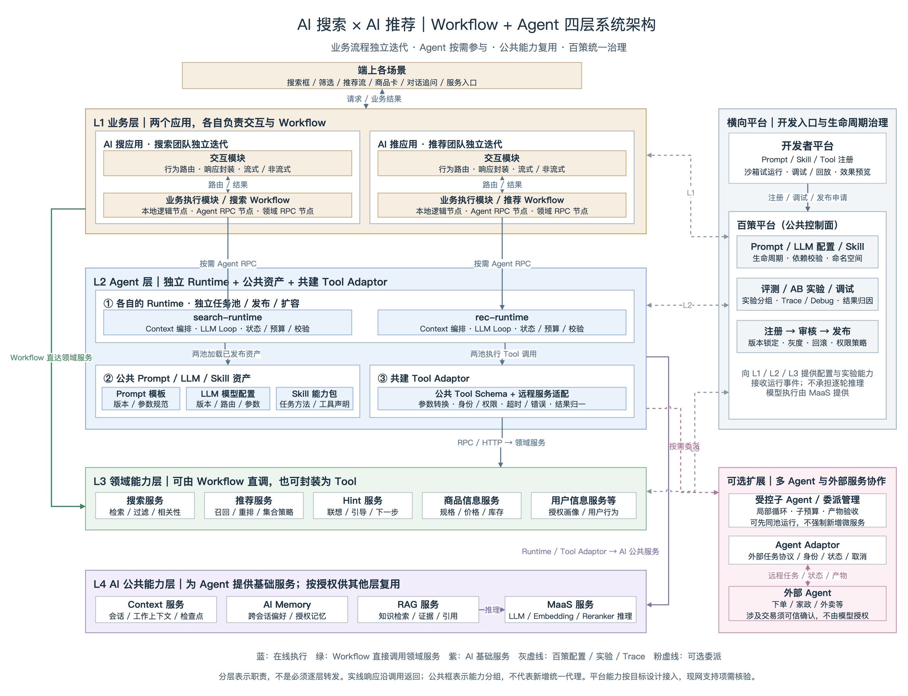

# AI搜索×AI推荐系统架构｜Workflow与Agent协同的四层设计

> 版本：2026-10-09。定位：两套业务应用独立迭代，Workflow 承担业务流程，Agent 按需参与；共享 Prompt / LLM 配置 / Skill，共建 Tool Adaptor，复用领域与 AI 公共服务，通过百策平台统一治理。
>
> 本文参考[原系统方案](https://joyspace.jd.com/pages/K3uGoCwFEEp1zbP9v3Hf)，按本次明确的四层职责重新组织，为独立新文档，不覆盖原文。本文是目标架构设计，不是当前 Demo 的部署现状。百策、MaaS、Context 等以本次给定的平台定位为设计前提，具体接口、能力覆盖、接入方式及 SLA 需与对应平台核验，不将设计能力表述为现网已全部具备。

## 一、总体思路：业务流程为主，Agent 按需参与

### 1.1 AI 搜索、AI 推荐不是“所有请求都交给 Agent”

搜索和推荐同时包含大量确定性业务逻辑与少量需要模型动态判断的任务。架构应允许一个 Workflow 混合执行本地逻辑、领域 RPC 和 Agent RPC，而不是要求用户每次筛选、刷新、点击商品都经过大模型循环。

**控制关系：端上行为 → 交互模块路由 → 业务 Workflow → 按节点执行 → 汇总业务结果 → 交互模块封装响应。Agent 是 Workflow 可以调用的执行能力，不接管整个业务应用。**

| 执行方式 | 谁决定步骤 | 适合什么场景 | 与大模型的关系 |
| --- | --- | --- | --- |
| 传统 Workflow | 业务代码或已发布流程定义 | 价格筛选、翻页、刷新推荐、商品卡聚合、固定搜推融合 | 可以完全不调用大模型 |
| AI 辅助 Workflow | 业务流程决定固定步骤，模型只完成一个明确子任务 | 固定的文本分类、条件抽取、文案生成 | 一次模型调用不等于 Agent；可通过统一 Runtime 的单次推理模式治理 |
| Agent 增强 Workflow | Workflow 决定业务阶段，Agent 在某个阶段内动态选择下一步 | 多轮选购、商品优劣比较、证据补查、复杂任务澄清 | Runtime 管理 LLM → Tool → 结果回填的有界循环 |

Workflow 可以在 Agent 前执行资格校验、召回，在 Agent 后执行库存复核、卡片装配和业务兜底。也可以存在多个串行或并行 Agent 节点，但必须明确数据依赖、预算和汇合条件，不能在应用中另藏一套不受治理的模型循环。

### 1.2 两套应用、两个 Runtime，公共能力复用

- **业务独立：**AI 搜与 AI 推服务的入口、行为体系、业务策略、交付形式和迭代节奏不同，因此保留 ai-search-app、ai-rec-app 两套应用，各自拥有交互模块和业务执行模块。
- **执行隔离：**search-runtime、rec-runtime 分别承接所属场景的 Agent 节点，独立扩容、灰度和回滚；公共执行机制尽量共建，不要求业务配置同步发布。
- **能力复用：**双方按权限复用 Prompt 模板、LLM 模型配置、Skill 与 Tool 契约。共用是“同一资产可被双方引用”，不是所有场景强制使用同一版本或同一模型。
- **领域复用：**搜索、推荐、Hint、商品、用户服务同时服务于传统 Workflow 和 Agent；不因新增 Agent 而复制一套业务服务。
- **平台统一：**百策负责资产、版本、实验、评测与调试观测；MaaS 负责实际模型访问和推理；Context、AI Memory、RAG 分别提供上下文、记忆与知识证据能力。

## 二、系统架构图

### 2.1 如何阅读这张图

1. **L1 业务层**有两套业务应用，每套都包含交互模块和业务执行模块。Workflow 中既能调用 Agent，也能直接调用 L3 专业服务，还能执行本地逻辑。
2. **L2 Agent 层**分三部分：双方独立的 Runtime；公共 Prompt / LLM 配置 / Skill 资产；双方共建的 Tool Adaptor。资产由百策管理，实际执行由 Runtime 驱动。
3. **L3 领域能力层**承载已有专业服务。绿线明确表示 Workflow 直接调用 Domain，不必经过 Runtime 或 Tool Adaptor。
4. **L4 AI 公共能力层**提供 Context、AI Memory、RAG、MaaS 等服务。L2 按需直接访问这些服务，不是先经过 L3 再到 L4。
5. **右侧横向平台**包括开发者平台和百策。灰色虚线表示配置、实验和观测交互，不是用户请求必须经过的同步业务链路。
6. **右侧可选扩展**表示 Runtime 可支持内部子 Agent，以及通过 Agent Adaptor 接入外部下单、家政、外卖等 Agent，不要求首期全部实现。

分层表达职责，不是严格的逐层网络代理关系。图中大框是逻辑分组，不代表必须新增一个服务；响应沿原调用返回，公共依赖未逐条展开。L2 的“LLM”指模型使用配置、调用策略和运行绑定，不是把推理服务重复部署在 Agent 层，实际模型调用统一走 L4 MaaS。

### 2.2 相比原方案的主要调整

| 原方案中已有的思路 | 本版进一步明确的边界 |
| --- | --- |
| App 负责场景、Runtime 执行任务 | App 拆成“交互模块 + 业务执行模块”，Workflow 是端到端业务流程的控制者 |
| 六层逻辑分工 | 按此次要求重组为四层；数据存储由所属领域 / AI 服务维护，治理平台横向贯穿 |
| 两套场景应用、两个 Runtime 池 | 保留独立性，公共资产和适配能力显式共用，避免业务流程绑在同一个发布周期 |
| agentControl 管理能力 | 在本设计中由公共百策承担相应治理职责，开发者平台作为使用入口，不再另建一套重复管理系统 |
| 模型、Memory、RAG 底座 | 增加 Context 的独立职责，区分上下文、长期记忆、知识证据与 MaaS 推理 |
| 可选多 Agent | 显式区分 Tool Adaptor 与 Agent Adaptor，前者访问服务动作，后者委派外部任务 |

## 三、四层模块职责与服务边界

### 3.1 第一层：业务层

两套应用拥有同样的模块划分，但可以使用不同的业务代码、Workflow 目录、返回卡片和实验策略。交互模块与业务执行模块可以先在同一应用内按模块组织，不强制拆成两个微服务。

#### 交互模块：把端上行为变成正确的业务请求

| 职责 | 具体工作 | 不应承担的工作 |
| --- | --- | --- |
| 接入与上下文标识 | 识别可信用户、场景、端能力、会话、请求和权限；规范化输入事件 | 不从模型返回中接受用户身份覆盖 |
| 行为路由 | 根据 sceneId、actionType、会话阶段和已发布路由规则，选择 Workflow 与版本 | 不要求每个点击都先用 LLM 判断；不允许端上任意指定内部 Skill / Tool |
| 响应封装 | 将业务结果映射为商卡、文本、对比卡、Hint、澄清表单、操作状态等 | 不重新实现搜索、推荐和商品事实核验 |
| 双输出协议 | 根据端能力提供非流式聚合响应，或流式状态、文本与卡片事件 | 不将未经校验的模型原始 token 直接当成完整业务响应 |
| 用户行为回传 | 接收曝光、点击、修改条件、拒绝、取消等授权事件，带上任务与实验标识 | 不把一次点击自动解释成购买成功或永久偏好 |

建议将路由维护为可发布的场景配置，而不是一组不可追踪的散落判断。例如：

| 应用 / 端上行为 | 交互模块选中的 Workflow | 典型响应 |
| --- | --- | --- |
| AI 搜：提交已有明确条件的查询 | search-list | 商卡列表、筛选项、分页信息 |
| AI 搜：调整预算或品牌筛选 | search-filter | 非流式结果列表，或逐批卡片 |
| AI 搜：提交开放式选购问题 | shopping-assist | 澄清、进度、商卡及解释 |
| AI 推：刷新推荐流 / 换一批 | feed-refresh | 推荐商卡和 Hint |
| AI 推：点击“比较这几款”或追问差异 | product-compare | 对比卡、引用和流式解释 |
| AI 推：请求预约外部服务 | service-assist | 方案卡、确认页入口和任务状态 |

路由可以先进入一个固定解析 Workflow，再依据结果选择分支；路由能力自身是否需要模型应由场景决定，而不是默认所有入口都 Agent 化。

#### 业务执行模块：拥有 Workflow 和业务执行状态

| 节点类型 | 谁执行 | 示例 | 关键约束 |
| --- | --- | --- | --- |
| 本地逻辑节点 | 本应用内的业务代码 | 参数校验、条件合并、资格判断、去重、结果装配、分支与汇合 | 不把专用算法或远程数据复制到应用层 |
| 领域 RPC 节点 | L3 专业服务 | 搜索候选、推荐重排、查询 Hint、商品和用户信息 | 可直接 RPC，不经过 Agent，也不要求调用 Tool Adaptor |
| Agent RPC 节点 | 本场景 Runtime | 需求澄清、商品比较、证据研究、动态补查 | 明确目标、输入产物、允许工具、输出 schema、deadline 和预算 |

Workflow 负责节点顺序、依赖、分支、超时、重试、业务降级、最终汇合和可恢复的业务状态。Runtime 只负责一次 Agent 节点内部的循环，不替 Workflow 决定交易阶段是否通过。

**关键状态边界：**一次业务请求用 businessRunId 标识；其中每个 Agent 节点可创建独立 agentRunId。Agent 返回 completed、need_input、partial、failed 等结构化状态，由 Workflow 决定继续、等待用户补充、降级或终止。need_input 不是保持 RPC 无期限阻塞：长任务应保存状态、返回任务句柄和澄清产物，用户下一次输入再由交互模块路由恢复。最终业务交付 Owner 始终是入口应用。

### 3.2 第二层：Agent 层

#### A. 双方各自的 Runtime

| Runtime 职责 | 实现要求 |
| --- | --- |
| 接收 Agent 节点请求 | 验证任务、调用方、场景、预算、允许能力和输入 schema；不启动另一个场景的根任务 |
| 加载已发布能力 | 通过百策发布接口 / SDK / 配置通道解析并加载 Prompt、模型路由与版本、Skill 及权限策略，固定本次运行快照 |
| 构建模型输入 | 根据 Context 服务返回的工作状态，结合授权 Memory、Skill 指令和工具证据组装 Prompt，并控制上下文大小 |
| 执行模型循环 | 经 MaaS 调用 LLM，接收工具意图，校验后执行，回填工具结果，再次推理直到满足输出或停止条件 |
| 调用公共 Tool | 使用共建 Tool Adaptor，真实访问领域 / AI 服务；模型生成 tool call 不等于工具已经执行 |
| 维护运行状态 | 维护消息、toolCallId、检查点、取消、耗时、并发及预算；不能把会话持久化直接等同于任意步骤可恢复 |
| 交付结构化结果 | 输出可验证的文本、候选引用、证据与状态；交回 Workflow，不直接绑定端上的卡片协议 |
| 可选委派 | 按策略创建内部 childRun 或外部 remoteTask，分配子预算并验收产物；不无限递归 |

search-runtime 与 rec-runtime 是两套运行服务 / 资源池，不是两套模型推理集群。建议共建接口、执行机制和可复用内核；若业务技术栈不同，也可以先共建契约与兼容测试，逐步收敛实现，不以统一语言为架构成立的前提。

#### B. 公共 Prompt、LLM 配置与 Skill

| 公共资产 | 定义 | 谁执行 / 管理 |
| --- | --- | --- |
| Prompt 模板 | 系统规则、输入变量、输出约束及引用表达要求 | 百策管理版本，Runtime 按任务渲染 |
| LLM 模型配置 | 模型标识、可解析版本、MaaS 路由、推理参数、结构化输出 / 工具能力要求和回退策略 | 百策管理使用配置；MaaS 验证可用路由并执行推理，返回实际模型版本 |
| Skill 能力包 | 某类任务的方法、指令、资源、工具依赖、输入输出及停止要求 | 百策管理发布；Runtime 加载，LLM 与程序执行机制共同完成任务 |

公共资产使用命名空间、Owner、版本与访问范围。例如搜索和推荐均可引用 product-compare Skill，但各自绑定经过验证的版本、模型配置与场景参数。底层工具权限仍由 Runtime 和服务端强制校验，不能仅靠 Skill 文本写一句“禁止越权”。

共享资产更新先产生新版本，不直接覆盖所有线上使用者。模型配置的发布需要校验 MaaS 路由是否存在、是否支持所需工具协议、Prompt 参数和 Skill 依赖是否兼容；“登记了一个模型名”不等于已经有可用的模型推理资源。

#### C. 共建 Tool Adaptor

Tool 是模型可识别的 schema 和受控动作；Tool Adaptor 是将这些动作映射到真实 RPC / HTTP 服务的执行适配层。它对接服务，不承接完整购物业务编排。

| 公共 Tool 示例 | 适配的服务 | 典型产物 |
| --- | --- | --- |
| searchProducts | 搜索服务 | CandidateSet：候选、硬约束摘要、检索版本 |
| rankCandidates | 推荐服务 | RankedSet：在给定候选集合内的重排与理由特征 |
| getHints | Hint 服务 | 结构化下一步选项，不允许任意执行动作 |
| getProductFacts | 商品信息 / 价格库存服务 | EntitySnapshot：SKU、规格、价格条件、库存与查询时间 |
| getUserProfile | 用户信息服务 | 经授权的画像与历史行为投影，不含无关原始隐私 |
| retrieveKnowledge | RAG 服务 | EvidenceBundle：来源、型号、有效期、引用与缺失项 |

Tool Adaptor 统一处理参数映射、schema 校验、身份传递、超时、有限重试、错误归一、限流和 Trace；专业检索、排序和业务规则仍由原服务负责。RPC / HTTP 已满足接入时不强制改成 MCP。

**部署建议：**初期可以做成两个 Runtime 共用的 SDK / 模块，而非强制独立中转服务。只有在凭据托管、跨网络出口、语言隔离或集中治理需要时，再部署独立 Tool Gateway，并评估新增时延和故障点。公共 Tool 不意味着所有场景、所有用户都有调用权限。

### 3.3 第三层：领域能力层

| 领域服务 | 对 Workflow 与 Agent 提供的能力 | 主要 Owner |
| --- | --- | --- |
| 搜索服务 | 条件检索、过滤、相关性、候选集合与必要检索提示 | 搜索领域团队 |
| 推荐服务 | 个性化召回、指定候选重排、集合策略、多样性与去重策略 | 推荐领域团队 |
| Hint 服务 | 联想、澄清选项、下一步建议及场景引导 | 指定 Hint 能力 Owner；搜推共同定义输出契约 |
| 商品信息服务 | 商品规格、售卖状态、价格与促销条件、库存等权威事实 | 商品、价格与库存领域团队 |
| 用户信息服务 | 授权画像、偏好特征、历史行为及用户资格 | 用户 / 数据领域团队 |
| 其他专业服务 | 物流、售后、优惠、服务供给等已有能力 | 对应领域团队 |

**同一服务，两种入口：**Workflow 用领域客户端直接调用；Agent 经 Tool Adaptor 调用。两条路径都使用同一底层业务契约、鉴权与限流，Tool 封装不成为绕过业务规则的旁路。领域服务不依赖某个 Skill 才能提供基础功能。

候选重排接口应明确输入集合与条件版本；如果推荐服务需要补充召回，应使用明确的补召回接口或模式，不能在“只重排这些 SKU”的契约中静默插入其他商品。搜索相关性、推荐排序分数和 RAG 检索分数各有语义，不直接相加。

### 3.4 第四层：AI 公共能力层

| 服务 | 负责什么 | 与相邻能力的边界 |
| --- | --- | --- |
| Context 服务 | 当前会话消息、条件、候选引用、工具产物引用及 Agent 检查点；提供隔离读写、版本和 TTL，可提供受控摘要 | 面向当前任务的工作上下文；不自动将所有会话内容变成长期偏好。Runtime 决定本次 Prompt 的组装策略 |
| AI Memory | 经授权、可追溯、可纠正和可删除的跨会话偏好与经验 | 不是用户信息服务的全量副本；关键资格、身份和购买事实仍向权威领域核验 |
| RAG 服务 | 知识接入、清洗 / 切分、索引发布；在线带 ACL、型号及有效期检索、重排、引用证据返回 | 不是实时商品价格库，也不是用户长期记忆；向量索引只是实现手段之一 |
| MaaS 服务 | LLM、Embedding、Reranker 等模型的访问、版本、推理、配额、限流和故障回退 | 负责模型执行，不负责业务 Workflow、Skill 生命周期或任务状态 |

典型依赖为：Runtime 调用 Context / Memory 并经 MaaS 推理；知识 Tool 通过 Tool Adaptor 调用 RAG；RAG 查询和索引任务通过 MaaS 使用 Embedding / Reranker。上述能力也可以按授权被固定 Workflow 或领域服务复用，不因为画在第四层就只能由第二层使用。

Context 的会话与 Agent 状态、Workflow 的业务执行状态、交易域的订单状态要分别有明确真源。即便底层复用存储，也不能让三个模块无约束地修改同一份状态。跨场景传递上下文应传受控引用或必要投影，不默认开放搜推双方的全部历史。

RAG 线上查询使用已经发布的知识索引；索引构建与增量更新是后台流程，不由每次用户请求触发。生产共享索引需要持久化、权限更新、删除同步和版本管理，本地内存向量库适合开发或缓存，不作为多副本系统的唯一知识真源。

## 四、百策与开发者平台：资产如何变成线上能力

### 4.1 开发者平台是入口，百策是公共治理控制面

开发者平台提供统一操作入口，可以作为百策已有界面 / API 的扩展，而不是另建独立的资产真源。开发者可注册 Prompt 模板和 Skill，绑定模型配置、工具依赖和测试集，进行试运行、调试与效果比较；百策负责其生命周期、实验、评测、Trace / Debug 和发布治理。

| 环节 | 开发者 / 团队做什么 | 平台产物与上线条件 |
| --- | --- | --- |
| 注册草稿 | 填写资产 ID、Owner、命名空间、输入输出、工具依赖和适用场景 | 草稿版本；注册成功不等于线上立即可用 |
| 沙箱调试 | 用指定测试身份、数据范围和非生产写权限运行真实调用流程，查看工具及模型结果 | 可关联的 Trace、错误、成本和效果记录；副作用操作需隔离 |
| 自动与人工评测 | 验证约束满足、证据、Schema、失败降级、安全与成本 | 评测报告及准入结论；不只比较回答流畅度 |
| 审核与实验 | 确认依赖、模型可用性、数据权限、配额及实验配置 | 被审核的发布包与灰度计划 |
| 发布生效 | 发布不可变的版本组合，配置允许的场景与流量 | 可被 Runtime 解析的 ReleaseManifest；灰度失败可回滚 |
| 运行加载 | Runtime 根据业务传入的场景、实验和发布标识加载资产快照 | 记录实际 Prompt / Skill / 模型 / Tool 版本；热加载需受控 |
| 反馈迭代 | 使用授权业务反馈和运行证据定位问题，再提交新版本 | 不允许模型自行改线上配置，也不让调试版本污染生产 |

“注册生效后 Runtime 就可以用”的准确含义是：**资产通过必要审核并发布到对应环境 / 场景后，Runtime 才具备加载资格；最终是否选用由场景绑定、实验和权限决定。**

### 4.2 第一、二、三层分别怎样与百策交互

| 层级 | 消费百策什么能力 | 向百策 / 观测系统回传什么 |
| --- | --- | --- |
| L1 业务层 | 已发布的场景路由、实验配置、能力绑定；如现有 Workflow 系统管理流程定义，百策关联版本而非重复托管 | sceneId、Workflow / 节点版本、结果质量、端到端时延与授权业务反馈 |
| L2 Agent 层 | Prompt、LLM 配置、Skill、Tool schema / 权限引用、预算、发布与委派策略 | 推理、Tool 调用、检查点、错误、成本、实际模型版本及 Agent 结果 |
| L3 领域层 | 与场景相关的实验参数和策略版本绑定；已有领域配置平台可保留真源，通过引用关联 | 候选 / 排序版本、服务状态、延迟、错误、数据版本及结果标识 |

百策不替代业务代码仓库、领域算法平台、MaaS 资源管理和底层存储。配置与发布是控制面，运行时模型 / 工具调用是数据面；不能把每一轮 LLM 推理都串行等待开发者控制台。

Runtime 可以按任务解析一次有效发布快照，或使用本地缓存的已签发版本。发布通道不可用时，是否继续使用有效快照由策略决定；首次加载、版本不兼容或权限无法确认时应拒绝或降级。安全撤权必须有独立的可强制执行机制，不能因缓存而永久失效。

### 4.3 实验、版本和 Trace 必须能贯穿一条业务链

建议入口为每个业务任务解析一次实验上下文，并逐层传播；不是要求所有领域只能有同一个实验，而是让跨层实验组合有明确的分组、互斥 / 叠加规则和归因记录。领域层不得在同一实验中自行随机再分组。

一次运行至少记录：businessRunId、workflowId / version、nodeId、agentRunId、releaseId、Prompt / Skill 版本、MaaS 实际模型版本、Tool / Domain 契约版本、实验标识及 Trace ID。回退到另一模型或策略时记录实际使用版本，不能仍归因为原模型。

调试应展示任务输入、发布版本、必要的 Prompt 投影、工具请求 / 结果、阶段事件与错误，敏感字段按角色脱敏和限期保留。真实进度不是模型内部思维链，不需要把隐式推理过程暴露给用户或无限保留在日志中。

## 五、跨系统协作的真实业务案例

以下为现实业务场景的目标执行设计，用来说明系统如何协作，不表示已实际调用服务、已生成报价或已完成交易。每个案例区分本地节点、领域 RPC 和 Agent RPC；案例中的 Workflow / Skill 名称为建议命名。

### 案例一：搜索结果页调整筛选——纯 Workflow，不启动 Agent

**用户行为：**已经在搜索“无线耳机”，把价格筛选改为“500 元以内”，点击“仅看有货”。

**业务路径：搜索交互模块 → search-filter Workflow → 搜索 / 推荐 / 商品服务 → 搜索交互模块。**

| 步骤 | 模块 / 节点 | 执行动作与协作 |
| --- | --- | --- |
| 1 | 搜索交互模块 | 校验场景与身份，根据 filter_change 路由到 search-filter，读取已发布的路由 / 实验快照 |
| 2 | 本地节点 | 合并用户明确筛选条件，生成新条件版本；校验分页、预算和字段 |
| 3 | 搜索 RPC 节点 | 搜索服务按条件返回候选及原排序，带 CandidateSet 标识 |
| 4 | 推荐 RPC 节点（按业务需要） | 推荐服务只在该候选内做固定的个性化重排；此步骤由 Workflow 定义，不由 LLM 临时决定 |
| 5 | 商品 RPC + 本地节点 | 获取价格库存并移除失效商品；去重、分页、组装业务结果，不静默放宽筛选条件 |
| 6 | 搜索交互模块 | 返回商卡、筛选项和分页信息；通常使用非流式响应，有逐批展示需求时也可用流式卡片事件 |

**这里不需要什么：**不加载选购 Skill，不启动 Agent Loop，不要求调用 RAG 或 MaaS。百策仍用于已发布配置、实验和链路归因，不因没有 Agent 就不参与治理。

**失败与团队协作：**搜索团队拥有 Workflow 和端到端交付；推荐团队提供可选重排，超时可保留搜索排序；商品事实不完整时不承诺实时库存。这个案例体现“AI 搜应用不等于每次请求都是 Agent 场景”。

### 案例二：刷新推荐流并展示下一步引导——传统服务与本地节点协作

**用户行为：**在推荐页点击“换一批”，此前明确选择过“通勤”“轻便”，并排除了某类商品。

| 步骤 | 模块 / 节点 | 执行动作与协作 |
| --- | --- | --- |
| 1 | 推荐交互模块 | 将 refresh 行为、当前场景和已展示集合引用路由到 feed-refresh |
| 2 | 用户 RPC 节点 | 用户服务返回允许使用的画像投影及行为特征；无授权时按匿名 / 场景策略执行 |
| 3 | 推荐 RPC 节点 | 推荐服务执行召回、排序与去重策略，输出推荐候选 |
| 4 | 商品 RPC + Hint RPC 节点 | 商品服务补全商卡事实；Hint 服务根据场景返回“更轻便”“预算更低”等可执行选项 |
| 5 | 本地节点 | 进行资格过滤、限额、结果汇合和卡片装配，不把推荐服务的内部打分直接展示为事实 |
| 6 | 推荐交互模块 | 返回商卡与结构化 Hint；用户点击 Hint 后再次按动作路由到明确的 Workflow |

**可选 AI 辅助：**如果需要将已确定的 Hint 改写成更自然的短句，可在固定位置设置一个单次模型节点，经 Runtime 统一加载 Prompt / 模型配置并调用 MaaS。该节点不允许模型自由选择工具，失败返回原始 Hint 文案，仍然不是多步 Agent 场景。

**团队协作：**推荐团队独立维护入口和 Workflow；用户、商品与 Hint Owner 保障契约；只在明确需要时复用公共模型资产，不为普通刷新引入额外 Agent 循环。实验上下文贯穿服务，反馈由推荐应用归集。

### 案例三：找到高性价比耳机——Workflow 与 Agent 联合工作

**用户需求：**“想买一款 500 元以内的无线耳机，主要地铁通勤，用安卓手机，重视降噪和舒适，不想为用不到的功能多花钱。”

“高性价比”在本例中指：先满足预算、兼容性和可售性，再解释价格、功能、体验证据与限制的取舍。不是只挑最低价，也不让 LLM 凭感觉生成一个“全网最优分数”。

| 步骤 | 执行位置 | 系统协作与产物 |
| --- | --- | --- |
| 1. 路由 | AI 搜交互模块 | 根据选购咨询行为选择 shopping-assist Workflow；分配 businessRunId、实验和响应模式 |
| 2. 前置校验 | Workflow 本地节点 | 校验用户与输入，设定总时限和能力范围，构造选购 Agent 节点请求 |
| 3. 按需调用 Agent | Workflow → search-runtime RPC | 创建 agentRunId，将用户目标、允许服务、结果 schema 和预算交给 Runtime；缺条件则返回 need_input，由 Workflow 暂停并交互澄清 |
| 4. 加载公共能力 | Runtime ↔ 百策 | 解析 shopping-value Skill、Prompt、LLM 配置和工具依赖的已发布快照；不是读取开发者未发布草稿 |
| 5. 准备工作上下文 | Runtime → Context / AI Memory | Context 提供当前会话、条件和候选引用；Memory 只提供已授权长期偏好；本轮明确需求优先 |
| 6. 推理与工具执行 | Runtime → MaaS；Runtime → Tool Adaptor | LLM 根据任务返回 tool call，Runtime 校验后执行；通过 searchProducts 获取候选，通过 getProductFacts 获取价格、库存和参数 |
| 7. 获取比较依据 | Tool Adaptor → RAG → MaaS / 知识索引 | RAG 按 SKU、型号、权限与时效检索说明、测评和使用限制，必要时 Embedding / Reranker 推理，返回 EvidenceBundle |
| 8. 排序与有界补查 | Tool Adaptor → 推荐服务；Runtime ↔ MaaS | 对有效候选重排；将结果回填模型。资料不足可预算内补查，仍缺证据则说明限制，不制造降噪效果或舒适度结论 |
| 9. Agent 节点完成 | Runtime → Workflow | 输出建议、候选引用、差异、证据及缺失项；校验 SKU、约束、引用与输出 schema，返回 completed 或 partial |
| 10. 业务后处理 | Workflow → 商品服务；本地节点 | 再核对将展示的价格与库存，处理失效候选，汇合结果。价格变化导致超预算时重新筛选或告知，不静默替换已解释的商品 |
| 11. 用户交付 | Workflow → 搜索交互模块 | 封装商卡、对比文本与引用；执行期间已可发送真实进度，满足校验条件的文本和卡片按阶段流式释放 |
| 12. 状态与反馈 | Workflow / Runtime → 状态与平台 | 分别保存业务进度和 Agent 上下文；授权反馈与 Trace 用于评测，长期记忆写入另走政策 |

**用户看到的不是内部工具日志：**可以看到“已确认需求”“已找到符合预算的候选，正在核对说明”“已完成对比”等执行事件；最终看到“更省钱且够用”“加价能换来什么”“哪些限制需要接受”。没有同口径测评时不能把“支持主动降噪”说成“地铁降噪最好”。

**失败兜底：**MaaS 不可用时，Workflow 可回到按已确认条件的传统搜索结果；RAG 无证据时只展示可信事实与缺失说明；推荐超时保留合格搜索排序。流式交付应标明 partial / error / done 状态，不把中途失败伪装成完成。

**团队协作：**搜索团队负责本案例 Workflow 与用户交付；推荐团队提供排序能力；知识团队提供证据；公共平台提供百策、MaaS、Context / Memory。若同一咨询从推荐入口发起，则推荐团队负责 Workflow 并调用 rec-runtime，但仍可复用同一 shopping-value Skill 和 Tool，而不是调用 search-runtime 再启动另一根任务。

### 案例四：推荐后追问“这几款哪款更适合雨天徒步？”——跨轮 Context 与 RAG

**用户行为：**推荐流已经展示三款冲锋衣，用户点击“比较这几款”，追问下雨徒步的适用性。

| 步骤 | 模块 / 节点 | 执行动作与协作 |
| --- | --- | --- |
| 1 | 推荐交互模块 | 根据 compare 行为和当前 candidateSetId 路由到 product-compare Workflow |
| 2 | Workflow 本地 / 状态读取节点 | 核对卡片引用及条件版本，明确“这几款”是哪几个 SKU；引用不存在则要求选择，不让模型猜测 |
| 3 | Workflow → rec-runtime | 调用受限商品比较节点，绑定公共 product-compare Skill，默认只比较指定集合 |
| 4 | Runtime → Context / Memory / MaaS | 读取本轮会话和必要偏好，形成比较目标；重点确定防水、透湿、重量、用途与测试口径 |
| 5 | Tool Adaptor → 商品服务 / RAG | 核对型号、规格、使用说明、资料有效期及证据缺失；不是每次知识查询都再调用搜索服务 |
| 6 | Runtime → Workflow | 返回带引用的差异与限制；不把“防泼水”夸大成“完全防水”，资料矛盾时说明范围 |
| 7 | Workflow → 推荐交互模块 | 完成卡片装配，以流式解释和对比卡展示；用户改为“换成更轻的”后，再路由补候选分支 |

**为什么需要三个不同的公共能力：**Context 解决“这几款”和当前条件；AI Memory 提供授权的跨会话偏好；RAG 提供防水与适用性知识证据，三者不能互相代替。商品服务负责同型号参数与实时事实。

**团队协作：**推荐团队负责比较体验；搜索 / 知识能力 Owner 提供 RAG 契约和资料质量，双方共用 Skill。只有需要替代商品时才显式调用搜索服务补候选；不为了跨团队复用而创建子 Agent。

### 案例五：选购后预约家政安装或下单服务——可选外部 Agent 协作

**用户需求：**“帮我选好这款家电，再看看周六上午是否能预约安装 / 家政服务，合适的话给我确认。”

该例假设存在已接入、已授权且具备相应能力的外部服务 Agent，不表示所有下单或预约接口都应该包装成 Agent。若只是查询预约库存或提交已确认订单，一般领域 API 和固定 Workflow 就够了；只有外部系统本身需要多步沟通、规划或异步处理时才采用任务委派。

| 阶段 | 模块协作 | 权限与状态要求 |
| --- | --- | --- |
| 业务分支 | 交互模块选择 service-assist Workflow，先核对用户意愿、服务城市与必要信息 | 未授权时不读取完整地址和无关购买历史 |
| 方案研究 | Workflow 调用所属 Runtime；Runtime 可在政策允许时使用内部子 Agent 分别研究商品适配和安装要求 | childRun 拥有独立上下文与子预算；主任务验收证据，不直接写长期 Memory |
| 外部委派 | Runtime → Agent Adaptor → 家政 / 安装 Agent，传必要任务信息与 deadline | Agent Adaptor 做身份、协议、remoteTaskId 映射、超时与取消；仅传所需数据 |
| 获取方案 | 外部 Agent 返回服务方案、可预约时段、价格条件和有效期，Agent Adaptor 归一状态与产物 | 外部“完成”只代表任务产物已返回，不代表订单已创建或服务已预约成功 |
| 用户确认 | Runtime 把方案交回 Workflow，Workflow 校验报价与资格；交互模块展示可信确认页面 | 用户对明确服务、时段、地址和金额确认；模型不能替用户确认 |
| 执行预约 / 下单 | 确认后由 Workflow 调用交易 / 预约服务；如协议必须经外部 Agent，携带绑定操作的有限授权凭证 | 写操作使用幂等键、状态查询与对账；超时先查单，不盲目重试 |
| 返回结果 | 业务服务返回权威订单 / 预约状态，Workflow 汇合并由交互模块展示 | 支付进入可信支付流程；不能把 Agent 文本“已成功”当成订单事实 |

**内部子 Agent 与外部 Agent 的边界：**内部子任务由本方 Runtime 管理局部循环；外部 Agent 拥有独立运行平台和发布体系，经 Agent Adaptor 按任务契约合作。二者都继承主任务的权限上限和总预算，不得自行扩大服务范围、替用户下单或互相无限递归。

**团队协作：**入口搜 / 推团队负责 Workflow、确认和用户交付；Agent 平台共建委派与 Agent Adaptor；服务供给方负责专业方案和服务 SLA；交易域负责订单真源。外部 Agent 不可用时返回可确认的已有方案、转普通服务列表或引导人工，不无限等待。

## 六、调用契约、输出协议与运行保障

### 6.1 主要调用关系

| 调用方 | 被调用方 | 调用目的 | 不允许混淆的边界 |
| --- | --- | --- | --- |
| 交互模块 | 本应用业务执行模块 | 路由 Workflow，获取状态和业务结果 | 不直接把端行为变成任意 Tool 指令 |
| Workflow 节点 | 本地逻辑 / L3 服务 | 执行业务规则、查询或固定服务组合 | 无需先经过 Agent 或 Tool Adaptor |
| Workflow Agent 节点 | 本场景 Runtime | 执行有边界的智能任务 | Runtime 返回节点结果，不接管全部 Workflow |
| Runtime | 百策发布能力 | 解析 Prompt / LLM / Skill 与能力版本 | 加载配置不等于模型推理 |
| Runtime | MaaS | LLM 推理与受控模型回退 | 不通过百策页面执行推理，不在每个应用另配模型密钥 |
| Runtime | Context / AI Memory | 读写工作上下文，访问授权记忆 | 当前状态和长期偏好分开管理 |
| Runtime | Tool Adaptor → L3 / RAG 等 | 执行通过校验的 Tool | Tool 结果必须来自实际服务执行，不把模型的调用提议当成功 |
| RAG | MaaS / 知识索引 | 向量化、检索、可选重排与证据组织 | 在线查询不临时重建整库索引 |
| L1 / L2 / L3 | 百策 / 观测能力 | 配置、实验、调试、Trace 与评测归因 | 不能每层独立打散同一实验的流量归属 |
| Runtime（可选） | 子任务执行器 / Agent Adaptor → 外部 Agent | 受限委派并接收产物 | 不把专业 RPC 包装成无必要的 Agent，不递归启动另一场景根任务 |

### 6.2 建议的最小产物契约

下列为逻辑契约建议，实际字段及协议由双方与平台协商；身份和权限字段来自可信服务，不接受客户端或模型随意覆盖。

| 契约 | 关键内容 |
| --- | --- |
| InteractionRequest | sceneId、actionType、可信主体、sessionId、用户输入、卡片引用、responseMode、requestId |
| WorkflowContext | businessRunId、workflowId / version、当前 nodeId、约束版本、实验上下文、预算和 deadline |
| AgentTask | agentRunId、节点目标、输入产物引用、releaseId、输出 schema、允许 Tool / Agent 范围、contextRef、预算 |
| AgentResult | completed / need_input / partial / failed、文本与证据、候选引用、下一步输入需求、错误与实际版本 |
| CandidateSet / RankedSet | 集合 ID、SKU、约束版本、检索 / 排序版本及过期信息；重排需标明原候选集合 |
| EvidenceBundle | 来源、SKU / 型号、引用位置、有效期、权限范围、冲突与缺失项 |
| BusinessResult | 商卡所需事实、解释 / 对比、Hint、确认动作、状态与降级说明；与端渲染协议解耦 |
| DelegatedTask（可选） | parentRunId、childRunId / remoteTaskId、目标、数据范围、deadline、子预算、产物 schema、取消与幂等标识 |

### 6.3 流式与非流式共用业务结果，不各做一套流程

交互模块负责协议，业务执行模块输出同一套语义结果 / 事件。非流式模式聚合后返回；流式模式按阶段发送已满足展示条件的结果。是否流式不决定是否需要 Agent：传统 Workflow 同样可以逐批返回卡片，Agent 结果也可以聚合后一次返回。

| 事件示例 | 何时发出 | 校验与用户感知 |
| --- | --- | --- |
| progress | 实际节点 / 工具开始、完成或失败 | 如“已检索候选，正在核对参数”；不能用固定计时动画冒充完成 |
| clarification | 当前节点需要用户补充信息 | 标明等待输入，保存状态并停止无意义推理 |
| text_delta | 模型产生可释放文本且通过所需增量处理 | 不暴露内部思维链；关键推荐结论等待相应事实 / 引用校验 |
| product_cards / comparison | 商品事实、候选身份与约束校验通过 | 价格、库存来自业务服务；需要更新时用带版本的替换事件 |
| hint / confirmation_required | Workflow 产生明确下一步选项或可信确认要求 | 选项绑定允许的动作，不赋予模型写操作权限 |
| done / partial / error | 业务 Workflow 完成、部分交付或失败 | 明确最终状态；某个 Agent 节点结束不等于整个 Workflow 完成 |

事件需携带 businessRunId、nodeId、eventId / sequence 与产物版本。端上取消应传递到 Workflow、Runtime 和可取消的外部任务；已提交交易需按交易状态机处理，不能把取消连接当成撤销订单。断线重连按已保存事件和检查点恢复，不能重复触发非幂等操作。

### 6.4 正确性、安全与降级的共同要求

- **权限：**两条领域调用路径使用相同鉴权；模型只能选择允许的动作，不能生成授权。RAG 原文、外部工具及 Agent 返回内容均视为不可信数据，不能覆盖系统规则。
- **预算：**Workflow 设置端到端 deadline 和可用预算；Agent 分配循环、token、工具和子任务预算，包含实际重试和回退成本，不能各自无限重试。
- **事实：**商品、价格、库存、订单由权威服务确认；Memory 不是事实数据库；引用存在不自动证明结论忠实，冲突或证据不足必须收窄结论。
- **可靠性：**明确每个节点可重试条件；只读接口可有限重试，写操作需要幂等与查询核实。领域、MaaS、RAG 和外部 Agent 各有超时与替代路径。
- **观测：**一个业务 Trace 关联 Workflow、Agent、Tool、领域 RPC 与模型调用；敏感内容最小化采集，访问、导出与保留时间受控。
- **发布：**版本与实验可追溯、可灰度、可回滚；公共资产升级不得自动改变双方所有线上行为；关键故障可关闭 Agent 分支并回到传统 Workflow。

## 七、团队分工、交付顺序与验收

### 7.1 谁负责什么

| 团队 / 角色 | 主要负责 | 与其他团队的合作方式 |
| --- | --- | --- |
| AI 搜应用团队 | 搜索交互、搜索 Workflow、搜索运行池、场景配置及端到端交付 | 向领域和平台提出契约需求，复用推荐、RAG 和公共资产 |
| AI 推应用团队 | 推荐交互、推荐 Workflow、推荐运行池、场景配置及端到端交付 | 复用搜索、商品和知识能力，贡献推荐 / 比较 Skill 与适配器 |
| Agent 共建团队 / 双方代表 | Runtime 公共机制、Tool Adaptor、任务 / 产物契约、可选委派与 Agent Adaptor | 公共内核和接口联评，业务场景与版本分别发布 |
| 百策 / 开发者平台团队 | 公共资产生命周期、注册发布、实验、评测、Trace / Debug 入口 | 明确支持清单和扩展项，提供发布 / 查询 / 观测契约，不替场景团队决定业务结果 |
| MaaS / AI 公共能力团队 | 模型执行、Context、AI Memory、RAG 服务能力与资源保障 | 各服务独立 Owner 和 SLA；向双方提供权限、版本、容量及故障信息 |
| 搜索 / 推荐 / Hint / 商品 / 用户领域团队 | 专业算法、权威事实、领域契约与数据质量 | 同时支撑直接 RPC 与 Tool 路径；公共 schema 变更做兼容验证 |
| 产品 / 前端 / QA / 数据运营 | 场景路由需求、响应协议、端到端测试、知识和效果评测 | 验证商卡、澄清、取消、失败及反馈闭环，不只验收模型文案 |
| SRE / 安全 / 值班 Owner | 容量、限流、告警、权限、安全审计、故障演练 | 场景入口团队牵头事故处置，能力 Owner 定位依赖；每个服务明确值班归属 |

共建不意味着责任平均分摊。搜索入口的业务问题由搜索团队牵头，推荐入口由推荐团队牵头；具体候选、知识、模型或状态故障由能力 Owner 修复。公共资产有维护 Owner，使用场景对是否上线、实验效果及降级承担责任。

### 7.2 建议交付顺序

| 阶段 | 交付范围 | 阶段验收 |
| --- | --- | --- |
| 第一阶段：理顺业务层 | 两套应用的交互 / Workflow 模块、场景路由、直接领域 RPC、统一业务产物与双输出协议 | 传统搜索和推荐无须 Agent 即可运行；端到端 Trace、失败与取消可定位 |
| 第二阶段：接入公共 Agent | 两个 Runtime、百策资产加载、MaaS、Tool Adaptor、Context、RAG；优先落地选购 / 比较案例 | 真实模型与 Tool 循环、候选和引用校验、版本归因、超时与传统链路降级 |
| 第三阶段：公共资产与效果闭环 | 开发者注册调试、评测、AB、灰度、回滚，以及有授权的长期 Memory | 双方可独立采用公共资产版本；可复现失败，支持删除和纠正记忆 |
| 第四阶段：按需扩展多 Agent | 内部子任务与 Agent Adaptor，优先只读的方案研究，再评估交易类接入 | 有实测收益才启用；验证预算、上下文隔离、取消、迟到结果和可信交易确认 |

若平台已有能力，应直接接入而不是按阶段重复建设；若现网能力缺失，应先登记缺口、Owner 和降级方案。没有必要为了画出完整四层，立即创建所有新服务或把所有模块微服务化。

### 7.3 联合验收清单

1. **路径正确：**筛选 / 刷新不被强制 Agent 化；同一 Workflow 可以混合本地、领域 RPC、Agent RPC 节点。
2. **边界正确：**Agent 返回节点产物后 Workflow 继续控制业务；交互模块统一处理流式与非流式，need_input 可挂起和恢复。
3. **复用正确：**搜索与推荐可调用同一领域契约和公共 Skill，但资产、权限、实验和 Runtime 发布互不误影响。
4. **质量正确：**候选硬约束满足、实时价格一致、证据与型号匹配、无证据可弃权；不能以流畅度替代业务正确性。
5. **实验可归因：**路由、Workflow、Prompt、Skill、模型和领域策略的实际版本可追踪；回退与组合实验明确记录。
6. **故障可控制：**工具、RAG、MaaS、Context、百策发布通道和外部 Agent 故障有测试过的降级，不无限循环或重复写操作。
7. **性能可接受：**按场景评估首个有效结果时延、总时延、任务成功率、基础服务错误率和总成本；具体阈值由业务目标与压测确定。
8. **扩展有边界：**内部子 Agent 和外部 Agent 必须有清晰任务契约、数据范围、预算、取消和验收；交易由可信确认与权威状态闭环。

**最终结论：AI 搜、AI 推分别拥有自己的业务交互、Workflow 和 Runtime；Workflow 决定业务怎么走，Agent 负责某些节点中的智能执行；双方共享资产、适配器和专业能力，由百策管理生命周期和效果，由 MaaS 与 AI 公共服务支撑运行。**
